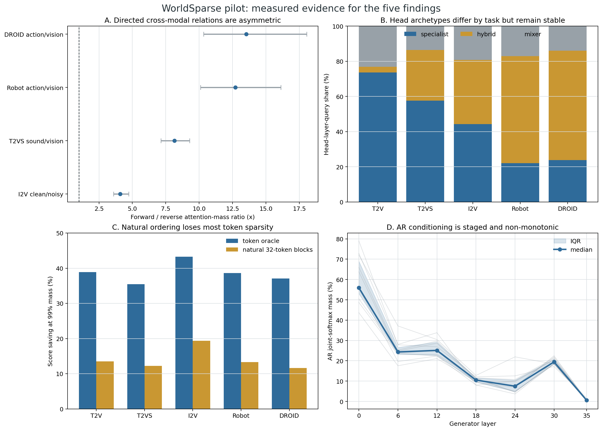

# ThunderWorld

ThunderWorld studies sparse attention for mixed autoregressive–diffusion (AR–DM)
world models, using Cosmos3-Nano as the current reference architecture.

> **Working thesis:** world-model sparsity is relation-local, while approximation
> error is trajectory-global.

This repository is an audited evidence snapshot as of **2026-08-29**. It records
what the experiments currently support, what failed, which speed numbers are
measured kernel results versus estimates, and what must still be validated before
making a publication-scale acceleration claim.

## Current bottom line

| Operating point | Evidence | Joint-QK reduction | 16K attention speedup | Quality screen | Status |
| --- | --- | ---: | ---: | ---: | --- |
| q12, 50% GQA groups sparse | 1 T2V prompt × 3 seeds × 20 steps | 36.68% | 1.21× measured | min SSIM 0.923; min PSNR 25.30 dB | current 0.90 development point |
| q12, 75% GQA groups sparse | 1 T2V prompt × 2 seeds × 20 steps | 55.02% | 1.41× measured | min SSIM 0.856; min PSNR 21.29 dB | provisional 0.80 aggressive point |
| all-head sparse | 1 T2V prompt × 1 seed × 20 steps | 73.36% kernel case | 1.93× measured | best comparable SSIM 0.770 | quality failure |

The 1.21×/1.41×/1.93× numbers are **H200 attention microbenchmarks**, not
complete Cosmos3 generation speedups. With the explicit Amdahl assumptions used
in the analysis—Generator share 0.9 and attention share 0.387—the corresponding
end-to-end estimates are approximately 1.065×, 1.112×, and 1.202×.

The all-sparse kernel is therefore useful as an execution bucket for selected
`layer × stage × relation` cells. Current evidence does **not** support making
every layer, head, and diffusion step sparse.



## Retained publication contributions

1. **Relation/head/modality characterization.** Directed modality relations are
   4.09–13.53× asymmetric; 37.7% of Generator head-relation units are
   specialists, 45.7% hybrid, and only 16.6% mixers; action/audio self-relations
   are high-information dense anchors.
2. **Interaction-aware trajectory compiler.** Head-wise measurements are
   compiled into executable GQA buckets. A joint-projected error Gram, complete
   diffusion rollout, and uncertainty bound replace local-error or hand-written
   layer heuristics.
3. **Joint-softmax sparse runtime.** Dense anchors, local/semantic block lists,
   directed relation skips, and cross-step reuse share one online-softmax state,
   so DM←DM and DM←AR preserve their original joint normalization.

## Important negative results

- Shallow DM←AR hot blocks do not predict deep DM←DM hot blocks after position
  control: residual correlation is -0.065. The two branches must select blocks
  independently.
- Naive K-only semantic reorder does not close the oracle gap and is not a
  default runtime path.
- Hand-written depth relocation fails an equal-QK 20-step screen: SSIM falls
  from 0.906 to 0.861 even though its lookup-table speed estimate improves.
- Reusing prior-step attention outputs reaches only about 0.77–0.80 paired
  SSIM. Reuse descriptors/block lists, but recompute QK/softmax/PV.
- An apparent all-head SSIM 0.827 result used only four diffusion steps and is
  excluded from the comparable 20-step frontier.

## Repository map

- [`docs/EXPERIMENTAL_FINDINGS.md`](docs/EXPERIMENTAL_FINDINGS.md) — complete
  evidence narrative, definitions, and claim boundaries.
- [`docs/METHOD_AND_IMPLEMENTATION.md`](docs/METHOD_AND_IMPLEMENTATION.md) —
  retained algorithm/runtime design and engineering decisions.
- [`docs/REPRODUCIBILITY.md`](docs/REPRODUCIBILITY.md) — source inventory,
  regeneration commands, and validation rules.
- [`reports/thunderworld-current-evidence.html`](reports/thunderworld-current-evidence.html)
  — self-contained technical report.
- [`data/evidence_snapshot.json`](data/evidence_snapshot.json) — machine-readable
  reviewed metrics.
- [`data/finding_ledger.csv`](data/finding_ledger.csv) — frozen
  finding→implementation→contribution decisions.
- [`data/source_manifest.json`](data/source_manifest.json) — SHA-256 provenance
  for every private-workspace aggregate used to build this snapshot.

## Reproduce the public snapshot

The validation step has no third-party Python dependency:

```bash
python3 scripts/validate_evidence.py \
  --data-dir data \
  --output data/validation_report.json
```

To rebuild the snapshot from the private experiment workspace:

```bash
python3 scripts/build_evidence_snapshot.py \
  --source-root /path/to/WorldModel \
  --output-dir data

python3 scripts/validate_evidence.py \
  --data-dir data \
  --output data/validation_report.json
```

The public bundle intentionally excludes model weights, datasets, generated
videos, raw attention traces, and multi-gigabyte Parquet files. Their reviewed
aggregate identities and hashes remain in `data/source_manifest.json`.

## Confidence

**Share with caveats.** The calculations and experiment-family comparability
pass the included audit, but the latest quality frontier is still dominated by
one T2V prompt. Final VBench, control adherence, AV synchronization, action
error, trajectory error, and task success remain open.

## Configurable FP4 repair runtime

The [standalone FP4 package](packages/fp4-repair/README.md) provides independent FFN, attention core, and projection repair settings, per-head block budgets/masks, a head-atlas adapter, and native SM120 Tensor Core kernels. See [validation and current performance limits](packages/fp4-repair/VALIDATION.md) before use; the new portable FFN has operator validation but no full-model quality claim.

The [FFN block-repair study](docs/FFN_BLOCK_REPAIR_20260907.md) adds K128/K256 activation-channel repair and an offline sparse weight-residual bank, with equal-budget comparisons, full local FFN replay, and native fused kernels. These experimental candidates leave production defaults unchanged.

## RTX 5090 kernel handoff

The [receiver guide](tools/kernel_handoff/README.md) provides a data-only workload bundle, pinned Hugging Face shard downloads, offline weight preparation, and portable FFN/attention benchmarks. See the [Codex task brief](tools/kernel_handoff/CODEX_TASK.md) for the optimization protocol.
