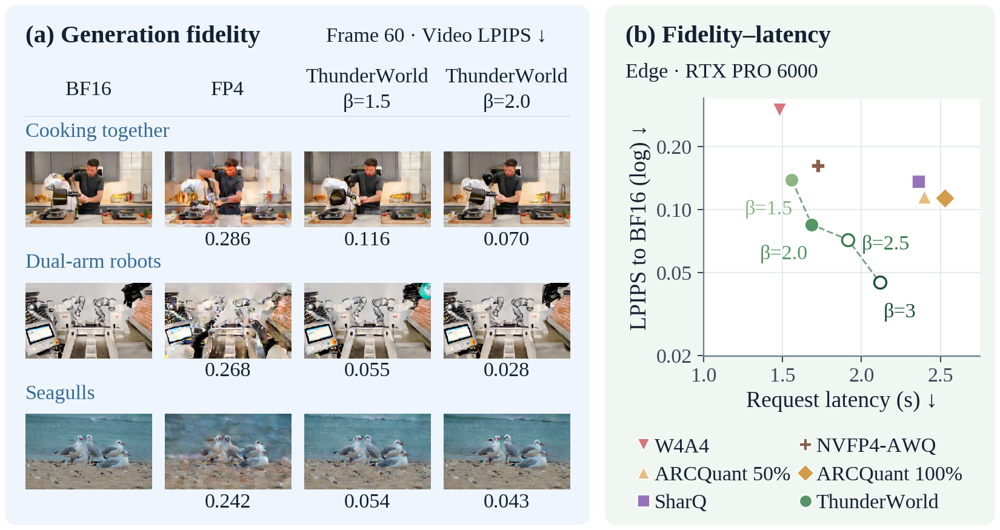
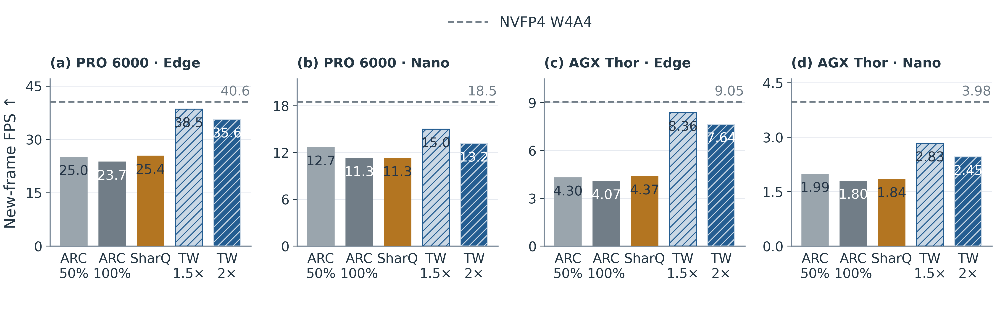

<div align="center">

# ⚡ ThunderWorld
### Efficient World Model Generation with Selective FP4 Refinement via Native GEMMs

[📄 Paper / Preprint](https://www.preprints.org/manuscript/202610.0689) · [🤗 Model collection](https://huggingface.co/collections/Concyclics/thunderworld-cosmos3-fp4) · [🎬 Benchmark outputs](https://huggingface.co/datasets/Concyclics/thunderworld-benchmark) · [📚 Documentation](docs/INSTALL.md)

[](LICENSE)
[](https://huggingface.co/collections/Concyclics/thunderworld-cosmos3-fp4)
[](https://huggingface.co/datasets/Concyclics/thunderworld-benchmark)

</div>

**ThunderWorld is a training-free FP4 inference framework for Cosmos3 world models.** It repairs weight and activation quantization error with additional native FP4 matrix products, then allocates correction tiles under a request-wide compute budget. All base attention blocks remain present.


*Figure 1 from the [preprint](https://www.preprints.org/manuscript/202610.0689), using the original author artwork. The timing panel is a scoped experiment; see [results and measurement conventions](docs/RESULTS.md).*

## What is released

- **Frozen Edge, Nano and Super models:** packed generation weights, compact W1 supports, 1.5× / 2× plans, runtime, checksums and calibration provenance.
- **Inference:** native FP4 linear and streaming attention kernels, current-input activation repair, joint CUDA Graph execution, independent FFN/projection/attention policies, and optional timing/trace modes.
- **Calibration and quantization:** full-M teacher capture, measured repair-benefit allocation, channel compensation, representation/support search and request budget verification. No training or gradients.
- **Reproducible comparisons:** native FP8/W4A4, ARCQuant 50%/100%, SharQ, ModelOpt NVFP4-AWQ W4A16 quality reference, higher-order and mechanism studies, paired LPIPS/SSIM/PSNR, and judge tools.
- **Evidence:** complete three-model × two-benchmark summary tables, release validation receipts and original paper figures. Historical experiments remain available separately.

The released 1.5× and 2× settings cap **issued FP4 matrix work relative to base W4A4**, including padding. They are not 1.5×/2× speedups, bit widths, or additional denoising rounds. The research code also supports 1.25× and 2.5× searches; these are not separate pretrained releases.

## Models

| Model | 1.5× packed assets | 2× packed assets | Loading |
|---|---:|---:|---|
| [🤗 Cosmos3-Edge-ThunderWorldFP4](https://huggingface.co/Concyclics/Cosmos3-Edge-ThunderWorldFP4) | 0.778 GiB | 0.812 GiB | One SM120 GPU, sufficient VRAM |
| [🤗 Cosmos3-Nano-ThunderWorldFP4](https://huggingface.co/Concyclics/Cosmos3-Nano-ThunderWorldFP4) | 3.833 GiB | 4.197 GiB | One SM120 GPU, sufficient VRAM |
| [🤗 Cosmos3-Super-ThunderWorldFP4](https://huggingface.co/Concyclics/Cosmos3-Super-ThunderWorldFP4) | 17.203 GiB | 18.838 GiB | Two SM120 GPUs; qualified on 2 × 96 GB PRO 6000 |

These are **custom generation-branch weight packages**, not standalone `from_pretrained()` checkpoints. The pinned NVIDIA base is also required for unchanged AR, vision, VAE and other components; preparation loads base weights before replacing generation projections. The sizes above are **not total deployment size or peak VRAM**. RTX 5090 supports the kernel architecture, but model fit must be checked separately. [Release identities and hardware details →](docs/INFERENCE.md)

## Quick start

Linux, Python 3.12 and NVIDIA SM120 hardware are the qualified path. Use a fresh environment; the exact tested dependencies are in [requirements-runtime.txt](requirements-runtime.txt).

```bash
git clone https://github.com/Concyclics/ThunderWorld.git
cd ThunderWorld
python3.12 -m venv .venv
source .venv/bin/activate
python -m pip install --upgrade pip
python -m pip install torch==2.11.0 torchvision==0.26.0 --index-url https://download.pytorch.org/whl/cu130
python -m pip install -r requirements-runtime.txt
python -m pip install -e '.[hub]'

tw-infer --doctor --check-gpu
CUDA_VISIBLE_DEVICES=0 tw-infer   --model edge --profile 2x   --image /path/to/first-frame.png   --prompt "The robot carefully picks up the object and places it in the tray."   --seed 12345 --output outputs/edge-demo
```

The launcher downloads **pinned revisions**, verifies assets, and invokes the released runtime. Access to the NVIDIA base model must be available through your Hugging Face account. To reuse a local base, pass `--base-model /path/to/Cosmos3-Edge`. The output directory must be new.

Outputs: `video.mp4`, original float `outputs.npz`, and `result.json` with configuration, output hashes and provenance. Defaults are **320 × 192, 61 stored frames, 35 denoising steps, CFG 6, 24 fps**, Graph execution and `--debug off`. Frozen plans reject incompatible generation shapes. Use `--profile 1.5x` for the smaller repair budget; Super uses `CUDA_VISIBLE_DEVICES=0,1 --model super` with two sufficiently large GPUs.

[🛠️ Installation](docs/INSTALL.md) · [🚀 Inference and debug modes](docs/INFERENCE.md) · [🎯 Calibration / quantization](docs/CALIBRATION.md) · [⚖️ Baseline reproduction](docs/BASELINES.md) · [📊 Benchmark workflow](docs/REPRODUCE.md)

## How it works

For a projection, the base and residual representations form

```text
A Wᵀ ≈ A0 W0ᵀ + A1 W0ᵀ + A0 W1ᵀ [+ A1 W1ᵀ]
         base      A repair    W repair    optional cross term
```

W0 and selected W1 tiles are prepared offline. A0 and selected A1 tiles always come from the current input. Calibration chooses weight representations, weight supports and repair quotas; the online selector applies those quotas to current residuals. QK corrections occur before softmax, and PV is repaired independently. Selected work executes dense FP4 tiles with shared FP32 accumulation.


The published 2× model uses joint representation/support calibration. The published 1.5× model retains identity-prescale RTN weights with calibrated allocation. **Neither released profile enables outlier splitting or the second-order cross term.** Outlier and higher-order experiments are research ablations, not hidden parts of the released models. [Method and implementation map →](docs/ARCHITECTURE.md)

## Selected quality results

LPIPS ↓ to **same-input, same-seed BF16 generations**, averaged first over seeds and scenes within each category, then equally over categories. Full RBench: **650 scenes**; PAI-Bench-G: **1,044 scenes**; **two seeds per scene**. These corpora include earlier calibration/development scenes, so this is full-corpus consistency, not held-out scene generalization. Super extends the Edge/Nano experiments in the preprint.

| Model / benchmark | W4A4 | ARCQuant 100% | SharQ | TW 1.5× | TW 2× | AWQ W4A16† | FP8 |
|---|---:|---:|---:|---:|---:|---:|---:|
| Edge / RBench | 0.3001 | 0.1776 | 0.1918 | 0.1928 | **0.1717** | 0.1768 | 0.1188 |
| Edge / PAI-Bench-G | 0.2824 | 0.1670 | 0.1812 | 0.1834 | **0.1567** | 0.1749 | 0.0990 |
| Nano / RBench | 0.3584 | 0.1250 | 0.1301 | 0.1381 | **0.1181** | 0.1201 | 0.0931 |
| Nano / PAI-Bench-G | 0.3979 | 0.1322 | 0.1346 | 0.1519 | **0.1219** | 0.1214 | 0.0960 |
| Super / RBench | 0.1620 | 0.0959 | 0.1036 | 0.1046 | **0.0884** | 0.0956 | 0.0748 |
| Super / PAI-Bench-G | 0.1956 | 0.1119 | 0.1172 | 0.1257 | **0.1055** | 0.1137 | 0.0885 |

Bold identifies the best mean among the listed **native FP4** methods; it is not a blanket statistical claim. † AWQ is the decoded ModelOpt NVFP4 W4A16 quality reference. ARCQuant/SharQ/AWQ retain BF16 attention; ThunderWorld uses FP4 attention. The released low-budget profiles **do not outperform FP8 on these pixel-consistency metrics**. [All PSNR, SSIM, LPIPS, relative-L2, paired intervals and judge results →](docs/RESULTS.md)

## Performance evidence



The paper reports **1.17–1.88× throughput versus ARCQuant (2.0)** across its measured RTX PRO 6000 / Jetson AGX Thor cases. This is scoped to the paper's device, execution and sample protocol; it is not a new measurement of this checkout or a universal advantage over BF16/FP8. The figure uses **60 generated frames per request**; the saved 61-frame clip includes the conditioning frame. [Protocols, limitations and device-specific reproduction →](docs/PERFORMANCE.md)

## Repository guide

| Path | Contents |
|---|---|
| `packages/fp4-repair/src/thunderworld_fp4/` | Installable FP4 kernels, Cosmos runtime, budget compiler, asset loading and Hub launcher |
| `tools/public/` | Portable dataset, calibration, baseline and quality orchestration |
| `tools/contribution_study/` | Mechanism, outlier, allocation, baseline, full-benchmark and judge research code |
| `tools/joint_inference/` | Advanced calibration, kernel tuning and end-to-end diagnostics |
| `experiments/cutlass_fused_repair/` | Optional CUTLASS implementations and qualification tools |
| `tools/fp4_handoff/`, `tools/thor_handoff/` | Device qualification / handoff utilities; read their documented scope |
| `configs/public/` | Calibration identities and pinned baseline sources |
| `docs/results/` | Published measurement summaries and release verification receipts |
| `data/`, `figures/`, `docs/archive/` | Earlier evidence snapshot; not silently replaced by the new release |

Start with `tools/public/`; older research drivers can contain historical workstation paths and are not the portable quick start. No checkpoints, full datasets, generated videos or credentials are stored in Git.

## Citation and licenses

```bibtex
@article{chen2026thunderworld,
  title={ThunderWorld: Efficient World Model Generation with Selective FP4 Refinement via Native GEMMs},
  author={Chen, Han and Chen, Xi and Xu, Borui and Pang, Zixi and Pei, Wenqi and Yu, Feng and He, Bingsheng and Wu, Ming and Zeng, Jason and Heinrich, Michael and Yan, Jiahao},
  journal={Preprints.org},
  year={2026},
  doi={10.20944/preprints202610.0689.v1}
}
```

Code: **[Apache-2.0](LICENSE)**. Paper figures: **CC BY 4.0**. Model weights: **OpenMDW-1.1**. Dataset and third-party terms remain separate; see [NOTICE](NOTICE) and [third-party notices](THIRD_PARTY_NOTICES.md). Contributions are welcome through [issues and pull requests](CONTRIBUTING.md).
