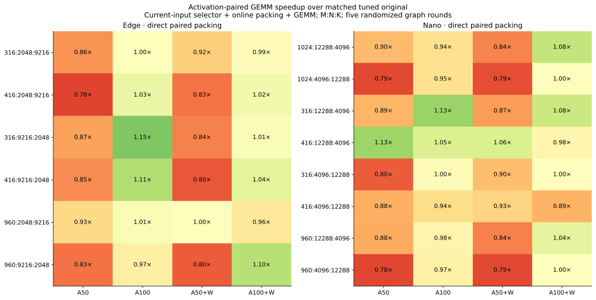
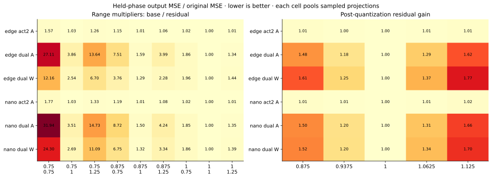

# ThunderWorld: paired activation tiles and residual calibration

**RTX 5090 · experimental follow-up · 11 September 2026**

## Paired activation GEMM

In the repository's row-vector convention:

`A0 W0 + A1 W0 = [A0  A1] [W0; W0]`.

The new native FP4 kernel combines these terms in K256 reduction tiles with one FP32 accumulator and one BF16 output store. W0 addresses alias the same weight allocation. It does not materialize a duplicate W0, reconstruct BF16 activations, or add the cross term. Arithmetic remains two products per repaired tile.

| Path | Activation reads | Online layout work |
|---|---|---|
| Original fused kernel | Separate A0/A1 K128 dots | Existing two-plane quantizer |
| Paired gather | One K256 dot gathers both planes | Existing two-plane quantizer |
| Paired direct | One K256 dot reads interleaved A0/A1 | Quantizer directly writes final layout |

Direct packing has the same packed allocation size and launch count as the existing two-plane pack. Optional W1 repair remains in the compact residual loop in the **same kernel and accumulator**. Partial A repair switches to a K128 base-only dot on unselected tiles, preserving the selected arithmetic budget.

The benchmark includes 14 model shapes (the existing 10 plus four M416 variants), four repair tiers, and three launch candidates per path. Online current-input selection, quantization, packing and GEMM are included. Each winner is retimed in five randomized CUDA Graph rounds. The timing inputs repeat real captured probes to actual M; they are not additional quality samples. The baseline is tuned with the same launch search. This is not an exhaustive search or a claim of Tensor Core saturation.

All **504 numerical candidates** match the original BF16 output bitwise on the benchmark probes. Direct packing reaches **1.155×** on Edge A100 (M316 up) and **1.130×** on Nano A100 (M316 up/gate-shaped projection). For the actual M416 policy shape, the corresponding local ratios are **1.106× / 1.052×**. Most half-budget cases regress: direct A50 ratios span 0.781–0.933 on Edge and 0.783–1.129 on Nano. The policy therefore selects a paired path only for measured shape/tier winners; it does not force K256 everywhere.

These ratios are operator measurements including packing/selection, not complete-request speedups. The full-repair accumulation order in this A-paired implementation differs from the previous W-pair experiment: the tested A-pair outputs remain bitwise identical, which still requires a trajectory/dispatch check.

## Calibrate quantization for its output, not just reconstruction

The new packer exposes two static parameters: a multiplier on the first-round block max, and a multiplier on the residual block max. Scales are rounded to actual E4M3, values to actual E2M1; residuals are recomputed **after** rounding/clipping the base. The outer factor remains shared, so both planes can still accumulate directly in FP32. There is no runtime grid search or extra repair product.

| Decision | This experiment |
|---|---|
| Scale grid | Base: 0.75, 0.875, 1.0; residual: 0.75, 1.0, 1.25 |
| Objective | Normalized squared error of the FFN linear output against its BF16 teacher |
| Coverage | First/middle/last layer; every FFN projection; both models |
| Fit split | Development captures, seed 7101, steps 1 and 11 |
| Held split | Same development cases/seed, steps 23 and 33; never selects parameters |
| A-only tier | Calibrate A, with the original W0 fixed |
| Dual tier | Compare calibrating A or W; choose one family to change |
| Runtime policy | One setting per model/projection/tier, pooled over sampled layers/tasks/branches |

This is a bounded first experiment, not joint optimization of both quantizers. The 64-row teacher-input probes do not reproduce the full-input global activation scale or the evolving quantized-trajectory distribution. Held phases are correlated observations, not independent tasks/seeds. Complete trajectories determine whether a local improvement transfers.

Both the 3×3 range search and a second residual-gain search (0.875, 0.9375, 1, 1.0625, 1.125, applied to stored residual scales with actual FP8 rounding) select the **original parameters for all ten pooled projection/tier policies**. The searches contain 6,804 and 3,780 candidate/probe measurements, respectively, over **252 distinct teacher-input probes**. These counts are not independent quality samples.

Finer fitting by layer × task × CFG branch changes five of 18 Edge A-only groups; the other 108 groups remain unchanged. Four of those five changes improve held-phase error and one regresses. The largest held-phase local reduction is **0.884%**, and the mean across all 18 Edge A-only groups is only **0.092%**. This is a small exploratory effect, not a case for universal gain scaling. All five fit-selected changes are retained for the fresh trajectory test, including the held-phase regression; held results do not reselect the policy.

This does not prove min–max is globally optimal. It shows that uniform clipping or gain adjustment is insufficient for the current K16, two-plane implementation and this probe distribution. Under dual repair, changing a well-matched residual magnitude can substantially increase the remaining error.

## Full-trajectory check and implementation decisions

The fresh pair screen runs **25 mode/task trajectories** at seed 8601 for 35 steps: Edge I2V/policy and Nano I2V/policy/AV, each with BF16, original A-only, original dual, paired A-only and paired dual. All paired variants' saved outputs match their same-tier original **bitwise**, including video, trajectory sketches, actions and AV sound latents where present.

Actual execution receipts distinguish these results from fallback-only checks:

| Model | Actual paired path exercised |
|---|---|
| Edge | Policy A-only up, M416; I2V dual up, M960 |
| Nano | Policy A-only gate/up, M416; AV dual gate/up, M1024 |

Other shapes fall back according to the measured tuning table. There is no claim that every trajectory executes the paired kernel. Request times are recorded as single eager diagnostic runs; no end-to-end throughput gain or energy reduction is inferred. AV waveform decoding was not needed for a separate pair comparison; only the saved latent equality is claimed.

The separate Edge granular-gain screen repeats four anchors (all bitwise identical to the pair campaign) and adds two unique trajectories. Its local held-phase gain does **not** transfer to a useful fresh-task improvement:

| Metric against BF16 | Original A-only | Granular residual gain |
|---|---:|---:|
| I2V SSIM ↑ | 0.86415 | 0.86251 |
| I2V pixel MSE ↓ | 0.013560 | 0.013430 |
| Policy video SSIM ↑ | 0.94905 | 0.94850 |
| Action relative L2 ↓ | 0.18362 | 0.18747 |

Pixel MSE improves slightly while SSIM slips, and the action metric worsens. Keep residual gain=1 for deployment. These are **27 unique mode/task results total**, with one fresh seed and existing evaluation scenes; they are an exploratory screen, not a broad quality benchmark. The pooled calibration modes are omitted because their selected settings are exactly the originals.

For attention, the appropriate next calibration target remains **marginal output error from each repair term and selected tile**, separately for QK and PV, with task-sensitive action/audio constraints. Attention mass and AR–DM/modality asymmetry can serve as priors; the previous experiment did not establish them as causal repair-benefit scores. This follow-up calibrates FFN quantizers; it does not claim to have solved attention allocation.

The next calibration refinement should preserve the full-input scale during probe capture, include quantized-trajectory inputs, fit task/layer/step settings where data support them, and evaluate joint A/W choices under a measured latency budget. Do not expand policy complexity solely to minimize training error.

## Reproduction and checks

Code: [tools/activation_repair](../tools/activation_repair/README.md). Results: [results/activation_repair_20260911](../results/activation_repair_20260911).

Compute Sanitizer completed with **0 errors**. Eighteen decoded-reference checks (16 baseline/layout cases and two non-default range/gain cases) cover M=1/257, partial/full A and A+W, exact default packing, exact direct-layout reinterpretation, and CUDA Graph replay after changing inputs on the baseline/layout cases. Larger-shape candidates are checked against the original kernel during timing search. Production defaults remain unchanged.
