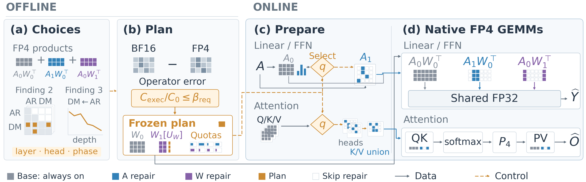

# Method and runtime map

*Original Figure 4 artwork from [Han Chen et al.](https://www.preprints.org/manuscript/202610.0689), CC BY 4.0.*

## Offline representations and supports

`cosmos/calibration.py`, `cosmos/assets.py` and `importance_joint_calibrate.py` implement represented-value residuals, compensated channel scaling and compact assets. W0 is fixed for a request. W1 only stores the union of blocks required by the chosen plan; support indices and scales are included in storage accounting. Changing steps does not requantize weights. Outlier ablations mark any moved element's W1 tile as mandatory; these experiments are separate from the released profiles.

The standard linear decomposition is `A0 W0ᵀ + A1 W0ᵀ + A0 W1ᵀ`, optionally adding `A1 W1ᵀ`. A and W components denote decoded low-precision representations, not exact residuals. Increasing plane/term count is not guaranteed to improve a nonlinear trajectory monotonically.

## Online current-input work

`_calibrated.py`, `_sparse_pack.py`, `_native.py` and `_fusion.py` handle activation packing, residual selection and FP4 projection/FFN execution. Work reduction must skip real residual preparation and MMA tiles, not merely zero masked dense work. Compatible packing may be shared only when channel compensation and quantization semantics match. Kept repair tiles use dense Tensor Core instructions; algorithmic tile sparsity does not imply hardware 2:4 sparse MMA.

`runtime.py`, `_kernels.py` and `_attention_sparse_pack.py` implement streaming attention. QK corrections feed the same current softmax; PV has independent repair quotas. No base attention block is removed. K/V supports are unioned across GQA query heads, so per-head density is not equal to K/V packing density.

`cosmos/engine.py` and `cosmos/runner.py` manage stage/CFG scheduling, prepared input buffers and joint Graph replay. The CPU already knows step/CFG state; it does not read the current timestep tensor back each iteration. Every request receives independent output storage. `cosmos/diagnostics.py` contains optional instrumentation; normal inference defaults to off.

## Configuration

The `RunConfig` dataclass in `cosmos/settings.py` separates FFN, generation projections and attention. `RepairPolicy` supports layer, step, CFG branch and nonuniform per-head budgets. Logical repair blocks are 128×128; an attention query execution tile can be smaller. Changing execution tile changes padding and must be reflected in the ledger.

A unified repair plan has keys `branch|phase|operator` for linears and `branch|phase|layer` for attention. The phase edges are `[0,7,18,28,35]`. Linear rows contain integer `a_blocks`, explicit `w_blocks` and `cross`; attention rows contain `qk_counts`, `pv_counts`, `qk_terms` and `pv_terms`, or explicit full-attention settings. The preparer validates shapes, GQA and support intersections before Graph capture.

## Budget and cost

`cosmos/budget.py` counts issued MMA work for the whole request relative to ordinary W4A4 at the same scope and tile sizes. It includes padding and cross terms. `cosmos/resources.py` guards resource modes; shared calibration is never a formal performance mode. A quota is a hard upper bound, not an observed average or a latency prediction.

Report non-MMA packing, selection, sorting, softmax, scratch and support-union bytes separately. A twofold arithmetic cap does not imply a twofold request latency, and isolated speedups cannot be multiplied to obtain an end-to-end claim. [PERFORMANCE.md](PERFORMANCE.md) describes the qualification sequence.

## Optional CUTLASS backend

`cutlass/` contains the fused backend, its collective, packing/layout adapter, binary identity and build tools. `experiments/cutlass_fused_repair/` contains independent reference tests and request-level integration experiments. The CUTLASS path can change accumulation order relative to the frozen Triton release; keep it opt-in and rerun complete quality validation before publishing a new model/profile. No hidden BF16 fallback establishes a native FP4 success.
