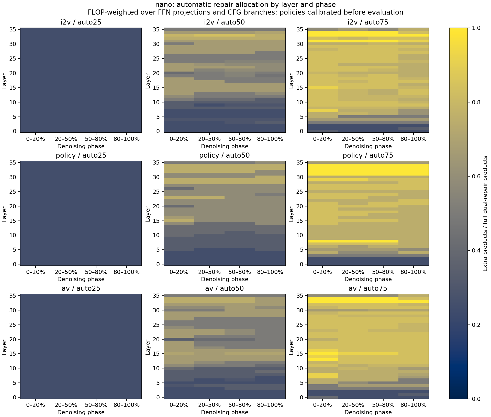
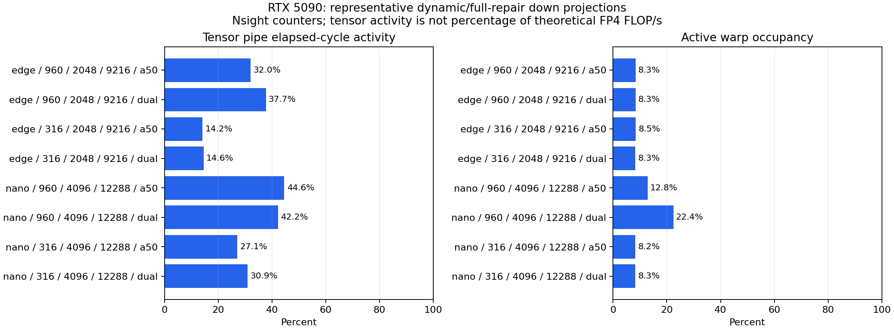

# RTX 5090：自动修复预算与 Tensor Core 执行效率

实验窗口：2026-09-10 至 09-11（Asia/Singapore）；结果目录沿用启动日。

本轮实现模型本地的 **FFN A/W 自动预算分配、GPU 当前输入 tile 选择、按形状调优，以及 Nano gate/up 激活打包共享**。
Attention 保持 BF16：上一轮 attention 修复的质量和性能尚不足以进入默认部署路径。
这里没有实现自动 attention 预算、bulk-fit 首轮量化或其他 GPU 架构后端。

**结果：动态预算可以执行真实 FP4 Tensor Core 计算，但当前尚未打满，也没有普遍优于均匀预算。**
139 条完整 35-step 对照轨迹、29 条解码音频、60 组算子测量和 8 组 Nsight profile 已完成。
实际预算与编译预算逐条一致，全部不超过各任务上限。
质量门控在 10 个任务/预算组合中保留 3 个候选，其余 7 个回退均匀预算。

## 完整轨迹的预算收益与回退

下表是半量 A 下限版，seeds 7203/7204；每格两个种子，每种子一次，尚不足以确认小幅速度差异的稳定性。
50% 的同预算参考是全量 A 修复；75% 的参考是半量 A + 全量 W 修复。

| 模型 / 任务 | 自动 50% | 自动 75% |
|---|---|---|
| Edge / I2V | 保留候选；相对均匀 1.068× | 回退：视频质量退化 |
| Edge / policy | 回退：LPIPS、action 退化 | 回退：视频与 action 退化 |
| Nano / I2V | 保留候选；相对均匀 1.022× | 保留候选；相对均匀 0.987× |
| Nano / policy | 回退：action 退化 | 回退：action 退化 |
| Nano / AV | 回退：一种子 LPIPS 退化 | 回退：视频 SSIM 退化 |

“保留”仅表示没有超过同预算参考的临时容差。Edge I2V auto50 的 BF16 SSIM 均值仅 **0.6286**，且相对 BF16 速度为 **0.966×**，不能据此推荐为高质量/高性能方案。
Nano I2V auto50 的 SSIM 均值 **0.8400**、相对 BF16 **1.224×**；auto75 的 SSIM 均值 **0.9558**、相对 BF16 **1.175×**。
后者相对同预算均匀修复略慢，但避免了该参考在其中一个种子上的明显退化；这仍是小样本候选，需要独立测试。
Nano policy 的视频指标看起来尚可，但 action 误差越界，说明只用视频验收会接受错误的策略。

完整逐任务表、action/音频距离见 [结果汇总](../results/auto_budget_20260910/summary.md)。
原始负对照、分配图、逐种子 CSV 和验证记录见 [证据目录](../results/auto_budget_20260910/README.md)。

此图展示质量门控前的候选分配；被拒绝任务的最终策略已回退，不能将图中全部策略标成推荐部署配置。

## 自动分配的含义

每个决策单元为 `任务 × CFG 分支 × 去噪阶段 × 层内线性算子`，候选档位如下：

| 档位 | A 修复 | W 修复 | 基础乘积之外的矩阵乘倍数 |
|---|---:|---:|---:|
| base | 0 | 0 | 0 |
| a50 | 50% K blocks | 0 | 0.5 |
| act2 | 全量 | 0 | 1 |
| wgt2 | 0 | 全量 | 1 |
| a50w | 50% K blocks | 全量 | 1.5 |
| dual | 全量 | 全量 | 2 |

25% / 50% / 75% 是相对于双一阶全修复的**额外 FP4 产品 FLOP 预算**，即平均允许 0.5 / 1 / 1.5 个额外矩阵乘。
不是显存比例、总网络 FLOPs 比例或端到端时间预算。按任务分别约束，避免将 AV 的预算挪给 policy 后仍声称每个任务满足相同档位。
K blocks 为 128；当前形状的 K-block 数均为偶数，因此半预算不需要向上取整。

校准覆盖 Edge 672 个、Nano 2,160 个单元：全部 Generator FFN linears，在 35-step 的第 1、11、23、33 步采集连续 64 行真实 BF16 输入/输出。
阶段为 `[0,20%), [20%,50%), [50%,80%), [80%,100%)`，边界取 ceil；两个 CFG 分支分开，policy 只有一个分支。
这是局部探针，并不是完整输出误差，也没有把线性层局部误差当成生成质量的保证。
当前探针重放会在这 64 行上重新计算 activation global amax，并以其行样本选择 K blocks；与完整 M 的 scale/支持上下文可能不同。
因此其误差只能作为候选排序信号。后续应保存完整输入的 scale 和选择上下文，或做完整 M 重放，再结合轨迹敏感度重新校准。

对候选档位测量局部相对平方误差及真实形状下的 native kernel 时间，用正向误差改善 / 增量耗时进行确定性贪心分配。
分配器严格检查额外 FLOP 上限，但不宣称全局最优。每个阶段的档位先离线确定；在线的半量 A 支持再根据**当前激活**的采样 block energy 在 GPU 上选择。
因此动态性包括阶段/层/分支切换和当前值驱动的 K-block 选择，不是在线闭环质量估计。

校准输入为 `robot_observe / policy_observe / av_waterfall`、seed 7101。
初次验证为 `robot_table / policy_table / av_pottery`、seeds 7103/7104；修订策略使用新 seeds 7203/7204。
评估场景没有参与本分配器的局部拟合，但此前研究已使用过这些场景，故不是全流程盲测。
action 图像没有匹配动作真值；音频波形距离也不能替代听感或任务成功率。

## 运行时实现与优化

- 所有档位共享一次准备好的 W0/W1。每步不重新量化权重、不执行 CPU nonzero、不上传 mask。
- 半量 A 的排序与 mask 写入合并为一个 Triton kernel；所有线程块仍调用 NVFP4 `dot_scaled` Tensor Core 乘积。
- 按真实 M/N/K 和档位搜索 M32/64/128、流水 stages 2/3，使用相同量化码和支持检查输出，再用新实测成本重新分配预算。
- 不使用 Split-K，避免已知的累加次序变化在低精度完整轨迹中放大。
- 全部六种 shape/tier 特化在正式请求前预热；正式时间包含动态选择和预算查表。
- Nano gate/up 的输入相同，新增共享打包：为两者 A 支持的并集量化一次，各自 GEMM 保持自己的 mask、修复档位和权重 factor。缓存只存在于同一次 forward 的同一层、同一份输入，第二个投影消费后释放；不跨 step 复用数值。

W1 为支持所有档位而常驻；降低某一步的计算预算不会同比减少权重显存。
单策略部署时裁去永远不用的 W1 是后续资产导出的工作，当前结果不冒充该项节省。

## 初次完整轨迹暴露的失效与调整

不设最低 A 预算的贪心策略，会将部分层分配为 base 或 W-only。虽然局部校准损失下降，Edge 的完整 I2V 轨迹可能明显退化。
这组结果保留为负对照；不能只展示分配器的局部目标值。

修订版先给每个单元设置半量 A 下限，再在 `a50 / act2 / a50w / dual` 中分配剩余预算。
下限是看到初次完整轨迹失效后提出的探索性调整，使用原校准探针重新编译，另用新 seeds 验证。
25% 档位被下限全部占满，严格等价于 uniform a50，不将其计作自动分配带来的收益。

再增加离线质量门控：同一任务任一种子超过同预算均匀参考的容许退化，就将该任务整套阶段/层策略回退到对应均匀参考。
临时工程容差为 SSIM 最多下降 0.02、LPIPS 最多增加 0.01；action、音频 latent 及波形相对/频谱误差最多为参考的 1.05 倍加 0.001。
这些值可配置，不代表用户已确定产品质量门槛，也不是绝对质量或任务成功率的保证。
`policy_validated.json` 保留逐任务接受/拒绝理由和验证记录哈希；它是验证集选择后的产物，仍需要新的独立最终测试。

预算策略是离线重编译，不会在生成期间尝试多个候选、调用 BF16 teacher 或回滚整条轨迹。

## Tensor Core 是否打满

八组代表性 down-projection 的 Nsight 实测，Tensor pipe elapsed-cycle 活跃度约 **14.2%–44.6%**。
这证明实际执行了 Tensor Core 计算，同时表明这些形状并没有打满。
活跃 warp 占用约 **8.2%–22.4%**，部分配置每线程使用 **254 个寄存器**；所测 GEMM 的 local-memory load/store sectors 为零，未观察到相应的 local-memory 流量。
结合 launch 形状和这些计数器，推断小 M 的 CTA 数不足和较高的寄存器占用限制了并行度；不能简单将 GPU utilization 当成 Tensor Core 饱和度。

Nsight replay 中，非 GEMM 阶段占相应算子的 kernel 时间约 **8.9%–27.9%**，包含全局 amax、量化和选择。
这些阶段不执行 Tensor Core 矩阵乘，即使 GEMM 更快，也会限制完整算子的加速。
不同 kernel 的单独计时不能简单相加当作生产延迟；正式算子速度使用独立 CUDA Graph 稳态计时。

Edge policy 的 M316 down projection 对 tile 选择尤其敏感；部分档位相对原 M128/stages2 配置提升约 **1.6–2.0×**。
大矩阵的收益较小，不能把小矩阵的最高比值推广到整个模型。

60 组完整 FP4 算子实测速率约 **328–896 TFLOP/s**，FLOPs 包含实际修复乘积。
360 个 launch 候选与原配置的输出差为零。Nano M316 down projection 的最佳调优收益约 **1.67×**；Edge 对应形状最高约 **2.05×**。
这些比值只比较 launch 调优前后，不是自动预算本身或整个模型的加速倍数。

[NVIDIA 的指标定义](https://docs.nvidia.com/nsight-compute/ProfilingGuide/)区分 active-cycle 和 elapsed-cycle 分母；本报告使用后者。
Tensor pipe 活跃度也不等于“实现了理论 FP4 峰值 FLOP/s 的同一百分比”，不将这两个指标混用。
Nsight 保持时钟控制为 none，使用默认 replay/cache control；其延迟不替代独立稳态基准。

共享打包已通过全部 36 种 gate/up 档位组合的数值检查，CUDA memcheck 为零错误。
3 种真实 Nano M 形状 × 4 种代表性档位组合，五次交替顺序 CUDA Graph 测量中，两投影合计提升 **1.005–1.036×**。
9 条 BF16/ACT2/auto50 完整轨迹对照（每任务 seed 7103），视频、轨迹摘要、action、音频 latent 的数组哈希全部与独立打包一致。
FP4 每个请求共享命中数为 policy 1,260、I2V/AV 2,520，结束时无未消费缓存。
单种子、分进程的 eager 耗时没有稳定加速，因此只确认算子级小幅收益，不把它写成端到端性能提升。
带半量 A 下限的质量对照没有同时开启共享打包，两项收益没有相乘包装成一次实测结果。

## 复现与结果边界

工具入口见 [tools/auto_budget](../tools/auto_budget/README.md)。
算子测量为 CUDA Graph replay；完整 Generator 对比使用共同 eager 框架，包含图像编码、去噪、视频解码和相同的预测抽样开销。
每个预算/任务使用两个种子、每种子一次请求，各模式顺序执行；未做交替顺序的大样本整模型计时，因此小幅延迟差异不能视为稳定收益。
加载、离线权重量化、JIT/预热和输出序列化不计入请求时间；AV 波形另进程解码。
这不是 AR Reasoner 联动、机器人真实执行或能耗实验，也不替代此前共同全 Transformer Graph 下的吞吐测试。

本机 CUDA 12.9 和对应 Nsight Compute 已可使用。旧 `/usr/bin/ncu` 不识别 SM120，本轮显式使用 `/usr/local/cuda-12.9/bin/ncu`，无需更新 Toolkit。

质量、预算、完整请求覆盖、原始数组哈希、LPIPS 全帧覆盖和音频波形哈希均已通过检查。
4 个 allocator/GPU 测试在 Compute Sanitizer 下通过，内存错误为 0；另一个质量门控测试通过，覆盖视频改善但 action 退化、波形退化和 NaN 拒绝。
W1 常驻的初次对照峰值显存：Edge BF16 8.20–8.31 GiB、FP4 7.34–7.46 GiB；Nano BF16 30.22–30.33 GiB、FP4 25.85–25.97 GiB。

继续优化时，优先补齐完整 M/轨迹敏感度校准和独立质量测试，再让固定阶段策略进入完整 Transformer CUDA Graph。
算子方面优先减少小 M 的寄存器占用与量化/非线性中间写回；共享打包已证明只是小收益。
这些是本轮实测后的工作顺序，并非已经实现的吞吐提升。最终推荐档位应由任务质量门槛决定，不由 nominal FP4 FLOPs 最大化决定。
