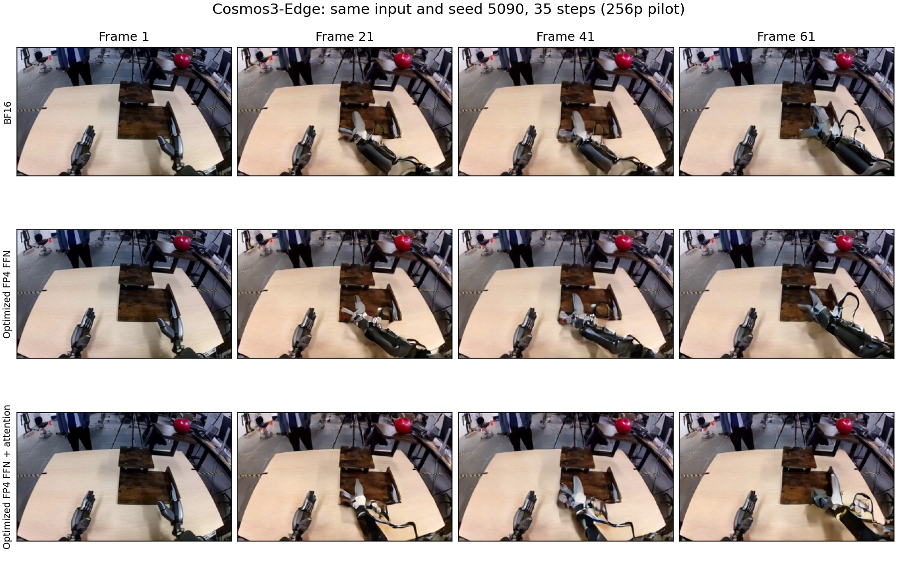
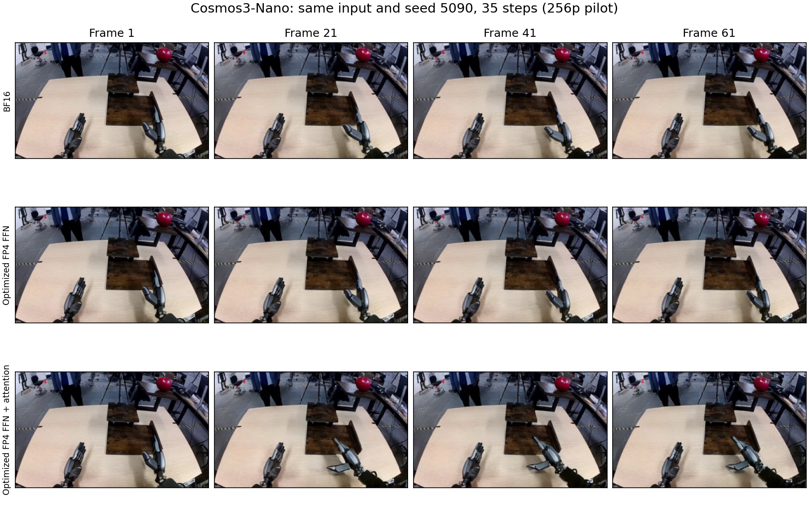

# Cosmos3-Edge / Nano：RTX 5090 端到端迁移与对照

日期：2026-09-10。本机 RTX 5090 上，两种模型都已接入优化内核并完成完整图生视频 Generator 对照。
**可以迁移并提速，但不能照搬启动参数、校准统计或单算子的加速倍数。**

本轮最好的测试点是仅替换 generation FFN，保留 BF16 attention。在共同的 CUDA Graph 执行方式下：

| 模型 | BF16 总延迟 | 原始 FP4 FFN | 优化 FP4 FFN | 优化 / 原始 FP4 的加速 | 优化 / BF16 的加速 |
|---|---:|---:|---:|---:|---:|
| Cosmos3-Edge | 2.914 s | 2.769 s | **2.559 s** | **1.082×** | **1.138×** |
| Cosmos3-Nano | 8.130 s | 7.118 s | **6.109 s** | **1.165×** | **1.331×** |

加速倍数均为参考延迟 / 候选延迟。相对原始 FP4 的倍数隔离内核执行优化；相对 BF16 的倍数同时包含量化方案与执行优化。
上述数据为每方案同一 seed 三次完整请求的中位数，不能将原单算子 1.13–2.16× 直接当成全模型收益。

- [全部 10 个模型/方案点及样本范围](../results/cosmos_e2e_20260910/TABLE.md)
- [CSV](../results/cosmos_e2e_20260910/latency.csv)、[完整 JSON](../results/cosmos_e2e_20260910/summary.json)
- [模型与固定 revision](../results/cosmos_e2e_20260910/models.json)、[逐项验证](../results/cosmos_e2e_20260910/validation.json)
- [接入代码、环境准备与复现](../tools/cosmos_e2e/README.md)

## 测试口径

同一官方机器人输入图、同一英文提示词；320×192、61 帧、24 FPS、35 步、CFG 6。
每个模型比较 BF16、原始/优化 FP4 FFN、原始/优化 FP4 FFN+attention 五个方案。
每方案 seed 5090 测三次，seed 5091 做一次完整轨迹对照：两个模型合计 40 次完整请求。

计时包含图像 VAE 编码、文本分词、全部条件/无条件去噪、VAE 解码及输出数组转换。
不含权重加载、离线量化、JIT/调参、prompt upsampler、safety checker 或 MP4 文件编码。
两个模型、所有正式方案都全驻显存，未使用 CPU offload，因此加速不是减少 CPU 权重传输造成的。

三次计时按方案顺序执行并保存 min/max；没有估计 p95，也没有将不同 seed 当成同条件延迟样本。
外层 Graph 对 BF16 和所有 FP4 方案相同，当前输入复制和输出 clone 计入时间，图捕获不计时。
图按 CFG 分支形状缓存，在换权重/方案前清理，不缓存旧 step 的激活或预测。

这是一个低分辨率、单图/单提示词、两个 seed 的完整 Generator pilot。
没有测试更大分辨率、长视频、Reasoner 文本生成、音频或机器人 action 输出；也未测任务成功率。

## 两个模型的不同之处

| 项目 | Edge | Nano |
|---|---|---|
| 固定 revision | a9d944e2c6a1bf9f48b92ad16348e70c5f1836ba | 411f42a8fdfb8c5b2583cb8786e0938f49796eaa |
| 层数 | 28 | 36 |
| hidden / intermediate | 2048 / 9216 | 4096 / 12288 |
| FFN | down(ReLU(up(x))²)，无 gate | down(SiLU(gate(x)) × up(x)) |
| Hq / Hkv / head_dim | 16 / 8 / 128 | 32 / 8 / 128 |

配置来自固定版本的官方 [Edge config](https://huggingface.co/nvidia/Cosmos3-Edge/blob/a9d944e2c6a1bf9f48b92ad16348e70c5f1836ba/transformer/config.json)
和 [Nano config](https://huggingface.co/nvidia/Cosmos3-Nano/blob/411f42a8fdfb8c5b2583cb8786e0938f49796eaa/transformer/config.json)。
FFN 与两条 attention 路径的实际实现核对了固定提交的
[Diffusers 源码](https://github.com/huggingface/diffusers/blob/04e724ce518e087301052b65ff81ec35d54f4040/src/diffusers/models/transformers/transformer_cosmos3.py)。

两者的线性层尺寸满足 K/N128、head dimension128 的内核约束，但实际 tile、流水级数必须按形状选择。
仅替换 `mlp_moe_gen` 中的线性层：Edge 每层两个，Nano 每层三个；原始非线性保持不变。
joint 方案仅替换非因果 generation attention，保留文本因果 attention、RoPE、QK norm、QKV/out projection 和理解分支 FFN。
两者默认文本模板与 flow schedule 不同，因此横向绝对时间不是同一模型缩放的严格控制实验；优化倍数均在同模型内计算。

## 精度与推荐使用点

本轮 FFN 是**每个模型自身的 RTN W4 + full ACT2，identity prescale，不含 W1 修复**。
它没有使用旧 Nano layer-0 的 AWQ prescale、静态支持或 head atlas，不能继承旧方案的校准质量结论。
joint 方案额外使用 75% 双侧一阶 attention 修复，所有 heads 为均匀配额。

| 模型 / 优化方案 | 总延迟 | BF16 SSIM，seed 5090 / 5091 | 与原始 FP4 视频 |
|---|---:|---:|---|
| Edge：FFN | 2.559 s | 0.8909 / 0.8934 | 逐位一致 |
| Edge：FFN+attention | 2.601 s | 0.8624 / 0.8552 | 逐位一致 |
| Nano：FFN | 6.109 s | 0.9274 / 0.8714 | 逐位一致 |
| Nano：FFN+attention | 6.457 s | 0.8666 / 0.7958 | 逐位一致 |

因此，**执行优化本身在本轮两个 seed 下没有改变原始 FP4 视频；FP4 量化相对 BF16 的误差仍然存在。**
SSIM 是视频一致性，不是语义准确率、物理正确性或机器人任务成功率。
当前测试中只替换 FFN 同时更快、也更接近 BF16；修复型 attention 不作为这两个配置的默认速度方案。
部署前仍需当前模型/层的校准与更多输入、seed、分辨率的质量验证，不能称本轮未校准 RTN 为无损替代。

## 端到端发现的两个问题

**Split-K 的局部容差不足以保证轨迹一致。** Edge 的两步接入试验中，down 的局部输出差异约 1.5e-4，
经过多层在线量化后，优化/原始 FP4 视频 SSIM 降到了约 0.84–0.91。
正式对照默认关闭 Split-K，保留 K 累加顺序；优化后的 M tile/流水仍有收益。
`--allow-split-k` 保留为明确的实验选项，不能仅凭单算子或本地 FFN 的误差通过就默认用于完整生成。
两步试验仅用于定位数值放大，不计入主表的 35 步质量或速度证据。

**外层启动开销会掩盖内核收益。** Edge eager 对照中 BF16 中位数 5.082 s，优化 FFN 4.813 s，且波动较大。
采用共同 Graph 后，分别为 2.914 s 和 2.559 s；主表使用这组共同执行方式，避免只给 FP4 添加 Graph 的不公平比较。
Edge 全部 eager/Graph 方案的两个 seed 视频哈希一致，说明 Graph 的收益没有来自复用旧输入/输出。
原始 eager 记录保存在 [edge_eager_result.json](../results/cosmos_e2e_20260910/edge_eager_result.json)。

Nano 另用 eager 完整执行了 BF16、优化 FFN、优化联合方案各两个 seed；六个视频也都与 Graph 逐位一致。
合计 26 次 eager 请求的核对见 [graph_equivalence.json](../results/cosmos_e2e_20260910/graph_equivalence.json)。
Nano 这组 eager 仅作输出验证，未混入三轮计时主表。

## 显存、环境与验证

| 模型 | BF16 峰值 | 优化 FFN 峰值 |
|---|---:|---:|
| Edge | 8.22 GiB | 6.88 GiB |
| Nano | 30.25 GiB | 23.06 GiB |

这是 PyTorch 峰值 allocated memory，包含 Graph 池及本次输入工作区，不含桌面/驱动和其他进程。
Nano 在本轮 256p 配置下能全驻显存，不能由此承诺 480p/720p 也能容纳 BF16。

使用现有 Torch 2.11.0+cu130 / Triton3.6、CUDA12.9 工具，在 `data_local/e2e_venv` 隔离安装推理/视频依赖；
没有更新共享 vllm 环境或 Toolkit。Diffusers 固定为 `04e724ce518e087301052b65ff81ec35d54f4040`。
继承的可选 xformers wheel 与 Torch 不匹配，本轮进程关闭该可选后端发现，所有 BF16 attention 使用 PyTorch Flash SDPA。

四项新增 GPU 接入测试通过：Edge/Nano 非线性语义与权重移动、当前输入重放与输出独立性、因果路径保留、mask 边界。
正式测量逐请求校验算子调用数量、两 CFG 分支的 70 次 transformer 调用、61 帧输出形状与有限值。
checkpoint 加载没有 missing/unexpected/mismatched keys。相同 seed 的三次视频逐位一致，不同 seed 输出不同。
原始与优化 FP4 在两模型、两方案、两 seed 下均逐位一致；测量时源码按 SHA256 归档在结果目录的 `source_snapshots/`。

原单算子与数据包研究见 [RTX5090_RESULTS.md](RTX5090_RESULTS.md)。
