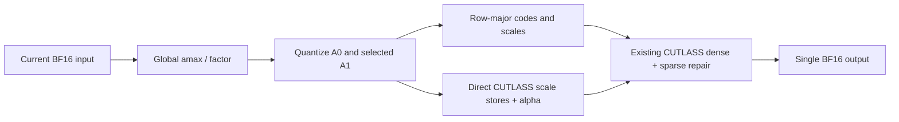

# CUTLASS on RTX 5090: verification and a further packing optimization

**2026-09-14 · upstream `23bd2a9` · local branch `perf/rtx5090-cutlass-followup`**

The PRO 6000 implementation runs on this RTX 5090 and still has optimization
headroom. This follow-up implements **direct CUTLASS scale stores during
activation quantization**, eliminating the separate scale-permutation kernel.
It preserves the existing repair products, masks, quantization, and GEMM
accumulation order. It is opt-in because some measured configurations regress.

## Measured result

| Panel / CUTLASS tile N | Original CUTLASS speedup over fixed Triton | Median additional direct-pack speedup |
|---|---:|---:|
| I2V 1.25 / 128 | 0.963–1.624× | 1.029× |
| I2V 1.25 / 64 | 1.019–1.438× | 1.015× |
| I2V 1.5 / 128 | 0.869–1.593× | 1.027× |
| I2V 1.5 / 64 | 0.748–1.333× | 1.021× |
| Policy 1.25 / 128 | 1.001–1.877× | 1.036× |
| Policy 1.25 / 64 | 0.973–2.496× | 1.056× |

The [complete table and raw samples](../results/cutlass_followup_20260914/TABLE.md)
cover **96 configurations**: three panels × four phases × Q/K/up/down × two
CUTLASS tiles. Measurements include current-input selection, packing, scale
conversion and all GEMM repair. The native comparator is **BM128/stages2**;
this is not a new search for the fastest possible Triton configuration.

**Actual input shapes:** the release tensors and manifests contain I2V M960 and
Policy **M316**. The upstream handoff text called the policy panels M416; that
label does not match the downloaded data. This report uses the measured M316
inputs. M416 passes separate correctness tests, but has no policy performance
or action-trajectory claim in this follow-up.

The median direct-pack ratio across the 96 cases is **1.028×**. Individual ratios
range from **0.949× to 1.165×**. These are shape/phase ranges, not confidence
intervals or whole-model speedups. The large FFN gains include zero-repair cases;
they must not be presented as evidence of equally large sparse-repair gains.

An initial run used one operator per graph with repeated Python replay calls and
showed large timing excursions. It remains archived as `records/direct_*.json`.
The confirmation captures **32 operators per graph**, performs nine alternating
rounds and amortizes host submission over that batch. Some variability remains
on this desktop GPU; do not enable a global winner based on small differences.
These diagnostic panels do not update a formal inference leaderboard.

## What changed



The original producer is followed by a separate read/permutation of A0 scales.
The new producer writes both required scale layouts while values are already in
registers and also writes the final alpha. Sparse A selection still computes the
same residual-sensitivity score and re-encodes exactly the selected residuals.
The residual pass, W repair, and CUTLASS C++ mainloop are unchanged.

Both scale layouts remain allocated: row-major scales are needed by repair and
native consumers. CUTLASS M128 padding is explicitly zero-filled even when native
packing pads only to M16. The path preserves nonidentity prescales, calibrated
base/residual scales, externally supplied valid factors and BF16 rounding.

The integration includes:

- `cutlass/packing.py`: producer, direct scale indexing, tail initialization and
  a typed packed-input container;
- `cosmos/linears.py` / `cutlass/backend.py`: native/shared-input fallback and
  opt-in producer dispatch;
- `RunConfig.cutlass_direct_pack`, CLI `--cutlass-direct-pack`, and configure
  `--direct-pack`: explicit selection, recorded in tuning keys and receipts;
- cost-ledger updates: scale conversion reads/executions are removed only for
  the direct path;
- single-GPU resource admission: an unset `CUDA_VISIBLE_DEVICES` now works on a
  GPU0-only host; an explicit missing/low-memory device still fails rather than
  silently switching devices.

`cutlass_direct_pack` defaults to false. It requires `linear_backend="cutlass-fused"`
and currently rejects shared gate/up packing. Existing shared packed inputs still
use the old scale conversion when passed to the low-level wrapper. Do not reuse
the typed direct packet across projections: its alpha includes that projection's
weight factor. Joint selection of tile, packing mode and Triton fallback is not
implemented by this change.

## Complete-trajectory and numerical validation

| Check | Result |
|---|---|
| Package + CUTLASS + direct-pack regression | 208 passed; one existing pytest marker warning |
| Direct producer cases | 30: M1/129/416/960/1024, base/full/partial/sparse/calibrated/factor paths |
| Graph behavior | Current inputs and masks change; outputs still match the reference exactly |
| Sanitizers on the direct producer suite | memcheck: 0 errors; racecheck: 0 errors / 0 warnings |
| Real operator panels | 96/96 direct vs original CUTLASS outputs are bitwise equal |
| Offline recipes rebuilt on 5090 | 168 projections × two budgets, all encoded assets pass byte-level checks |
| Full Edge I2V trajectories | 1.25/1.5 × seeds 7103/7104 × original/direct: eight runs, four bitwise-equal pairs |

The full runs use `robot_observe`, 35 denoising steps, identical fixed model,
policies, inputs and Graph execution. Array hashes are independently checked
against the saved NPZ arrays; comparison is not just a receipt assertion. Both
budgets remain feasible with identical MMA counts:

| Budget | Whole-request MMA / C0 | Removed scale read per request | Removed conversion executions |
|---|---:|---:|---:|
| 1.25 | 1.249995995× | 2,288,025,600 bytes | 11,760 |
| 1.5 | 1.499997073× | 2,288,025,600 bytes | 11,760 |

These are **logical traffic and GPU kernel-execution counts derived from shapes
and calls**, not measured DRAM traffic or host launch counts under CUDA Graph.
Scale writes remain about 2.441 GB per request. Prepared weight storage remains
973,334,736 / 1,077,834,368 bytes, including the upstream extra 84 MiB W0 scale
layout. No additional FP32 output scratch is introduced.

The whole-model runs are development equality checks, marked
`performance_eligible=false`; they are not a formal speed benchmark. They do not
establish unseen-scene quality, action/audio quality or superiority to FP8.
In particular, direct packing preserves the upstream CUTLASS result; it does not
repair the previously observed CUTLASS-vs-Triton or FP4-vs-FP8 quality gap.

## Environment and reproduction

Both N64 and N128 compiled with the existing **CUDA toolkit 12.9.86**, CUTLASS
4.5.0 headers and PyTorch 2.11.0+cu130 / Triton 3.6.0. No toolkit update was needed.
Full-model checks use a separate source checkout of the PRO 6000 Diffusers commit
`77c13f8a49c457f10a89862bb129bdc930b88929`; the old environment/checkouts remain
intact. Other Python dependencies remain the local environment's versions, so
this is a same-host matched comparison, not an exact replication of every PRO
6000 software component. The existing runner disables the incompatible optional
xformers backend and uses its established attention path.

Start with the upstream [download/build guide](../experiments/cutlass_fused_repair/README_5090.md).
Then run from the repository root, choosing fresh output paths:

```bash
export THUNDERWORLD_PYTHON="$PWD/data_local/e2e_venv/bin/python"
export TW_CUTLASS_LIBRARY="$PWD/build/cutlass5090_20260914/repair_n64.so"
export TW_CUTLASS_OTHER_LIBRARY="$PWD/build/cutlass5090_20260914/repair_n128.so"
bash tools/kernel_handoff/python5090.sh -m pytest \
  packages/fp4-repair/tests experiments/cutlass_fused_repair/test_fused.py \
  experiments/cutlass_fused_repair/test_direct_pack.py -q

bash tools/kernel_handoff/python5090.sh experiments/cutlass_fused_repair/retest.py \
  --capsule data_local/cutlass_5090_download/panels/i2v_b125 \
  --library "$TW_CUTLASS_LIBRARY" --resource-mode exclusive --device 0 \
  --compare-direct-pack --graph-batch 32 --timing-rounds 9 \
  --output runs5090/NEW_direct_pack_panel.json

bash tools/kernel_handoff/python5090.sh experiments/cutlass_fused_repair/configure.py \
  --policy data_local/cutlass_5090_download/ThunderWorld-CUTLASS-5090/policies/i2v_b125 \
  --library "$TW_CUTLASS_OTHER_LIBRARY" --small-library "$TW_CUTLASS_LIBRARY" \
  --direct-pack --output runs5090/NEW_direct_pack_config.json
```

Use this config with the upstream full-model `infer` command and the rebuilt
assets. Omit `--direct-pack` for the matched original control. The equivalent
runtime override is `--cutlass-direct-pack` / `--no-cutlass-direct-pack`.
Changing packing mode invalidates the relevant tuning key; retune on the target
device. Do not transfer the 5090 latency table as a PRO 6000 launch policy.

## Where the next gains are likely to come from

1. **Select backend, tile and packing together.** High-repair I2V cases still
   lose against the fixed Triton baseline. Keep a quality-validated fallback and
   compare complete operators in one tuning session, with confirmation rounds.
   N64 gives more CTAs but also repeats data loads; SM count alone is insufficient.
2. **Reuse W0 during A repair.** `RepairCollective::mma` currently completes the
   dense mainloop before A1W0 and rereads W0. Moving that term into the dense loop
   could reduce traffic, but changes accumulation order and requires a fresh
   full-trajectory quality check.
3. **Pipeline sparse repair loads.** The current repair term performs
   `cp.async`, immediately waits, then performs MMA. A measured two-buffer design
   may overlap next-tile loads with current MMA. Its extra shared memory and
   registers can reduce occupancy, so it is not automatically faster.
4. **Reduce scale and selector overhead further.** Unifying weight scale layouts
   could remove the extra 84 MiB. Avoiding duplicate A0 scale stores where no
   consumer needs row-major A0 is a separate specialization. Both require explicit
   consumer/lifetime accounting; this change retains the proven representations.
5. **Measure the full request before claiming a larger result.** The linear
   backend does not optimize all QK/PV/softmax work. Run fresh exclusive,
   interleaved full-request benchmarks and separate quality evaluation. Hardware
   saturation cannot be inferred from these speed ratios.

The implementation and raw evidence are ready for another optimization round;
the verified addition here is a modest, numerically exact packing improvement,
with retained counterexamples and explicit integration limits.
