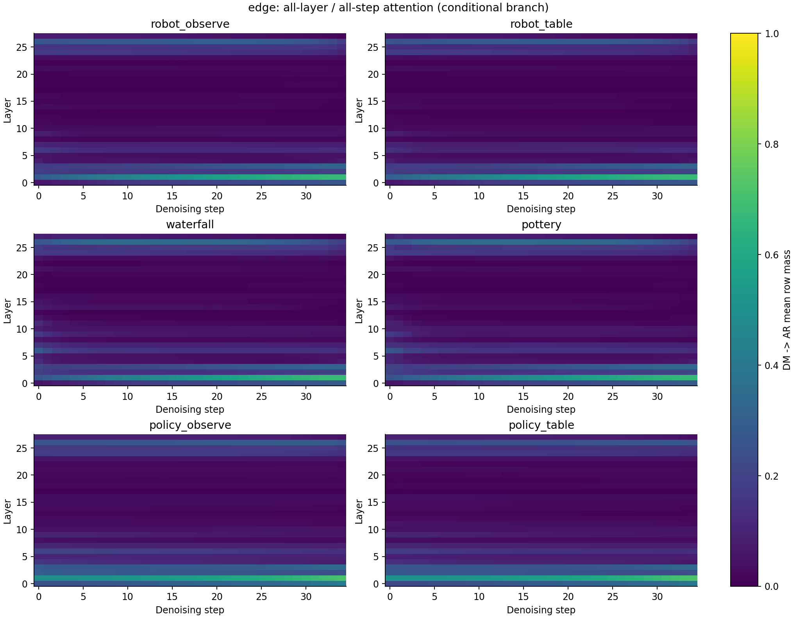
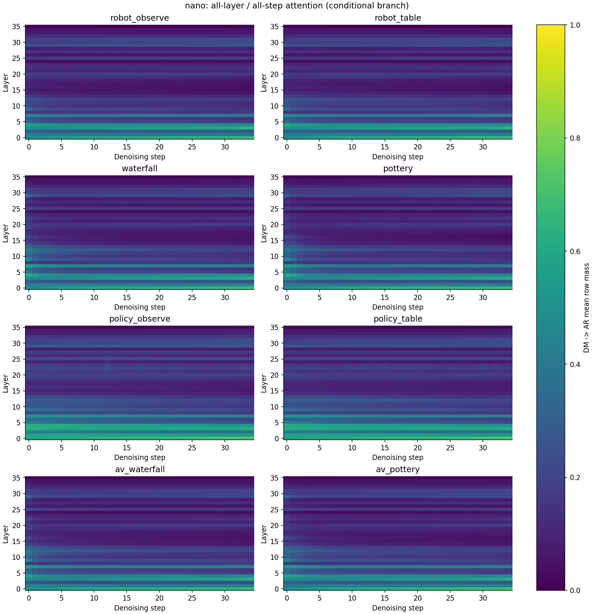
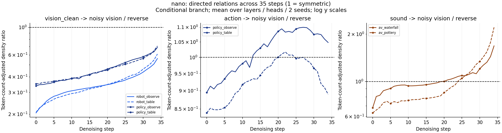
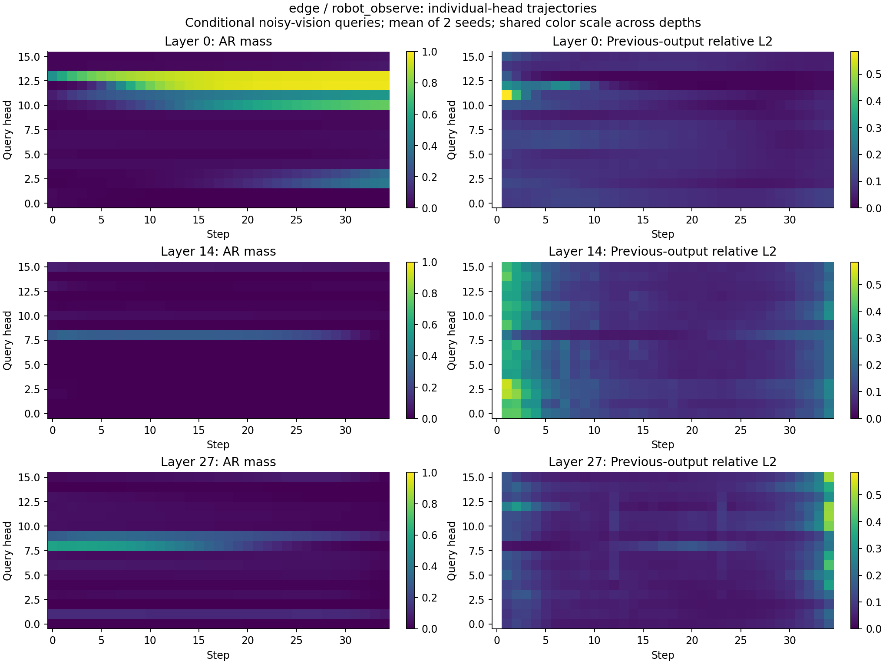
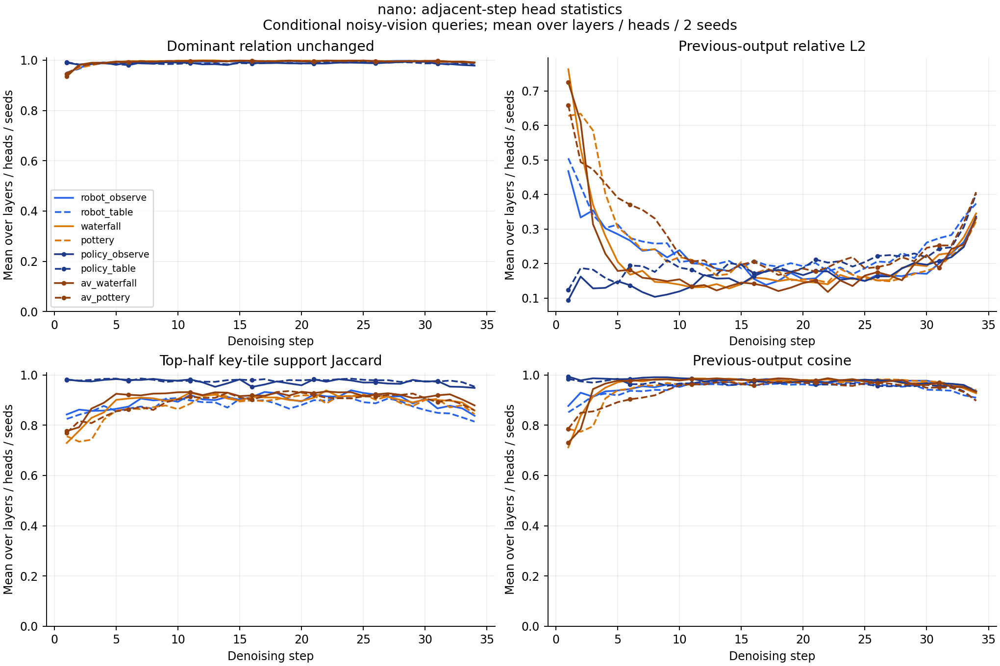

# Cosmos3：全 step 重采样、精度修复和跨 step 复用

本轮在本机 RTX 5090 上重新采样 Cosmos3-Edge / Nano 的完整 35-step 轨迹。
已完成 28 条 BF16 观察轨迹、170 条正式消融、170 条全帧 LPIPS 和 34 条 AV 波形解码。
**DM←AR 随深度减弱的现象在两个模型上成立；action/audio 的强单向性需要按 token 数量重新解释；head 关系稳定不足以推出数值输出可直接复用。**
结果是这组 checkpoint、输入和配置下的测量，不能推广为整个 Cosmos3 家族的质量保证。

## 采样覆盖与可复核口径

| 项目 | Edge | Nano |
|---|---|---|
| 模型 revision | `a9d944e2c6a1bf9f48b92ad16348e70c5f1836ba` | `411f42a8fdfb8c5b2583cb8786e0938f49796eaa` |
| Generator 层 / Q-head / KV-head | 28 / 16 / 8 | 36 / 32 / 8 |
| BF16 采样 | 6 个 case × 2 seeds | 8 个 case × 2 seeds |
| 模态路径 | I2V、T2V、action policy | 同左，另有联合音视频生成 |
| step | 全部 35 步 | 全部 35 步 |
| query 样本 | 每种真实 role 固定随机抽至多 32 行；小于 32 行则全量 | 同左 |
| key、layer、head、CFG | 所有 key、所有层/头；有 CFG 时记录两个分支 | 同左 |

每条 sampled query 都使用完整 key 集合计算 FP32 softmax；原来的 BF16 attention 返回值不被观察器替换。
查询位置独立于激活值采样，跨 step 固定。图以 conditional 分支为主，另附两分支 CSV。
role 来自当前 pipeline 的真实 token metadata，区分 AR、clean vision、noisy vision、sound、action 和 special。
单纯含机器人的视频没有被算作 action 采样。

采样 seeds 为 6101/6102；正式消融使用新 seeds 6103/6104。
两个真实机器人图像分别来自官方 `robot_153.jpg` 和 `robot_example.zip` 的输入视频首帧；
另有 waterfall / pottery 场景。I2V/policy 共用图像，T2V/AV 场景也相关，
因此 28 条轨迹只有约四个场景簇，不能把所有 head、step 或 case 当独立样本扩大统计置信度。

action 使用真实 policy 路径、`bridge_orig_lerobot` 接口和 16-token action chunk，但图像没有匹配的 Bridge 动作真值。
这里只测 action 数值一致性，不能宣称任务成功率。Edge 没有 sound 能力。
Nano 保存真实生成的 sound latent，并在释放主模型后独立解码为波形，避免 WDDM 显存溢出影响实验。

标准视频为 320×192、61 帧、24 fps、CFG 6、flow shift 3；policy 为 pipeline 的 resolution tier 256、17 帧、5 fps、CFG 1、flow shift 10。
模型严格检查缺失/多余/形状不匹配的权重；Diffusers 固定在 `04e724ce518e087301052b65ff81ec35d54f4040`。

## Finding A：深层 DM←AR mass 降低

`DM←AR` 指 Generator query 读取 AR key。图中 `DM -> AR` 使用 query→key 记法，表达同一方向。
先对每个 query role 求 attention row mass，再按该 role 的真实 query 数加权，最后对 head/step 和完整轨迹等权平均。
浅/深分别指首/末四分之一层；这不是“每一层都单调下降”的断言。

| 指标 | Edge | Nano |
|---|---:|---:|
| 浅层 DM←AR mass | 0.2126 | 0.3869 |
| 深层 DM←AR mass | 0.1068 | 0.1235 |
| 每轨迹 depth Pearson 的均值 | −0.3475 | −0.6922 |

这支持将深度作为修复预算的候选先验；attention mass 本身不能确定 FP4 误差或修复收益。
低 mass 的关系仍可能有高值幅度或高下游敏感度，实际预算应在完整轨迹中校准。

## Finding B：原始 row mass 的单向性包含长度效应

令 `m(i,j)` 为 i-role query 分配给 j-role key 的平均 row mass，`n_i`、`n_j` 为真实 token 数。
同时报告：

- 原始比：`m(i,j) / m(j,i)`。
- 每个 score entry 的密度比：`[m(i,j)/n_j] / [m(j,i)/n_i]`。
- 等价的两方向总 attention mass 比：`n_i*m(i,j) / [n_j*m(j,i)]`。

两方向有相同的 `n_i*n_j` score 数量，不代表它们的**每 query 行和**已经消除了 token 数量差异。
历史汇总缺少可重建归一化的原始 counts，因此保留历史数字，但修正了其解释；
本轮 policy/官方 checkpoint 与历史 forward-dynamics 任务不同，不能称为严格重复原实验。

| 关系（query→key / reverse） | 原始 row-mass 比范围 | 密度比范围 |
|---|---:|---:|
| Edge action→noisy vision | 24.0–29.2× | 1.40–1.61× |
| Nano action→noisy vision | 14.8–18.8× | 0.925–1.051× |
| Nano sound→noisy vision | 12.8–16.4× | 0.850–1.095× |

范围来自本轮各 case/seed 完整轨迹的聚合，非置信区间。
Edge action 仍有中等方向性；Nano action/audio 的全轨迹平均接近对称。
原始 row mass 的差异仍是真实的注意力分配现象，对实际布局下的预算有参考价值；
归一化改变的是“它证明了超出序列长度的模态偏好”这一解释，并不否定原始 mass 的测量。
Nano sound 的密度比在后期升高并跨过 1，提示**方向还随 step 改变**，不能固定写死“sound 总是单向参考 vision”。
clean/noisy vision 的原始比也会被 token 长度显著放大。

## Head 稳定性与输出复用

以下是在 noisy-vision query 上对 layer/head/轨迹平均的相邻 step 指标。
相对输出变化为 `||O_t−O_(t−1)|| / ||O_t||`，它测量真实 BF16 attention 的抽样输出行。

| 指标 | Edge | Nano |
|---|---:|---:|
| 主导 row-mass role 保持不变 | 99.16% | 99.16% |
| 主导 density role 保持不变 | 98.53% | 98.05% |
| 输出 cosine | 0.9864 | 0.9571 |
| 输出相对 L2 变化 | 0.1163 | 0.2190 |
| 按 mass 排序的 top-50% key tiles Jaccard | 0.9407 | 0.9123 |

主导 role 也有长序列偏置，因此 CSV 额外保留按 token 数归一化后的 dominant-role 稳定性。
这里的 support 是观测 attention mass 排序的 top-50% key tiles，**不是**运行时 mass×V-energy 修复选择器；二者不能混称。
原始 NPZ 保存所有层、头、step、role 的 mass、熵、最大概率、输出范数、Q/output cosine、相对 L2、support 交并比和 role JS 等 12 项特征。

输出变化整体后半段较小，但最后几步明显回升。故实验额外测试中间 20%–80% 阶段，
以及在 development 场景上冻结选择的最稳定 25% GQA groups；evaluation 图像/场景没有用于选择这些 groups。
这些 evaluation 场景的其他 seed 已包含在本轮结构展示中，研究者也已查看这些图；
因此这里的分离保证是 group 评分不使用 evaluation 数据、质量使用新 seed，
不是全流程盲测或完全未见场景测试。中间阶段窗口属于探索性设计假设，不是质量保证。

## 精度和复用消融的定义

正式矩阵包含每模型 17 种方案：Edge 的 I2V/policy × 2 seeds，Nano 另加 AV × 2 seeds。
每个变体都从相同 seed 自由运行完整 35 步，不把 BF16 中间激活喂给候选路径。

| 组别 | 对照与变体 |
|---|---|
| FFN 精度 | BF16、A0W0、A0W0+A1W0、A0W0+A0W1、双一阶、加上 A1W1 的四项 |
| Attention 精度 | 无修复、全量 A 侧、双一阶 50% / 100% tile、四项 100% |
| 修复选择复用 | 每隔一步复用上一步真实 native 50% mask；数值全部重算 |
| 修复增量复用 | 当前 base + 上一步 `(repaired output − base output)`；全程/中间阶段 |
| 完整输出复用 | 上一步 BF16 attention 输出；全程/中间阶段/稳定 GQA groups |

FFN 消融保持 BF16 attention；所有 attention/复用消融使用相同 RTN W4 + full ACT2 FFN。
因此 attention 结果同时报告相对 BF16 和相对该 FFN anchor 的指标；mask/delta 复用另与当前步 `attn_dual50` 对照。

delta 缓存的是**共同 softmax 归一化之后的完整输出差值**，包括 QK 改变带来的效应；不是把一个独立归一化的旧 PV tile 直接加到新结果中。
刷新阶段当前实现会各算一次 base 和 repaired，额外成本计入时间。所有缓存按 request、CFG 分支、层和形状隔离，最大年龄一步。
完整输出复用只跳过对应 attention；QKV/out projection、FFN 等仍计算。

当前第一平面量化仍是 absmax RTN。这里没有实现拟议的 bulk-fit 第一轮量化，故不能把结果作为完整 iterFP4 方案的定论。

当前全程隔步 delta 方案的平均计算成本近似 `C_base + (18/35)*C_repaired`，而每步重算的参考为 `C_repaired`。
因此在忽略缓存开销时，也只有 `C_base < (17/35)*C_repaired` 才可能更快。
跳过若干修复调用不等于已经省下整条路径的时间；后续必须评估量化、QK 基础乘积等可共享部分，
并保留两种 softmax/PV 路径所需的真实成本，不能假设一次简单 epilogue 融合就能消除全部重复工作。

详细结果在 [完整消融表](../results/findings_20260910/ablation/ABLATION.md) 和逐请求 CSV。
视频同时报告 PSNR/SSIM、相对 L2 和 [LPIPS AlexNet v0.1](https://github.com/richzhang/PerceptualSimilarity)：RGB 输入映射至 [-1,1]，原始分辨率、全部帧等权。
LPIPS 越低表示越接近同 seed 参考；这些指标都不是绝对视觉质量或任务成功率。
action 给出原始数组误差；audio 区分 latent 误差与解码波形 L2 / log-STFT 差异，波形误差也不是听感评分。

所有时间都是相同 eager 框架的诊断时间，包含当前输入处理、Transformer、视频 VAE 和一致的少量预测抽样开销；
不含模型加载、离线权重量化、JIT/warmup、MP4/NPZ 序列化。AV 波形独立解码时间另列。
每 case/seed 只有一次正式计时，顺序运行；不可将微小差异或模式间顺序波动解释为稳定加速。
这不替代此前共同 CUDA Graph 下的生产吞吐测试，也不含完整 AR Reasoner 或任务执行环境。

### FFN 修复项：改善依赖模型和模态

下表的 I2V 为同一个 evaluation 图像/prompt、两 seeds 的平均 SSIM；action 为 policy 两 seeds 的最大相对 L2。
所有 FFN 行均保持 BF16 attention，避免混入 attention 误差。

| FFN 项 | Edge I2V SSIM ↑ | Nano I2V SSIM ↑ | Edge action 最差 L2 ↓ | Nano action 最差 L2 ↓ |
|---|---:|---:|---:|---:|
| A0W0 | 0.5337 | 0.9229 | 0.3826 | 0.1754 |
| +A1W0 | 0.5329 | 0.9563 | 0.1028 | 0.0739 |
| +A0W1（不含 A1W0） | 0.5727 | 0.9221 | 0.2546 | 0.0824 |
| 两个一阶项 | 0.6919 | 0.9603 | 0.0366 | 0.0219 |
| 再加 A1W1 | 0.7710 | 0.9644 | 0.0344 | 0.1217 |

在 Nano I2V 中，A 侧修复明显优于 W 侧；在 Edge 这个 I2V 样本上不成立。
action 两模型均从双一阶项受益，但 Nano 加交叉项的最坏 action 误差反而变大。
因此“优先 A，W 次之，cross 可以忽略”需要作为按模型/模块/模态验证的假设，不能硬编码为通用定律。
Edge 四项仍未接近 BF16，说明更好的首轮量化、非线性敏感层处理和完整轨迹校准仍是必要实现缺口。
同一 I2V 对照的全帧平均 LPIPS 从 base 到双一阶、四项分别为：
Edge `0.4254 → 0.2437 → 0.1693`，Nano `0.0474 → 0.0182 → 0.0172`（越低越接近 BF16）。
因此双侧修复的改善也得到感知距离支持；它仍不代表真实动作正确或生成内容优于 BF16。

固定帧展示在选择前固定为最小评估 seed 6103、视频的 1/4、1/2 与末帧，所有变体相同：
[Edge I2V](../results/findings_20260910/ablation/edge_robot_table_frames.png)、
[Edge policy](../results/findings_20260910/ablation/edge_policy_table_frames.png)、
[Nano I2V](../results/findings_20260910/ablation/nano_robot_table_frames.png)、
[Nano policy](../results/findings_20260910/ablation/nano_policy_table_frames.png)、
[Nano AV](../results/findings_20260910/ablation/nano_av_pottery_frames.png)。
完整视频、动作数组和 WAV 保留在本地原始 run 目录，由结果包清单索引。

### 跨 step 复用：阶段限制改善质量，目前没有可靠净加速

下表先隔离缓存本身的影响，比较各方案与其**不缓存的相同配置参考**。
mask/delta 的参考为 `attn_dual50`；完整输出缓存的参考为 `ffn_act2`（BF16 attention）。
最差 SSIM 取各模型全部评估 case/seed，时间比是逐请求配对比的几何平均。
两模型 case 集不同，数字只能在各自列内比较。

| 缓存方案 | Edge 最差 SSIM ↑ | Nano 最差 SSIM ↑ | Edge 时间加速比 | Nano 时间加速比 |
|---|---:|---:|---:|---:|
| 原生 50% repair mask 隔步复用 | 0.8885 | 0.6810 | 0.991× | 0.950× |
| repair delta 隔步复用 | 0.7897 | 0.7749 | 0.925× | 0.995× |
| repair delta，仅中间阶段 | 0.8850 | 0.8731 | 0.949× | 0.932× |
| 完整输出隔步复用 | 0.7452 | 0.4352 | 0.966× | 1.010× |
| 完整输出，仅中间阶段 | 0.9059 | 0.9209 | 0.955× | 0.984× |
| 完整输出，中间阶段 + 稳定 25% GQA groups | 0.9663 | 0.9503 | 0.985× | 1.001× |

这轮最适合继续探索的是最后一行的受限缓存；它不是已通过部署验收的加速方案。
该策略仅省掉一部分 attention，仍有 gather/scatter、缓存读写和其他网络模块成本；
单次 eager 计时下的 1.001× / 1.010× 不能算可靠加速。
稳定 GQA 方案相对不缓存参考的最坏全帧 LPIPS 为 Edge 0.0235、Nano 0.0310，
但相对 BF16 的误差仍包括共同 FFN anchor 的误差，不能把缓存相对误差当成模型总误差。
Nano AV 的完整输出缓存最差为 0.4352，说明跨 step 数值复用的边界不能从 policy/I2V 推广到 AV。

### 音频补充

34 条 AV 波形均从保存的真实 sound latent 成功解码；单独解码中位数约 0.0243 秒，
该数字排除了 decoder 加载和 warmup，不是包含主模型的集成请求时间。
Nano 音频相对 BF16 的最坏波形 L2 从 base 的 1.1496 降至 A-only 的 0.5770、
W-only 的 0.3927、双一阶的 0.0489；四项为 0.0766。
这与“所有模态都应优先 A-only”的简单规则不一致，且再次显示 cross 不必然改善完整轨迹。
波形 L2 对相位变化敏感，必须结合保留的 WAV、log-STFT 指标和后续听感/同步评测理解。

## 下一步实现调整

1. **先提高第一平面与敏感模块的质量。** 接通有明确目标函数的 bulk-fit / repair-aware scale 校准；
   分模型和模态比较 A-only/W-only/双一阶/cross，保留 BF16 非线性与必要的敏感层回退。
   不把更多修复项自动视作更高整轨迹质量。
2. **结构先验同时保留 mass、counts、density、V 能量和修复收益。**
   按 layer/step/CFG/role 标定，不能只根据原始方向比或固定“后期”规则分配预算。
3. **缓存优先研究受限 GQA/阶段策略，但先算清开销。**
   冻结规则后再做融合访问与 Graph 版本；mask/delta 复用要保留完整轨迹回归，
   normalized delta 的双路径成本需要显式优化和测量。达到实际质量目标后才比较共同 Graph 下的速度。
4. **补足真正未知场景和任务质量。** 下一批需要与本轮场景完全分离的输入、匹配的动作真值、
   音视频同步/听感检查以及更多 seeds；先冻结量化器和策略，再运行这一批。
   本轮公开完整结果和失败案例作为开发证据，不据此宣称端侧任务成功率或无损加速。

## 实现与证据管理

入口为 [tools/finding_resample](../tools/finding_resample/README.md)。
每个 run 保存模型 revision、参数、输入哈希、完整输出哈希和源码 SHA256 快照。
Nano 采样因音频 decoder 显存问题分段完成：canonical 合并结果保留来源运行状态，重叠视频先验证哈希一致，再采用保存 sound latent 的完整轨迹。
中断/失败原始 run 不会被改写为成功；2-step smoke 和 FFN mask bug 修复前的失败 campaign 均不进入正式结论。

本轮修正了研究适配器的一个真实问题：`.expand()` 产生的零步长 mask 被 native 平坦指针读取，四项 FFN 路径可越界。
现在每个行数缓存 contiguous mask；GPU 独立 FP4 解码参考覆盖五种修复项与尾块，且 Compute Sanitizer memcheck 无错误。
这项修复位于新研究适配器，不改写历史测量。

本机 toolkit 无需更新。性能/质量报告不声称能耗改善，也不声称已在 Thor、Spark 或其他架构验证。
