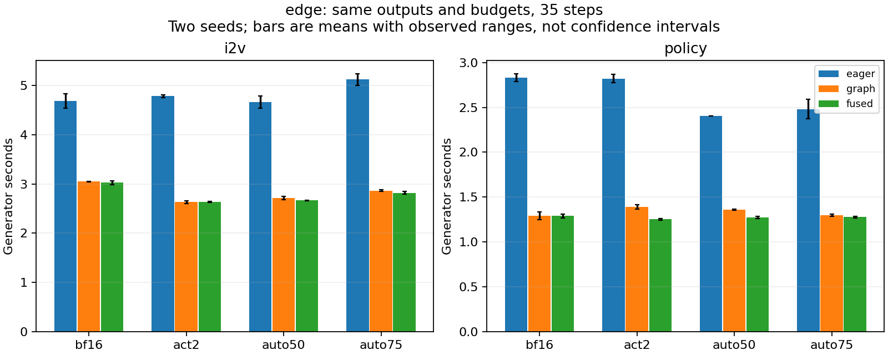
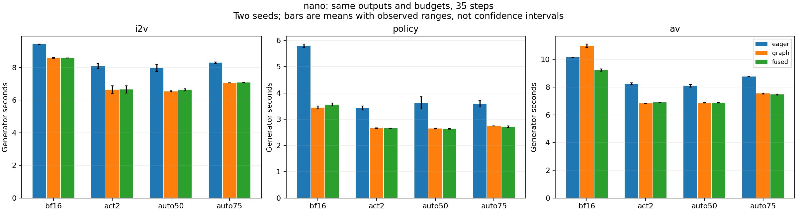

# 分阶段 CUDA Graph、数值等价融合与双缓冲验证

日期：2026-09-11。设备：本机 RTX 5090；模型为此前固定 revision 的 Cosmos3-Edge / Nano。
本轮沿用已选择的 FFN 预算与 BF16 attention，优化执行方式，不改变修复公式、分配策略、steps 或输出尺寸。

## 已实现的执行路径

### 完整 Transformer 的分阶段 Graph

新增 [phase_graph.py](../tools/auto_budget/phase_graph.py)，由 `run.py --phase-graph` 启用。
缓存键包含任务、模式、CFG 分支、去噪 phase、CUDA stream 和输入结构/shape/dtype/stride。
自动档位最多为 4 phases × 2 branches 的 8 个 Graph；固定档位只需每分支一个。
每次 replay 都复制当前输入、timesteps、位置与 domain IDs，返回独立拥有存储的输出；没有跨 step 复用旧数值。

预热时为所有要执行的 phase 建图，正式请求遇到未预热 shape/phase 会报错，不在计时中临时捕获。
捕获使用合成 phase 上下文确定预算，正式运行仍按实际 35-step 日程分配，阶段长度为 7/11/10/7。
Python 的 FFN 次数、分档计数和修复 FLOPs 在捕获时记录增量，replay 时更新；实际阶段命中数单独记录。
模型权重/任务变化前清理缓存。图串行执行，共享中间内存池；各图的静态输入单独保存，输出在下一图执行前 clone，避免跨图覆盖。
这符合独立图共享内存池时的存储条件；并不允许多个请求并发复用同一实例。[PyTorch CUDA Graph 内存说明](https://docs.pytorch.org/docs/main/notes/cuda.html#sharing-memory-across-captures)。

action 路径原来的 GPU→CPU `torch.any` 范围判断不能在 capture 内运行。适配器将 domain 范围检查放到每次 Graph 调用的捕获外；embedding/bmm 仍在图内读取当前 domain IDs，未将 action domain 固定成一次捕获的常量。
I2V、policy 和 AV 保留同样的模型运算；AR Reasoner 不在本轮范围。

### 与 BF16 舍入等价的融合

新增 [fusion.py](../tools/auto_budget/fusion.py)，由 `--fuse-ffn` 启用。

- Edge：将 `ReLU(up)²` 和下一 down 输入的 amax 分块统计合成一个 kernel。
- Nano：保留原 PyTorch SiLU，合并 BF16 `SiLU(gate) × up` 与下一 down 输入的 amax 分块统计。
- 显式先将逐元素结果舍入为 BF16，再统计 amax；最终全局 factor 使用原来的 `finish_amax`，down 的 packing 直接消费该 factor。
- scale group、K128 支持、当前激活的 tile 选择和 K 累加顺序均不改变。融合要求 identity prescale，安装时检查。

相对原链，Edge 少两个 kernel（独立 ReLU、square、amax 合并），Nano 少一个；还减少相应中间张量读写。
这不是把 SiLU 近似替换成另一个实现，也不是把整条 FFN 塞入一个 kernel。保留全局 amax 归约避免了 per-chunk scale 改变的数值风险。
本轮不同时开启旧的 gate/up 共享打包，因此测到的增量属于本次融合。

### 完整算子的两槽双缓冲

新增研究实现 [chunk_pipeline.py](../tools/auto_budget/chunk_pipeline.py)：

1. 在完整输入上计算一次 mask 和 global factor。
2. 将 M 按 128/256/512 行分块，边界对齐 M128。
3. packing stream 生产第 j+1 块，compute stream 对第 j 块执行 GEMM。
4. 两个固定 packed buffer 轮流使用，写入前等待该槽位的上一次 GEMM；compute 等待相应 packing event。
5. GEMM 直接写入完整输出对应的行，避免额外 concatenate；尾块保持正确 plane stride 和输出 mask。

这是有真实 producer→consumer 依赖的双缓冲，不是上一轮“不同输入的独立 SIMT/GEMM”探针。
它不做跨 step 缓存、不重新计算 chunk 的 global scale，也不使用 Split-K。
**所测 120 个候选均未超过原路径，因此保持研究工具，不接入默认 runtime。**
这否定的是当前 M-chunk/双 stream 实现和所测配置，不是否定 kernel 内的 warp specialization 或所有双缓冲设计。

## 局部结果与比较口径

用真实 layer-0 权重和实际 M/N/K，完整 FFN 的每种方案使用自己的上投影输出作为 down 输入。
Edge 2 个 M × 4 档，Nano 3 个 M × 4 档，共 20 组；每配置五次交替顺序、每次约 15 ms 的 CUDA Graph 测量。
双缓冲覆盖对应 up/down 共 40 组 shape/tier，每组 3 个 chunk 候选，三次交替顺序测量；计入全局统计、选择、packing、同步及 GEMM。
微基准输入由捕获的行扩展到真实 M，只用于执行成本，不能当作新增质量样本。

| 模型 | 完整 FFN 融合 / 原路径 | 双缓冲 / 原路径（所有候选） |
|---|---:|---:|
| Edge | 1.034–1.072× | 0.136–0.949× |
| Nano | 1.002–1.010× | 0.226–0.993× |

所有局部比较的最终输出逐位一致。分块减少每次 GEMM 的 CTA 数，增加同步与调度，是双缓冲未获益的合理解释；本轮没有新的完整硬件 stall 分解，不能将原因归结为单一资源。
更合适的后续方向是 kernel 内的预取/主循环/epilogue 分工，而非将现有 GEMM 继续切碎。

进一步对每组最接近原路径的 chunk 调整 BM32/64/128 × stages2/3，共 240 个 launch 候选，全部输出逐位一致；选择后用五次新的交替顺序计时复核。
Edge 真正多块配置为原路径速度的 0.680–0.925×，Nano 为 0.774–0.942×，仍全部落后。
仅 Nano M316 down 的 act2/dual 分别有 1.019× / 1.010×，但二者均选择 chunk512，只产生**一个块**，不能当作 overlap 收益；样本也存在波动，不接入默认路径。
这是针对最接近的 chunk 的有限复查，未对所有 chunk 联合穷举；详见 [tuned_double_buffer.csv](../results/execution_20260911/tuned_double_buffer.csv) 的 `num_chunks` 和原始记录中的全部样本。

## 完整轨迹实验设计

两模型共 5 个任务配置：Edge I2V/policy；Nano I2V/policy/AV。
每个配置使用 seeds 7403/7404、35 steps，对比 BF16、ACT2、auto50、auto75。
预算为上一轮的 `policy_validated.json`：部分任务在其中已经回退均匀修复，本轮不重新选择预算。

三路执行：eager、完整 Transformer Graph、Graph + FFN 融合。
请求时间包含相同的图像编码、去噪、视频解码和轨迹摘要；模型加载、离线权重准备、JIT、Graph 预热和输出文件写入不计入。
AV 保存音频 latent，波形解码不在请求时间内。这里的速度不是包含冷启动、AR Reasoner 或动作真实执行的完整应用延迟。
每种子每变体一次，变体按进程顺序测量；小幅融合差异仍可能受环境波动影响，应与局部交替计时结合判断。

**BF16 控制组揭示了明显的进程间差异。** Nano AV 在 Graph / Graph+fusion 两个进程中的 BF16 请求平均为 10.992 / 9.233 s，但此时根本尚未安装 FFN 融合，不能把 1.191× 归因于融合。对应 Transformer 事件计时为 7.618 / 7.663 s，差异主要在 Transformer 计时之外；本轮不能进一步确诊是哪项编码/解码、提交或运行环境开销。原始值完整保留，因此报告不把百分之几的端到端差异当作稳定收益。

## 端到端结果

以下时间为两个种子的请求均值，单位秒；加速为同种子比值的几何均值。BF16 行保留用于识别框架和运行环境效应。

| 模型 / 任务 | 档位 | eager | Graph | Graph + fusion | 组合相对 eager 加速 |
|---|---|---:|---:|---:|---:|
| edge / I2V | bf16 | 4.687 | 3.048 | 3.024 | 1.549× |
| edge / I2V | act2 | 4.784 | 2.630 | 2.632 | 1.817× |
| edge / I2V | auto50 | 4.664 | 2.709 | 2.664 | 1.750× |
| edge / I2V | auto75 | 5.123 | 2.862 | 2.819 | 1.817× |
| edge / policy | bf16 | 2.831 | 1.293 | 1.290 | 2.195× |
| edge / policy | act2 | 2.822 | 1.390 | 1.253 | 2.251× |
| edge / policy | auto50 | 2.407 | 1.359 | 1.271 | 1.894× |
| edge / policy | auto75 | 2.480 | 1.296 | 1.277 | 1.941× |
| nano / I2V | bf16 | 9.427 | 8.576 | 8.586 | 1.098× |
| nano / I2V | act2 | 8.074 | 6.636 | 6.657 | 1.213× |
| nano / I2V | auto50 | 7.965 | 6.538 | 6.626 | 1.202× |
| nano / I2V | auto75 | 8.299 | 7.057 | 7.070 | 1.174× |
| nano / policy | bf16 | 5.798 | 3.443 | 3.560 | 1.629× |
| nano / policy | act2 | 3.429 | 2.655 | 2.655 | 1.291× |
| nano / policy | auto50 | 3.620 | 2.644 | 2.634 | 1.372× |
| nano / policy | auto75 | 3.590 | 2.745 | 2.713 | 1.323× |
| nano / AV | bf16 | 10.147 | 10.992 | 9.233 | 1.099× |
| nano / AV | act2 | 8.232 | 6.838 | 6.895 | 1.194× |
| nano / AV | auto50 | 8.106 | 6.865 | 6.875 | 1.179× |
| nano / AV | auto75 | 8.767 | 7.537 | 7.467 | 1.174× |

FP4 三档（ACT2 / auto50 / auto75）单独使用 Graph 时：

- edge：相对 eager 为 1.721–2.029×；Graph 之上的 fusion 请求比值为 0.999–1.109×，后者受上述进程间差异影响。
- nano：相对 eager 为 1.163–1.367×；Graph 之上的 fusion 请求比值为 0.987–1.012×，后者受上述进程间差异影响。

**建议优先启用 Graph；fusion 保留为等价优化选项。** Edge 的局部完整 FFN 收益为 3.4–7.2%，Nano 只有 0.2–1.0%，不能据局部结果保证每个端到端请求都加速。Graph 并非所有配置必然缩短请求时间，Nano BF16 AV 控制组就是反例。

峰值 allocated memory 相对 eager 的增加很小，所有配置低于 11 MiB；这是 PyTorch 分配峰值，不是驱动实际占用或 reserved memory。Nano 最大峰值约 30.34 GiB（BF16 policy），FP4 约 25.97 GiB；预热建图时间尚未量化。

这些是同档位执行优化，未改善量化本身的质量。新种子上的 Nano I2V 三档平均视频 SSIM 约 0.971–0.974；Edge I2V 约 0.688–0.717，不能因加速而将其称为 BF16 等质。policy 的视频一致性也不是动作正确率；本轮未重新计算 LPIPS 或解码音频质量。

完整逐请求表、Transformer 事件计时、质量与显存字段见 [summary.csv](../results/execution_20260911/summary.csv) 和 [paired.csv](../results/execution_20260911/paired.csv)。

## 正确性与当前使用范围

新增测试覆盖：融合输出和全局 factor、全零输入及六种修复档位；两槽复用、M641 尾块及修改输入后的 Graph replay；跨 phase 边界、回到早期 phase、独立输出存储和未预热分支拒绝。
三个测试通过，也在 Compute Sanitizer memcheck 下通过，`ERROR SUMMARY: 0 errors`。
120 条正式轨迹的三路 video/trajectory/action/sound latent 数组哈希完全相同（各任务按实际输出类型核对），预算计数相同。原始 NPZ 有限值、数据覆盖和源码快照哈希检查通过。
Graph 捕获数量、phase 命中数和 replay 次数也全部通过断言；完整证据与复现入口见 [结果包](../results/execution_20260911/README.md)。

Graph 和融合是显式选项；使用前必须有与模型 revision 匹配的预算文件。当前动态图只支持 BF16/FFN 模式，未接入 attention 修复或 temporal cache。
本轮没有声称 GEMM Tensor Core 已打满：Graph 主要减少提交空隙，融合主要减少 SIMT 工作及读写，GEMM 的修复乘积和累加结构未改变。

## 接入方式与剩余优化空间

在现有 `tools/finding_resample/run.py --budget-policy ...` 命令上增加 `--phase-graph --fuse-ffn`；完整示例见 [运行说明](../tools/auto_budget/README.md#whole-transformer-graph-and-ffn-fusion)。对照组也必须使用相同的输入、预算文件、steps 和框架配置。当前复现覆盖单请求、固定任务尺寸；新 shape 需要预热，不能直接将结果外推到 batch 增大或长上下文。

接下来值得验证的方向，按当前证据排序：

1. **kernel 内部按 shape 调整预取和执行分工**：小 M 优先 CTA 数、寄存器和 tile；长 K 再考虑 load/compute ping-pong。当前跨 kernel 分块结果不能替代对此的验证。
2. **继续减少中间读写**：研究 GEMM epilogue、激活、残差打包的衔接。当前精确量化需要全局 amax，在统计完成前不能随意按 chunk 量化；若改成局部 scale，须重新做质量消融。
3. **与已有 Nano gate/up 共享打包组合**：本轮刻意只启用新的 pointwise/amax 融合，组合收益尚未测量，不能把两次局部加速比直接相乘。
4. **面向服务而非只看暖机延迟**：补充不同 batch/shape、并发、建图时间和请求尾延迟。相同预算的 phase 可进一步合并图缓存，以降低预热开销；这不减少正式请求的数学计算。

本轮不需要更新 CUDA Toolkit。Compute Sanitizer 使用已有 CUDA 12.9 工具；没有以不可用的旧 Nsight Systems importer 结果支持新结论。
