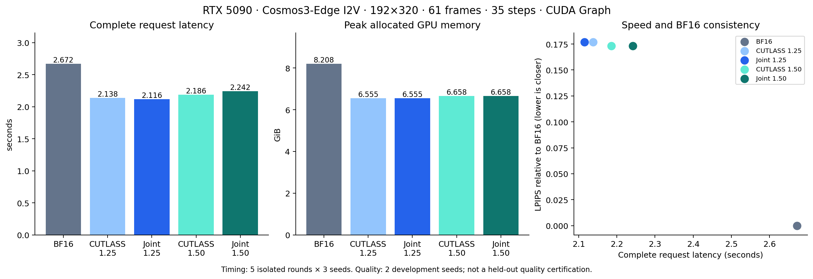
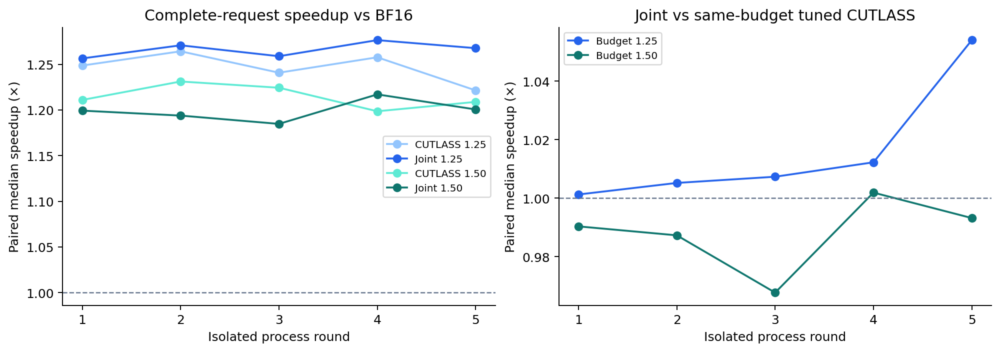
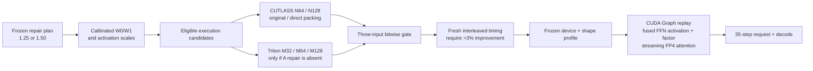

# Joint execution tuning on RTX 5090

## Measured result

The fastest measured warm configuration is **joint execution at budget 1.25**:
**2.116 s versus BF16's 2.672 s**, or **1.263× complete-request speedup**
(20.8% less latency). Peak allocated GPU memory is **6.555 GiB versus
8.208 GiB**, a 20.1% reduction. Both use CUDA Graph.



| Configuration | Median request (s) | P90 (s) | BF16 / candidate | Peak allocated (GiB) | Choice within budget |
|---|---:|---:|---:|---:|---|
| BF16 Graph | 2.6716 | 2.6965 | 1.000× | 8.208 | Reference |
| Tuned CUTLASS 1.25 | 2.1376 | 2.1870 | 1.250× | 6.555 | Control |
| Joint 1.25 | **2.1155** | **2.1643** | **1.263×** | **6.555** | **Select** |
| Tuned CUTLASS 1.50 | **2.1858** | **2.2447** | **1.222×** | **6.658** | **Select** |
| Joint 1.50 | 2.2416 | 2.2864 | 1.192× | 6.658 | Keep as opt-in experiment |

Each row contains 15 requests: five isolated process rounds × three seeds.
The comparison is entirely end to end; no kernel speedups are multiplied.
Memory is PyTorch's measured peak allocated memory, not total board usage.



Joint tuning adds **1.010×** at budget 1.25 by the ratio of request medians.
Its median paired-round gain is **1.007×**, with a five-round bootstrap 95%
interval **[1.001, 1.054]**. The BF16-relative paired-round interval is
**[1.256, 1.276]**. This is a modest incremental improvement.

At budget 1.50, joint selection takes 2.6% longer than the tuned CUTLASS control
by request medians. Its paired-round speedup interval **[0.968, 1.002]** provides
no evidence of an improvement. **Use the tuned CUTLASS profile for that budget.**
Per-operator graph timing does not guarantee the fastest complete pipeline;
`joint_tuning` therefore remains disabled by default.

All repeated performance outputs were deterministic, all three seeds produced
distinct outputs, and every same-budget joint/control output hash matched on the
three performance seeds. These six additional budget/seed comparisons were not
used for launch tuning. Together with the development trajectories, ten unique
budget/seed pairs preserve the original FP4 output.

This is the best measured choice within this request and candidate set, not a
claim of global optimality or saturated Tensor Core utilization.

## Experiment boundary

Cosmos3-Edge I2V, one frozen development image/prompt (`robot_observe`),
192 × 320, 61 frames, 35 denoising steps, CFG 6 with two branches.
Every control uses CUDA Graph. BF16 retains native BF16 projections and
native Flash attention. FP4 uses the unchanged released 1.25 / 1.50 repair
plans and calibrated assets. QK/PV/softmax use streaming FP4 attention;
the new CUTLASS integration covers generation projections and FFNs.

This experiment measures warm, resident **complete requests**: host argument
setup, conditioning, all denoising calls, video decoding, and output conversion.
Model loading, offline preparation, compilation, launch search, Graph capture,
and NPZ serialization are outside that timer. Startup costs are recorded
separately. This is not a cold-start or Nano/Policy result.

## Combined execution path



The search changes execution, not repair supports. CUTLASS accumulates the
base term before activation repair, while the existing native Triton kernel
interleaves activation repair with the base loop. A-repaired operators therefore
stay within CUTLASS. Candidates are checked on the warmup input, an affine
perturbation, and a row rotation. Full trajectories are checked separately.

The strict budget is issued MMA divided by issued base MMA, including padding.
An exploratory launch selection reduced base padding and exceeded the 1.25
ratio by 0.000013097, despite doing less absolute work. That run was rejected.
Frozen-plan search now preserves the M128 anchor's padded M extent. At M960,
this admits Triton M128 with two or three stages, and excludes M32/M64.
It does not lower repair quotas or relax the cap. A future budget definition
using a fixed reference denominator would require an explicit protocol version.

The cost ledger and observed-shape receipts record the actual selected backend,
tile, packing path, and issued work. Tuning profiles bind source, device,
calibration semantics, and offline CUTLASS binary manifests. Partial tuning
checkpoints support recovery; they do not certify a complete request.

## What improved, and what remains

| Whole-request accounting | Tuned CUTLASS | Joint 1.25 | Joint 1.50 |
|---|---:|---:|---:|
| Separate CUTLASS scale-conversion kernel executions | 11,760 | 2,024 | 2,834 |
| Logical reads by those conversion kernels (bytes) | 2,288,025,600 | 248,709,120 | 372,326,400 |
| Transformer calls / graph replays | 70 | 70 | 70 |

The joint choices remove 9,736 / 8,926 GPU conversion executions. These are
**GPU Graph nodes, not CPU Graph launches**. Byte counts are a logical traffic
ledger, not measured DRAM transactions or a latency estimate. Absolute issued
MMA is unchanged from the respective control, as are repair supports and peak
allocated memory. The overall memory saving versus BF16 comes from the existing
FP4 representation; joint dispatch adds no same-budget memory saving.

A separate diagnostic run, after a full warm request, recorded:

| Configuration | Transformer event intervals (ms) | Video encode (ms) | Video decode (ms) |
|---|---:|---:|---:|
| BF16 | 1796.7 | 181.9 | 728.3 |
| CUTLASS 1.25 | 1234.2 | 182.3 | 731.1 |
| Joint 1.25 | 1219.3 | 175.5 | 722.4 |
| CUTLASS 1.50 | 1343.8 | 176.9 | 743.0 |
| Joint 1.50 | 1336.0 | 181.6 | 735.5 |

These diagnostic outputs also match their uninstrumented seed-7103 outputs.
On this measurement, event sums exceed the host timer by 8–72 ms. They are
**non-additive intervals**, possibly including dispatch gaps; they do not define
a CPU residual or exact stage percentages. They never enter the formal timing
table. In particular, the diagnostic's small 1.50 Transformer improvement does
not override the complete-request regression.

The next experiments should prioritize:

- VAE encode/decode execution and fixed-shape Graph/fusion opportunities, with
  the same optimization applied to BF16 controls. Neither codec is accelerated
  by the current projection GEMM changes.
- Whole-phase or full-request validation of dispatch choices. The 1.50 result
  demonstrates that isolated operator timing is an imperfect pipeline objective.
- Further producer/activation/packing fusion where calibration and current-input
  selection remain equivalent. Existing CUTLASS producer/consumer overlap and
  FFN activation-factor fusion are already enabled here.

These are optimization targets, not implemented or measured additional gains.
No power/energy reduction or Tensor Core saturation claim is made.

## Implementation and checks

`RunConfig.joint_tuning` and `--joint-tuning` are opt-in. The implementation
adds mixed backend/tile/packing launch candidates, multi-input equivalence checks,
frozen-budget padding guards, actual-backend accounting, source-bound profiles,
and recoverable tuning checkpoints. `joint_e2e.py` and `summarize_joint.py`
provide the reproducible measurement and audit workflow.

The final GPU regression run passed **218 tests**, including changed-input Graph
replay, repair/no-repair cases, shared weight banks, padding constraints, direct
packing, and the fp4-repair package tests. Existing N64/N128 binaries remain
valid; regenerate execution profiles after updating the Python sources. The
profiles are device-specific and must be retuned on PRO 6000 or other shapes.

## Numerical validation

Both budgets matched their same-budget CUTLASS controls **byte for byte** on
both complete development videos (seeds 7103 and 7104). The joint launch search
therefore preserved the existing FP4 result in these four pairs.

| Frozen budget | Actual issued-MMA ratio | LPIPS vs BF16 ↓ | SSIM vs BF16 ↑ | Relative pixel L2 ↓ |
|---|---:|---:|---:|---:|
| 1.25 | 1.249995995 | 0.176909 | 0.693708 | 0.284695 |
| 1.50 | 1.499997073 | 0.173165 | 0.704371 | 0.280196 |

Quality metrics average two development seeds. Equality refers to execution
optimization versus the same-budget FP4 control. These FP4 outputs remain
different from BF16; this is not evidence of BF16-equivalent quality, a held-out
quality gate, or downstream task success. No held-out quality seeds were used
for execution tuning.

## Reproduction

Use the pinned Diffusers checkout and matching local model, assets, and offline
CUTLASS libraries described in [the preceding 5090 report](CUTLASS_5090_FOLLOWUP_20260914.md).
No toolkit upgrade is required for this run.

```bash
export PYTHONPATH="$PWD/data_local/cutlass_diffusers_20260914/src"
export THUNDERWORLD_PYTHON="$PWD/data_local/e2e_venv/bin/python"
OUT=runs5090/joint_e2e_reproduction
bash tools/kernel_handoff/python5090.sh experiments/cutlass_fused_repair/joint_e2e.py --output "$OUT" --stage tune
bash tools/kernel_handoff/python5090.sh experiments/cutlass_fused_repair/joint_e2e.py --output "$OUT" --stage trajectory
bash tools/kernel_handoff/python5090.sh experiments/cutlass_fused_repair/summarize_joint.py "$OUT" --stage trajectory
bash tools/kernel_handoff/python5090.sh experiments/cutlass_fused_repair/joint_e2e.py --output "$OUT" --stage performance
bash tools/kernel_handoff/python5090.sh experiments/cutlass_fused_repair/summarize_joint.py "$OUT" --stage performance
# Separate optional diagnostics; never included in the performance table.
bash tools/kernel_handoff/python5090.sh experiments/cutlass_fused_repair/joint_e2e.py --output "$OUT" --stage diagnostic
bash tools/kernel_handoff/python5090.sh experiments/cutlass_fused_repair/summarize_joint.py "$OUT" --stage diagnostic
```

The trajectory stage uses development seeds 7103 and 7104. The performance
stage requires those four same-budget trajectory comparisons to be bitwise
identical, then runs five isolated process rounds with three seeds per round
(93001–93003), configuration order shuffled with seed 120. Every timing process
performs one unrecorded complete warm request and checks for other GPU compute
processes. The summary rejects missing profiles, changed inputs or source,
incomplete timers, and nondeterministic repeated outputs.

`--joint-tuning --tune` enables search; `--joint-tuning --tuning PROFILE`
replays it. `benchmark` requires strict profile coverage. Repair budgets,
head quotas, W support, activation calibration, and current-input selectors
remain independently controlled by the frozen plan and assets.

## Evidence and selected configurations

The [evidence bundle](../results/joint_e2e_5090_20260914/README.md) contains
individual measurements, frozen profiles/configurations, source identities,
input manifests, full ledgers, plots, and test output.
[Selected configurations](../results/joint_e2e_5090_20260914/recommendations.json)
map budget 1.25 to `joint125` and budget 1.50 to `cutlass150`. The local complete
experiment is `runs5090/joint_e2e_20260914`.
