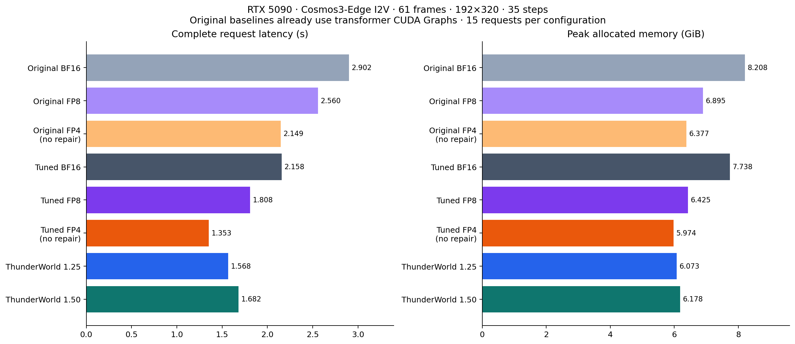
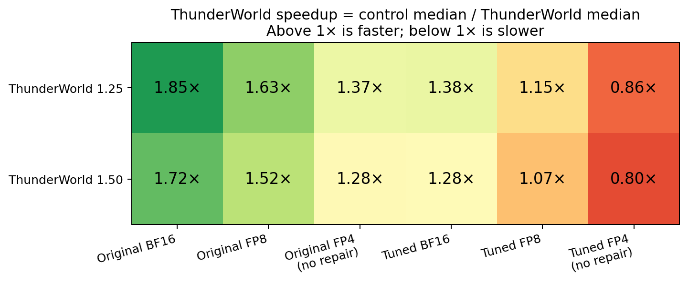
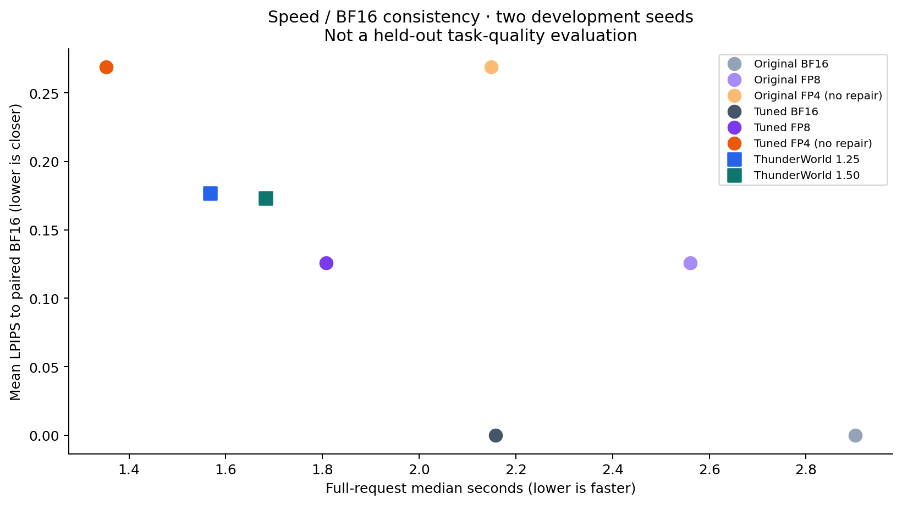

# ThunderWorld versus original BF16, FP8 and FP4 pipelines

**On this RTX 5090 Cosmos3-Edge I2V workload, ThunderWorld budget 1.25 takes 1.5677 s/request:** 1.851× faster than original BF16, 1.633× faster than original FP8, and 1.371× faster than original unrepaired FP4.

The comparison below also gives every baseline the shared pipeline optimizations. This distinguishes an improved inference pipeline from the cost/quality tradeoff of adding FP4 repair. Speedup less than 1× means ThunderWorld is slower than that control.

## What “original” means here

| Path | DM FFN and Q/K/V/output projections | DM attention | Shared pipeline changes |
|---|---|---|---|
| Original BF16 | BF16 | BF16 native Flash Attention | Existing transformer CUDA Graphs and host scheduler; recent flags off |
| Original FP8 | Native E4M3 W8A8; weight per tensor, activation per token | BF16 native Flash Attention | Same original pipeline |
| Original FP4 | Ordinary min-max W4A4; A0W0 only, zero repair | Q0K0 and P0V0, zero repair | Same original pipeline; native Triton linear backend |
| Tuned BF16 / FP8 | Same respective precision and weights | Same respective attention | AR prefill cache, first-frame encode, codec graphs, norm/RoPE/activation fusion, rotary reuse |
| Tuned FP4 | Same ordinary FP4 weights and zero repair | Same FP4 zero-repair attention | Same shared changes; separately selected frozen no-repair backend |
| ThunderWorld 1.25 / 1.50 | Calibrated FP4 base plus budgeted A/W repair | Budgeted FP4 attention repair | Validated tuned pipeline and previously frozen repair plans |

All paths quantize the same eligible **168 DM projections** where applicable. AR layers, video codec and other unconverted components retain their existing higher-precision computation. FP8 is therefore a mixed FP8/BF16 baseline; it is not FP8 attention. Plain FP4 has no calibrated repair. These are the repository's baseline implementations, not a benchmark of TensorRT/ModelOpt or every vendor inference engine. Original BF16 is already graph-enabled, not an artificially slow ungraphed control.

## Full-request speed and memory



| Configuration | Median seconds | P90 seconds | Peak allocated GiB |
|---|---:|---:|---:|
| Original BF16 | 2.9017 | 2.9417 | 8.208 |
| Original FP8 | 2.5603 | 2.5917 | 6.895 |
| Original FP4 (no repair) | 2.1486 | 2.1985 | 6.377 |
| Tuned BF16 | 2.1580 | 2.1757 | 7.738 |
| Tuned FP8 | 1.8081 | 1.8633 | 6.425 |
| Tuned FP4 (no repair) | 1.3530 | 1.3879 | 5.974 |
| ThunderWorld 1.25 | 1.5677 | 1.6048 | 6.073 |
| ThunderWorld 1.50 | 1.6824 | 1.7090 | 6.178 |



| ThunderWorld configuration | vs original BF16 | vs original FP8 | vs original FP4 | vs tuned BF16 | vs tuned FP8 | vs tuned FP4 |
|---|---:|---:|---:|---:|---:|---:|
| ThunderWorld 1.25 | 1.851× | 1.633× | 1.371× | 1.377× | 1.153× | 0.863× |
| ThunderWorld 1.50 | 1.725× | 1.522× | 1.277× | 1.283× | 1.075× | 0.804× |

Workload: one Edge I2V prompt/image, 192×320, 61 output frames, 35 steps, two CFG branches, CFG 6. **120 timed complete resident requests**, eight configurations × five randomized isolated process rounds × three seeds (93001–93003). Every process uses a full warm request, strict frozen profiles, debug off, eight CPU threads and TF32 disabled; GPU idle checks bracket requests. Loading, offline quantization, graph capture and file serialization are excluded. Host request setup, image conditioning, fresh AR work, all denoising steps, decoding and output conversion are included. The environment/source/input hashes are identical across configurations. Clocks were not locked or changed; process-to-process variation is retained in the P90 values and paired round confidence intervals in the summary. A single read-only temperature/clock spot check is archived; it is not an energy measurement.

The tuned plain-FP4 backend was selected as **`fp4_cutlass`** in a separate two-seed development pilot before formal timing. CUTLASS/native full-output equality checks: **[True, True]**. Pilot medians: native 1.3567 s, CUTLASS 1.3097 s. CUTLASS is selected only if exact and at least 3% faster in that pilot; the formal data is not used to select its own winner. Both variants preserve zero repair. Frozen profiles and definitions are archived.

The previous tuning report used a separate run matrix. Use the freshly measured controls above for these ratios; do not multiply speedups across reports or attribute all pipeline gains to FP4 arithmetic.

## Output consistency and the repair tradeoff

**This is not yet a quality-matched win over FP8.** On the two development seeds, ThunderWorld 1.25 has LPIPS 0.1769, versus 0.2688 for plain FP4 and 0.1257 for FP8. Calibration plus repair reduces the plain-FP4 LPIPS discrepancy by 34.2%, but both repaired budgets still have higher LPIPS/relative L2 and lower SSIM than FP8 in this sample. The repair policy needs further quality work before claiming FP8-level consistency.

With shared optimizations enabled on all paths, ThunderWorld 1.25 is 1.153× faster than FP8 and incurs 15.9% more latency than unrepaired FP4. The original-baseline speedups include substantial improvements that also benefit BF16/FP8/plain FP4. The next quality experiment should adjust calibration/repair allocation toward FP8 consistency, then remeasure this same pipeline comparison.



| Quantized path | LPIPS ↓ | SSIM ↑ | Relative L2 ↓ |
|---|---:|---:|---:|
| Original FP8 | 0.1257 | 0.8112 | 0.2382 |
| Original FP4 (no repair) | 0.2688 | 0.5311 | 0.3363 |
| ThunderWorld 1.25 | 0.1769 | 0.6937 | 0.2847 |
| ThunderWorld 1.50 | 0.1732 | 0.7044 | 0.2802 |

These metrics average all frames from two **development** seeds (7103/7104) against the same-seed BF16 videos. They measure BF16 consistency, not ground-truth accuracy, perceptual preference or task success. This is not the repository's reserved eight-seed final quality gate. Original and tuned versions of each baseline preserve the same videos, so they share quality metrics. The quality comparison is computed on CPU after performance measurement and never enters the inference timer.

All baseline tuning changes passed full-video bitwise equality on both qualification seeds. All 120 timed requests pass determinism and exact original/tuned output checks within each precision family; different seeds produce distinct outputs. Both ThunderWorld configurations still match their earlier frozen trajectories. Cross-precision output equality is neither expected nor required: unrepaired FP4 does less arithmetic, and the correction paths add work. ThunderWorld also uses calibrated assets, so the quality difference versus ordinary FP4 combines calibration and repair; this comparison does not isolate their individual contributions.

## Reproduce and inspect

Use the existing local runtime; no toolkit/package update was needed. New scripts prepare native FP8 and ordinary min-max FP4 assets, tune/freeze the FP4 backends, validate trajectories, and run the comparison serially on the local GPU:

```bash
# Prefix each command below with the same local environment:
export PYTHONPATH="$PWD/data_local/cutlass_diffusers_20260914/src"
export THUNDERWORLD_PYTHON="$PWD/data_local/e2e_venv/bin/python"
bash tools/kernel_handoff/python5090.sh experiments/cutlass_fused_repair/baseline_compare_setup.py
bash tools/kernel_handoff/python5090.sh experiments/cutlass_fused_repair/baseline_compare.py --stage qualification
bash tools/kernel_handoff/python5090.sh experiments/cutlass_fused_repair/baseline_compare.py --stage performance
bash tools/kernel_handoff/python5090.sh experiments/cutlass_fused_repair/summarize_baselines.py --stage performance
bash tools/kernel_handoff/python5090.sh experiments/cutlass_fused_repair/summarize_baselines.py --stage quality
```

Scripts keep existing complete run directories on rerun. To collect an independent new cohort, change the experiment output root rather than treating reused files as fresh measurements. Per-job exact commands are in the matrix. Benchmark settings, calibrated ThunderWorld assets and plans are the same as the [pipeline tuning report](NEXT_PIPELINE_TUNING_5090_20260914.md).

Evidence: [summary and paired confidence intervals](../results/baseline_compare_5090_20260914/summary.json), [quality samples](../results/baseline_compare_5090_20260914/quality.json), [full receipts](../results/baseline_compare_5090_20260914/receipts.json.xz), [configuration definitions](../results/baseline_compare_5090_20260914/configs.json), [native FP8 binary/runtime fingerprints](../results/baseline_compare_5090_20260914/runtime_metadata.json), [matrix commands](../results/baseline_compare_5090_20260914/performance_matrix.json), [qualification](../results/baseline_compare_5090_20260914/qualification_summary.json).
