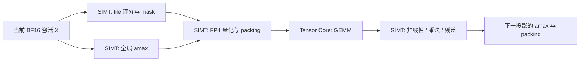
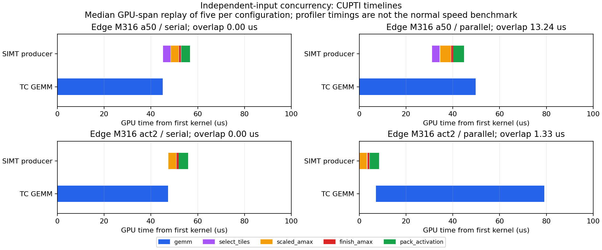

# 可调参数、主要档位与 SIMT / Tensor Core overlap

日期：2026-09-11。对象：本机 RTX 5090、Cosmos3-Edge / Nano 的 Generator。
依据：当前代码、[自动预算实测](AUTO_BUDGET_5090_20260910.md)、[此前完整 Graph 对比](COSMOS3_E2E_5090.md)，以及本轮独立任务并发探针。

**各主档位都没有证据表明已到性能极限。当前完成的是有限搜索空间内的 launch 调优；完整执行图、SIMT 融合、GEMM 主循环及 warp 分工仍有空间。**
SIMT 与 Tensor Core overlap 是可行的设计方向，但必须先满足数据依赖，并给寄存器、shared memory 和访存留出资源；不能把低 Tensor pipe 活跃度直接当作可免费填入的空闲算力。

## 1. 当前到底能调哪些参数

### 1.1 推理与精度参数

| 参数 | 当前入口 / 范围 | 作用和当前限制 |
|---|---|---|
| 模型与任务 | `run.py --model edge/nano --cases ...` | Edge 为 ReLU² FFN，Nano 为 SwiGLU FFN；Nano 另有 AV。任务改变 M、CFG 和质量目标 |
| 去噪步数 | `--steps`，本轮固定 35 | 直接改变请求算量和生成质量；不能通过减少步数来声称 kernel 加速 |
| 输出长度/分辨率、CFG | case/pipeline 配置；并非本 runner 的通用命令行开关 | 改变 token 数、M 与分支数，需要重新校准和调优；本轮 I2V M960、policy M316、Nano AV M1024 |
| FFN 修复档位 | `--modes`：`ffn_base / ffn_act2 / ffn_wgt2 / ffn_dual / ffn_uniform25 / ffn_uniform75 / ffn_auto25/50/75` | 自动档位的范围见下一表；各模式需要匹配入口，不是所有工具通用的 preset 名称 |
| A/W 分配 | `--budget-policy` 中每个任务×层×phase×CFG 的 assignments | 当前 A 支持为 0/50%/100%，W 为 0/100%；不是连续的任意百分比动态内核 |
| 总预算 | 编译器当前生成 25%/50%/75% | 指双一阶修复的额外产品 FLOPs 比例；不等于整个模型的算量、时间或显存比例 |
| phase 边界 | `dynamic.BOUNDS=(0,.2,.5,.8,1)` | 编译器和 runtime 必须一致，修改需要重新编译策略；35 steps 对应 7/11/10/7 步 |
| A 下限 | `guard_policy.py` 当前固定半量 A | 避免无 A 修复单元造成的风险；25% 总预算被下限用满，等价于 uniform25 |
| 在线 tile 排名 | 当前激活采样 energy；每 M128/K128 block 取 8×8 个元素 | GPU 上生成 mask；采样密度和评分方式是代码参数，改变会影响质量，尚未证明 energy 最优 |
| 质量门控 | `quality_gate.py --ssim-drop .02 --lpips-increase .01 --error-ratio 1.05 --error-slack .001` | 离线逐任务验收，失败回退同预算均匀参考；临时工程容差，不是产品质量标准，也不在每一步在线调用 BF16 teacher |
| 首轮量化 / prescale | 本轮 RTN + identity prescale | 新 bulk-fit、修复感知 scale、非 identity prescale 尚未纳入这套自动预算资产 |
| attention | 本轮 BF16 Flash SDPA | 独立实验 API 可调 `coverage / terms / head_budgets / query_tile / splits / lazy_p / fast_p / transpose_v`；不属于当前自动 FFN 预算的推荐路径 |
| step 间复用 | 另有 mask / repair-delta / output 的研究模式 | 会改变精度或时序语义；与本轮同一次 forward 的共享打包不同，不能默认叠加收益 |

入口为 [finding_resample/run.py](../tools/finding_resample/run.py)、[自动预算代码](../tools/auto_budget/dynamic.py)、[独立包配置](../packages/fp4-repair/src/thunderworld_fp4/config.py)。
`seed / rounds / sample` 属于实验控制和测量参数；head sampling 会增加开销，不应与部署测速混用。

### 1.2 执行参数

| 参数 | 最新自动预算实际使用 | 尚可搜索 / 需要改代码的范围 |
|---|---|---|
| M tile `bm` | 32/64/128，按真实 M:N:K 和 tier 查表 | 已扫描，仍会受主循环结构影响；不是一次搜索后永远最优 |
| `num_stages` | 搜索 2/3 | Native 接受 1/2/3/4；更深流水可能增加寄存器/shared memory，不能只向上调 |
| `num_warps` | 固定 4 | Native 接受 4/8，但最新 policy launch 查表只读取 bm/stages，需扩展实验及 runtime 才能接入 8 |
| N tile | 固定 128 | N64 等需要改 GEMM/布局，减少累加器寄存器并增加 CTA，同时可能损失复用 |
| K repair block / GEMM K tile | 当前均为 128 | Native 有 K64/128/256 实验能力；本动态选择、mask 和配额按 K128 编写，不能直接替换一个常量 |
| FP4 scale group | 每 16 个数一组 | 与 K128 修复 block 是两层概念；改变 scale group 会改变表示/指令格式 |
| A 修复循环 | `interleave=True` | 现有 A0W0 与 A1W0 在 K 循环内交错复用 W0；不是 SIMT/TC producer-consumer overlap，也不是显式 warp specialization |
| W 修复循环 | 主循环之后单独遍历 W1 | 即使全 W 修复仍走已有 residual-bank 索引；可做 dense-W1 特化、减少地址和重复 A0 装载，但累加次序变化要验质量 |
| Split-K | 本轮固定 1 | Native 支持 1/2/4/8；此前局部小误差在完整轨迹放大，不能仅凭算子测试恢复为默认 |
| gate/up 共享打包 | Nano 可选 `--share-ffn-pack` | 已通过 36 档位组合和完整轨迹一致性；算子收益 0.5%–3.6%，eager 端到端未证明稳定收益 |
| CUDA Graph | 最新动态预算：算子 Graph、完整 Generator eager | 固定 ACT2 另有全 Transformer Graph；动态 phase-aware Graph 尚未接入，不能直接复用旧缓存键 |
| 多 stream / warp specialization | 当前模型 runtime 未启用 | 本轮仅做独立任务 probe；完整调度和内核结构仍需实现和验证 |

最新六档×形状搜索检查了 360 个候选，其输出与原 launch 差为零。这里的结论只覆盖所测形状和候选。
历史 `a75 / a75_w6 / a93_w6` 是另一套离线稀疏 W 支持实验；attention 的 `balanced / quality` 也不等同于这里的 auto50/75。

## 2. 四个主要预算档位

令 A/W 的修复比例为 pA/pW，额外预算比例为 ρ=(pA+pW)/2，则 FFN 乘积数约为 **1+2ρ**。
这不包含选择、packing、非线性、attention 或调度。两个修复平面 W0/W1 在当前动态 runtime 中常驻。

| 档位 | 均匀参考 | FFN 产品数 | 最值得优先优化的部分 | 到极限了吗 |
|---|---|---:|---|---|
| 25% | a50：A0W0 + 半量 A1W0 | 1.5× | selector/packing 占比、较短 GEMM 的启动开销、规则支持和小 M 并行度 | 没有；选择开销可吃掉少算的收益 |
| 50% | act2：A0W0 + A1W0 | 2× | A0/A1 与 W0 的数据复用、量化融合、主循环流水、phase Graph | 没有；全 A 避开 selector，有时反而比 a50 快 |
| 75% | a50w：半量 A + 全量 W | 2.5× | selector 与 W1 循环并存，dense-W1 特化、减少 A0 重读、资源占用 | 没有；复杂分支使名义预算与耗时不成正比 |
| 100% | dual：全 A + 全 W | 3× | 规则稠密多产品主循环、warp ping-pong、累加器寄存器、Epilogue 融合 | 没有；SIMT 占比下降后更依赖 GEMM 本身改造 |

自动档位会在各单元混用六种 tier，不能用一个 a50/act2 kernel 的效率代表整条自动策略。
100% 对应 `ffn_dual`；当前没有单独编译的 `auto100`。A1W1 cross 不在这四个预算档位中。

以下是上一轮**完整 down 算子** CUDA Graph 延迟，包含选择和 packing，单位 μs：

| 模型 / M / N / K | 25% a50 | 50% act2 | 75% a50w | 100% dual |
|---|---:|---:|---:|---:|
| Edge / 316 / 2048 / 9216 | 54.58 | 54.20 | 90.34 | 88.86 |
| Edge / 960 / 2048 / 9216 | 95.22 | 111.16 | 144.82 | 156.96 |
| Nano / 316 / 4096 / 12288 | 85.59 | 91.93 | 134.93 | 140.94 |
| Nano / 960 / 4096 / 12288 | 201.77 | 274.35 | 324.92 | 403.95 |

来源：[全部 60 组记录](../results/auto_budget_20260910/kernels.csv)。Edge M316 的微小倒序不应解释为稳定的统计优势，但足以说明“少 0.5 个乘积必定更快”不能作为选档依据。
已有 M/stages 调优在 Edge 小 M down 上最高约 2.05×、Nano 约 1.67×；大形状部分候选差异很小或有测量波动。

## 3. 现有 profiling 能证明什么

8 组代表性 down-projection profile 只覆盖 a50/dual 和 M316/960；**没有为每个 tier、每层、每个算子测完整硬件计数器**。
这些 GEMM 的 Tensor pipe elapsed-cycle 活跃度为 14.2%–44.6%，warp occupancy 为 8.2%–22.4%，部分配置每线程 254 个寄存器。
GEMM DRAM throughput 指标约 10.5%–21.5%，所测 local-memory load/store sectors 为零。
这些证据不足以归因为“显存带宽已打满”，也不足以把低 occupancy 单独诊断成寄存器限制：还需看 grid wave、shared-memory 限制和 issue/stall 分解。
Tensor 活跃度不是 FP4 理论 FLOP 峰值百分比，不能用 100%/当前活跃度预测还能加速几倍。

从 Nsight replay 的时长看，非 GEMM 阶段占该算子约 8.9%–27.9%。设其占比为 p，在 GEMM 完全不变且非 GEMM 全部免费隐藏的理想模型里，加速为 1/(1-p)，即约 **1.10–1.39×**。
这只是对那组 replay 时长的理想演算；存在数据依赖、同步与资源竞争，不能作为生产加速预测。Nsight replay/cache control 与稳态 Graph 计时也不能混为一组相加。
真正的整模型上限还取决于 FFN 的耗时占比、BF16 attention、QKV/out、VAE 和启动间隙；目前没有动态策略的完整 Nsight Systems 时间线，不能声称 FFN 的算子加速可等比例转化为 E2E 加速。

## 4. SIMT 与 Tensor Core 怎样 overlap 才有意义

### 4.1 先看依赖，而不是先开 stream

本实现中，评分和 amax 只依赖 X，可以融合采样/统计或研究并行；packing 要等 mask 和 factor，GEMM 要等相应 packed tile。
GEMM 后的非线性又决定下一投影输入，所以同一份数据整链不能简单分配到两个 stream 就得到重叠。
同一 warp 的 SIMT 指令与依赖其结果的 MMA 也不能任意并行；可利用的是独立 tile、独立 warp 或独立工作项。
多 stream 提供并发机会而非保证，事件必须表达真实依赖。[CUDA 12.9 并发与 stream 说明](https://docs.nvidia.com/cuda/archive/12.9.1/cuda-c-programming-guide/index.html#concurrent-kernel-execution)。

### 4.2 有实际实现价值的四条路线

| 路线 | 怎样重叠或减少工作 | 适用位置 | 关键限制 |
|---|---|---|---|
| warp 分工与双缓冲 | producer warps 预取/整理下个 K tile，consumer warps 对当前 tile 发 MMA；ping-pong 让不同输出 tile 的 mainloop/epilogue 重叠 | 较长 GEMM，尤其规则 act2/dual | 当前只是 Triton `dot_scaled` + stages，不是显式这套结构；更多缓冲可能加重资源压力 |
| epilogue / 前处理融合 | GEMM tile 完成后处理非线性和局部统计，减少中间写回；后续 packing 读取更少中间张量 | Edge ReLU²；Nano gate/up→SiLU×up；down 前处理 | 必须保持既有 BF16 舍入点；全局 amax 仍是跨 tile 依赖 |
| 分块 producer-consumer | 已有完整 factor/mask 后，对 M chunks 双缓冲：pack 第 j+1 块时算第 j 块 GEMM | 单请求的大 M，或较长生产阶段 | chunk 太小会减少 GEMM 并行度、增加事件/launch；不得在每 chunk 重算 global amax 后宣称数值等价 |
| 独立工作项并发 | 当前请求/CFG 分支的 GEMM，与另一独立工作项的 SIMT producer 并发 | 多请求吞吐；可拆分的 CFG 工作 | 显存、cache/带宽竞争与尾延迟；pipeline/controller 状态需隔离，不能直接并发调用现有共享对象 |

5090 是 SM120。NVIDIA 的 SM120 文档明确列出 warp-level `mma.sync` 与 ping-pong/cooperative 调度；ping-pong 可在不同输出 tile 间重叠 mainloop 与 epilogue。
因此这个方向有硬件与库实现依据，但不能直接把 SM100 的 `tcgen05`/Tensor Memory、multicast 路径作为 5090 的实现方案。
现有 NVFP4 支持的具体 tile/scale 布局仍要遵循 SM120 约束。[CUTLASS SM120 说明](https://docs.nvidia.com/cutlass/latest/media/docs/cpp/blackwell_functionality.html#blackwell-sm120-gemms)。

两个需要特别处理的情况：

- **Nano gate/up**：两者输入相同，优先考虑共享读取/打包、配对或 grouped GEMM 与 SiLU×up 融合；简单两个 GEMM 并发会争用相同 Tensor Core。若合并为一个更大 N GEMM，不同 gate/up 预算、W factor 和输出布局仍需分别处理。
- **base / repair 分离**：A0W0 与 A1W0/A0W1 的数学乘积可拆开，但会增加输出存储、归并和同步，可能丢失当前共享累加器/数据复用；FP32 求和顺序也会变化。不能把“能并行”直接等同于“会更快且质量不变”。

### 4.3 本机新增的双 stream 探针

用已有真实权重/激活 payload，测 **已打包输入 X 的 GEMM** 与 **另一独立输入 X′ 的 selector+packing**。
两路使用独立输入和 mask，只有只读 prescale/权重共享；串行与并发两组都做同样的两项工作。
每配置五次交替顺序 CUDA Graph 测量，每次约 20 ms，输出 GEMM、量化码、scale 和 factor 均逐位一致。

下表为 `串行时间 / 双 stream 时间`，大于 1 才表示更快：

| 模型 / M / down | a50 | act2 | a50w | dual |
|---|---:|---:|---:|---:|
| Edge / 960 | 1.072× | 1.040× | 1.042× | 1.027× |
| Edge / 316 | 1.098× | 0.728× | 1.055× | 0.707× |
| Nano / 960 | 1.020× | 1.028× | 1.015× | 1.025× |
| Nano / 316 | 1.056× | 0.765× | 1.032× | 0.761× |

例如 Edge M316 act2 从串行 55.01 μs 变为双 stream 75.60 μs，五次并发测量约 75.4–75.7 μs；这不是用平均值掩盖单次离群点。
更大的 M 有小幅收益，但小 M 的全量修复可能明显变慢。资源竞争、调度与缓存行为均是待分解原因，不能仅据此确定是哪一种硬件限制。

这是独立工作项的并发可行性实验，**不是同一输入的 pack→GEMM，也不是完整 FFN 或整模型加速**。
算子 launch 使用上一轮所选配置，未为双 stream 重新调参；不能把本探针最差结果解释成 warp specialization 或所有 overlap 策略不可行。
微基准输入由捕获的 64 行扩展到真实 M，用于执行成本分析，不作为新的模型质量样本。
原始五次样本和源码哈希见 [overlap_probe.json](../results/parameter_audit_20260911/overlap_probe.json)；可复现脚本为 [probe_overlap.py](../tools/auto_budget/probe_overlap.py)。

随后用现有 PyTorch/CUPTI 记录 Edge M316 a50/act2 的串行和并发各五次 Graph replay，确认双 stream 的 GPU kernel 时间区间确实存在交叠，串行组没有交叠。
这证明任务层面的 overlap，并不直接证明同一 SM 上 SIMT 与 Tensor 指令同时运行；kernel 时间线与硬件 pipe 计数器是不同证据。
下图选择每配置五次 replay 中 GPU 总区间居中的一次，完整五次数据都保留在 [trace_analysis.json](../results/parameter_audit_20260911/trace_analysis.json)。
act2 的代表性并发 trace 中，量化与 GEMM 只部分重叠，同时 GEMM 持续时间变长，说明观察到 overlap 本身不足以证明总延迟会下降。

时间线包含 profiler 开销，正式速度仍取前面的无 profiler 五次交替测量。
本机 `/usr/bin/nsys` 为 2022.4，生成了原始 QDSTRM，但缺少 importer，未生成可用的 Nsight Systems 报告；该失败记录保留，未用于结论。
本次分析通过 PyTorch/CUPTI 完成，无需为这些结果更新 Toolkit。若后续要常规使用 Nsight Systems UI，应另行安装包含匹配 importer 的完整发行包。

## 5. 优先级与验收方式

后续实现与实测已单独记录于 [CUDA Graph、FFN 融合与双缓冲报告](GRAPH_FUSION_5090_20260911.md)。下面保留本轮审计时的优先级；独立 overlap 探针与后续真实依赖 pipeline 的结果不能混用。

1. **先给动态预算接完整 Transformer Graph**：按任务、phase、CFG、策略和 shape 建图，并复制当前输入/timestep。旧 Graph cache 的键没有本预算的 phase 语义，直接套用会冻结捕获时的档位；还需处理计数、缓存容量及显存。验证阶段边界两侧输出、mask 和实际预算，然后共同 Graph 对比 BF16/均匀/自动。
2. **先减少工作，再尝试掩盖开销**：量化全局统计、支持选择、非线性与中间写回的融合；prescale=identity 的路径可研究专用化。保持量化 factor、支持和 BF16 舍入语义，否则进入质量重验。
3. **针对形状改主循环**：小 M 优先 N/M tile、累加器与 CTA 数；大 M/长 K 优先数据预取、W/A 复用和 ping-pong。针对规则 act2/dual 与部分修复分别特化，不强求一个 kernel 覆盖所有档位。
4. **再落实 overlap**：本轮独立生产/GEMM 对照已完成，下一步是有真实依赖的 chunk pipeline 或完整 FFN；用可用的 CUPTI 时间线工具观察并发和空隙，正常运行下测尾延迟/吞吐。不能用 kernel replay profile 来证明跨 kernel 的并发收益。
5. **量化与质量继续推进**：完整 M scale/支持上下文及轨迹敏感度校准，修复感知首轮量化、稀疏 W1 资产；这些改变质量/工作量，应与相同数学计算的 kernel 加速分别报告。

共同验收：相同模型/输入/seed/steps/预算，保存实际执行档位和输出；数值等价改造检查完整轨迹一致性，累加/scale/支持变化检查视频、action 与音频；所有 packing、selector、同步、归并都计入时间。
没有证据支持继续盲目增加 stages、默认启用 Split-K，或仅为提高利用率而计算更多 repair。目标应是满足质量约束的请求延迟/吞吐，而非某个计数器接近 100%。
