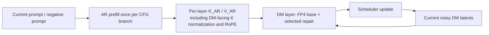

# Why convolution, copies, and higher precision remain expensive

Subsequent result: [AR caching is now tested end to end](AR_CACHE_AND_PIPELINE_5090_20260914.md), with local GPU execution restored. The codec/norm candidates in this earlier snapshot remain separate pending experiments.

The remaining cost is partly real video reconstruction and partly repeated work that the current integration has not eliminated. The new priorities are **AR prefill/cache**, **encoding only the conditioning frames actually used**, and **fusion of tensor conversions and pointwise chains**. These opportunities come from the pinned implementation and the existing full-request trace; their speedups have not yet been measured.

## What the BF16 / FP32 GEMMs actually do

The earlier 176.9 ms category was based on kernel names. Matching the fixed execution order across all 70 Transformer calls gives a more useful breakdown:

| Role | GPU kernel time per request | Precision / purpose |
|---|---:|---|
| AR FFN, including split-K reduction | 98.3 ms | BF16 up/down linear layers for the understanding prefix |
| AR Q/K/V and output projections, including split-K reduction | 60.4 ms | BF16 understanding attention projections |
| Timestep embedding MLP | 11.7 ms | Two FP32 linear layers; checkpoint keeps `time_embedder` in FP32 |
| Vision input/output projections | 1.8 ms | BF16 adapters outside the replaced DM layer targets |
| Rotary frequency matrix calculation | 0.09 ms | FP32 position/frequency calculation |
| VAE convolutions dispatched as BF16 GEMM | 4.7 ms | CPU correlation identifies `aten::cudnn_convolution` |
| **Total** | **176.9 ms** | |

This attribution is **inferred from source order**, with assertions that every Transformer call has exactly 170 BF16 GEMMs and three FP32 matrix operations. Each call contains vision input projection, 28 × six AR linear layers, and vision output projection; timestep and rotary math have distinct FP32 kernel signatures. Split-K kernels are associated with the preceding source GEMM. It is not a module-annotated profile. Codec attribution additionally uses the profiler's external-ID link to the CPU convolution operator. See [auditable role measurements](../results/pipeline_5090_20260914/source_roles.json) and [analysis script](../experiments/cutlass_fused_repair/analyze_pipeline_roles.py).

**The 158.7 ms AR cost is not BF16 execution of FP4 repair terms.** The runtime replaces only `mlp_moe_gen` and `add_q_proj/add_k_proj/add_v_proj/to_add_out`: 168 DM linear modules. AR linears remain ordinary BF16 layers, and causal AR attention remains BF16 FlashAttention. Its approximately 14.0 ms is counted in the attention category, outside the table above.

The FP4 base and selected `W1A0` / `W0A1` products use FP4 operand MMA. CUTLASS shares their FP32 accumulators and writes a BF16 result in one epilogue. Thus FP32 accumulation inside an FP4 Tensor Core kernel is already included in the **275.8 ms FP4 GEMM category**; it is not an extra FP32 GEMM in the table above.

| Operation in iterFP4 | Current representation | Why |
|---|---|---|
| Stored base/residual weights and packed activations | FP4 codes plus scales | Native low-precision matrix multiplication |
| Base and repair matrix products | FP4 operands, FP32 accumulation | Sum many products without accumulating in FP4 |
| Linear output / residual stream | BF16 | Interface to residual addition, normalization, activation, and subsequent quantization |
| Scale estimation and activation residual formation | FP32 local arithmetic, BF16 rounding where required | Preserve small errors when computing `A − reconstructed(A0)`; then encode residual as FP4 |
| Attention softmax, running max/denominator, partial-result merge | FP32 arithmetic within attention kernels | Stable exponentials and reductions across tiles |
| RMSNorm | FP32 statistics and normalization, BF16 output | Preserve normalization behavior |
| VAE | BF16 convolution inputs/outputs with higher-precision accumulation in observed kernels | Not converted to iterFP4 by this integration |

Residual formation does reconstruct FP4 values locally inside the quantizer to measure error. It does **not** imply materializing a dense dequantized weight matrix and running the repaired DM GEMM in BF16. A precise project claim is “FP4 base and correction matrix products with higher-precision accumulation and nonlinear processing.” The complete pipeline is not entirely FP4.

## Why convolution costs so much

The model uses a Wan video VAE to turn latent predictions into pixels. This is a separate neural network from the Transformer and runs outside the DM iterFP4 replacement.

| Codec stage | Explicit cuDNN convolution symbols | Convolution lowered to GEMM | Movement / layout category |
|---|---:|---:|---:|
| Encoder | 90.6 ms | 0.5 ms | 19.3 ms |
| Decoder | 442.8 ms | 4.2 ms | 97.0 ms |

**Large feature maps and wide channels.** The latent is `[1,48,16,12,20]`, while the output is `[1,3,61,192,320]`. The decoder expands both time and spatial resolution through many residual blocks. The configuration uses decoder base width 256, versus encoder base width 160, with channel multipliers `[1,2,4,4]`. The decoder therefore processes substantial intermediate feature volumes even though it runs only once per request.

**Causal chunking.** The decoder processes 16 latent time chunks, carrying convolution feature caches. The encoder similarly uses the first frame and then four-frame chunks. Caches require cloning, temporal concatenation, and padding around convolutions. This creates many small kernel dispatches and intermediate reads/writes. Combining time chunks indiscriminately would change causal behavior.

**Spatial overlap in the decoder.** The runner enables VAE tiling. For this request, the decoder's latent plane is 12×20, its tile width is 16, and its stride is 12. It decodes 12×16 and 12×8 tiles, blends their overlap, and joins them. Total input tile area is 288 versus 240 unique latent positions: **1.20× area**. This is not a FLOP ratio or a speedup prediction; boundary effects and kernel selection also matter. Disabling tiling or raising the threshold can change boundary outputs, so it needs a quality comparison and peak-memory measurement.

The encoder is different: patchification reduces its spatial input to 96×160 before the tiled loop. That fits in one tile. **There is no spatial tile overlap in this encoder sample**, despite entering the tiled encode code path.

**These convolutions already use Tensor Cores.** The observed cuDNN names include BF16 tensor-op convolution kernels. Their cost is not evidence that they fell back to scalar convolution. The trace provides timing, not utilization or bandwidth counters, so it cannot establish whether each shape saturates the GPU.

The codec graph pilot reduced host dispatch gaps and component latency. It leaves the convolution arithmetic and overlapping tile work intact. Reducing convolution cost requires a different intervention: remove unused encoder work, tune tiling/layouts, improve convolution shapes, or evaluate lower-precision VAE kernels with codec-specific quality checks.

## Why the “copy / layout” category is large

It contains **234.7 ms across 71,994 kernels**, not 234.7 ms of PCIe transfers. These are principally device-side casts, copies, concatenations, fills, layout conversions, and upsampling. Explicit CUDA memcpy events are accounted separately in the trace.

| Repeated pattern | Measured kernel time | Source-level explanation / action |
|---|---:|---|
| Transformer float-related copy kernel family | 64.9 ms | 27,720 calls; consistent with repeated RMSNorm activation/weight conversions. Exact module attribution requires additional markers |
| Transformer BF16 conversion family | 21.1 ms | 14,070 calls; mostly compatible with normalization output conversion plus other casts |
| Transformer 3D BF16 concatenation family | 25.7 ms | 9,800 calls = five `_rotate_half` concatenations × 28 layers × 70 calls; source-order/count attribution |
| Other Transformer BF16 concatenation family | 5.2 ms | Includes joining AR and DM K/V for generation attention |
| cuDNN NCHW→NHWC conversion | 50.9 ms | 6.5 ms encoder + 44.4 ms decoder |
| cuDNN NHWC→NCHW conversion | 5.7 ms | 1.4 ms encoder + 4.3 ms decoder |
| Codec BF16 direct-copy family | 36.4 ms | 7.4 ms encoder + 29.0 ms decoder; source includes cache copies, padding, and tensor movement |

The table highlights kernel families and is not an exhaustive partition. Multiple source operations can share a kernel name.

Normalization currently computes `float(x) → square → mean → epsilon/rsqrt → multiply → float(weight)/multiply → BF16`. The high-precision math is useful, but writing each intermediate to global memory is often avoidable. The prepared RMSNorm fusion targets those materializations. Similarly, `_rotate_half` creates a temporary concatenated tensor; a fused RoPE kernel can load both halves directly and produce the rotated output without storing that temporary. BF16 intermediate rounding must be preserved if exact trajectories are required.

The VAE stores and manipulates channels-first tensors while some selected convolution paths convert to channels-last internally. A sustained compatible layout could reduce conversions. Adding `contiguous()` or changing memory format at every convolution boundary would instead add more work. The experiment must cover normalization, causal caches, padding, upsampling, convolution, and final reconstruction together.

CUDA Graph replay reduces host launches but preserves individual kernel nodes and their global-memory traffic. Consequently, graphing alone cannot remove these costs. Conversely, these times do not prove DRAM bandwidth saturation: many kernels last only a few microseconds and can be limited by execution/dispatch overhead as well as traffic.

## Two stronger opportunities than blanket precision reduction

### Cache the invariant AR pathway once per branch

For the current I2V request, `und_len` describes the text prefix. Vision tokens begin after it; changing latent tokens and timestep embeddings enter the generation region. AR attention is causal and reads only AR K/V. Each AR layer consequently depends on its prompt, preceding AR layers, model weights, and static positions—not on DM denoising progress.



An exact implementation would compute and retain the per-layer AR keys/values separately for conditional and unconditional branches, then execute only DM work across the 35 steps. The AR output of each layer is needed to build the next layer during prefill, but need not be recomputed for every DM step. The current implementation reruns it 70 times.

This could remove most repeated **158.7 ms AR GEMM/reduction work**, plus repeated AR attention, norms, RoPE, and activations. These are costs of the current path, **not measured savings**; prefill, cache reads, graph integration, and validation remain. Scope the cache to the current request and branch, invalidate it when prompt/positions/weights change, and check complete trajectories. It must preserve the separately normalized AR keys used by DM attention. Dynamic AR generation or a model with reverse DM→AR dependence would require a different cache policy.

This is exact reuse of a mathematically invariant prefix under the stated conditions. It is different from approximating a changing DM tile with its previous-step output. AR caching is a higher-priority experiment than overlapping the same repeated AR computation with DM kernels.

### Encode only the latent conditioning actually consumed

For single-image I2V, the pipeline repeats the image into a 61-frame clip, encodes all 16 latent frames, then constructs the initial latent using:

```text
mask * encoded_video + (1 - mask) * seeded_noise
```

Only `mask[0]` is set for this request. The other 15 encoded latent frames are discarded. The causal VAE makes a first-frame-only encoding a strong candidate for producing the required first latent, while the remaining latent positions can be initialized directly from noise.

The implementation must preserve the full latent shape, exact RNG draw shape/order, masks, spatial tiling behavior, dtype conversions, and scheduler inputs. Validate that the retained first latent and final output match the reference. This optimization is specific to the conditioning pattern; it does not justify truncating multi-frame/video conditioning indiscriminately. It targets the current encoder's **123.8 ms total kernel work**, but the first-frame encode and tensor setup still remain.

## Recommended order

1. Validate exact AR prefill/cache and first-frame-only I2V conditioning. These remove repeated or discarded work without reducing the repair budget.
2. Complete codec graph and RMSNorm fusion validation; then fuse RoPE and calibrated activation/prescale/amax chains.
3. Compare decoder tiling thresholds and a consistent codec memory layout, recording both quality and peak memory.
4. Reprofile. Only then tune the remaining shapes, evaluate independent-kernel overlap, or extend iterFP4 to the VAE. Lower-precision VAE evaluation needs reconstruction and temporal-quality tests of its own.

Apply equivalent pipeline optimizations to the BF16 baseline when reporting ThunderWorld's FP4 speedup. Use the existing trace for prioritization, not as an end-to-end speed prediction. This analysis added no new GPU timings and does not validate the previously pending GPU candidates.

## Source anchors

The inspected Diffusers checkout is pinned to `77c13f8a49c457f10a89862bb129bdc930b88929` under `data_local/cutlass_diffusers_20260914/src/diffusers/`.

- `models/transformers/transformer_cosmos3.py`: processor projections/causal attention (lines 61–122), RoPE (125–161), Nemotron RMSNorm (164–175), decoder-layer residual/FFN flow (358–370), FP32 timestep module (473–474), region assembly (720–792).
- `pipelines/cosmos/pipeline_cosmos3_omni.py`: repeated-image conditioning (858–878), latent mask/noise mixture (935–953), static vision segment starts after text (1568–1580), step-specific timestep arrays (1703).
- `models/autoencoders/autoencoder_kl_wan.py`: causal concat/padding (166–173), encode/decode chunking (1133–1218), encode tiling (1269–1330), decode tiling (1344–1411).
- [Runtime replacement targets](../packages/fp4-repair/src/thunderworld_fp4/cosmos/engine.py), [FP4 accumulator/epilogue types](../packages/fp4-repair/src/thunderworld_fp4/cutlass/fused.cu), [activation residual quantization](../packages/fp4-repair/src/thunderworld_fp4/_quantize.py), [attention FP32 statistics](../packages/fp4-repair/src/thunderworld_fp4/_kernels.py).
- [Original profile and optimization report](PIPELINE_OVERHEAD_5090_20260914.md).
