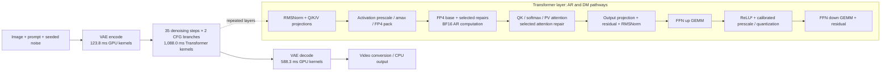
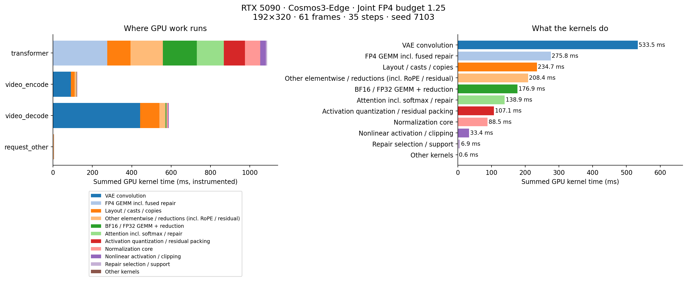

# RTX 5090 inference pipeline: measured overhead and optimization candidates

Subsequent result: [AR caching is now tested end to end](AR_CACHE_AND_PIPELINE_5090_20260914.md), with local GPU execution restored. The codec/norm candidates in this earlier snapshot remain separate pending experiments.

**There is substantial room beyond FP4 GEMM.** In the current best budget-1.25 configuration, FP4 linear GEMM—including fused repairs—accounts for **15.3% of summed GPU kernel time**. Codec convolutions, tensor movement, normalization, and other elementwise operations collectively cost much more. The next useful targets are codec launch overhead and Transformer pointwise fusion.

**Status:** baseline full-request profiling completed and output verified. Codec-only CUDA Graph pilot completed its numerical checks and timings. The final full-request pilot hit an incorrect `DecoderOutput` import; that import is corrected and checked on CPU. Subsequent GPU runs were rejected by the execution approval service because its review model was at capacity. **New end-to-end gains, RMSNorm GPU correctness, and graph memory costs remain unverified.** Both implementation candidates are disabled by default.

## Workflow and measured cost



The layer drawing is schematic: Q/K/V projection and attention have their own quantization/packing boundaries. It does not imply a single quantization stage or that the entire AR pathway uses FP4.



| GPU operation category | Kernel time / request | Share of summed kernel time | Interpretation |
|---|---:|---:|---|
| VAE convolution | 533.5 ms | 29.6% | Largest category; uses cuDNN tensor-core convolution |
| FP4 GEMM, including fused repair | 275.8 ms | 15.3% | 11,760 dispatches = 168 DM linear modules × 70 Transformer calls |
| Layout, dtype casts, copies, concatenation, fills, upsampling | 234.7 ms | 13.0% | Includes norm casts, RoPE concatenation, codec layout conversion |
| Other elementwise operations / reductions | 208.4 ms | 11.5% | Includes normalization multiplies, RoPE, residual adds, scheduler math |
| BF16 / FP32 GEMM and GEMM reduction | 176.9 ms | 9.8% | Remaining high-precision pathways; includes fused GEMM epilogues |
| Attention, including softmax and fused repair | 138.9 ms | 7.7% | Streaming FP4 attention and BF16 attention; cannot split fused internals from this trace |
| Activation quantization / residual packing | 107.1 ms | 5.9% | Prescale/amax, FP4 pack, residual pack, scale-layout conversion |
| Normalization core | 88.5 ms | 4.9% | Mean/power/rsqrt and codec norm reductions; surrounding casts/multiplies are above |
| Standalone nonlinear activation / clipping | 33.4 ms | 1.9% | ReLU² constituents, SiLU, clipping; excludes activation fused into GEMM |
| Repair selection / support | 6.9 ms | 0.4% | Online tile choice and support union are a small measured cost |
| Other kernels | 0.6 ms | <0.1% | Remaining miscellaneous kernels |

Categories are mutually exclusive by kernel name. They **do not** imply module-exclusive accounting: generic ATen multiply/copy kernels cannot be uniquely attributed to normalization versus RoPE from names alone. The 88.5 ms normalization row therefore understates the full normalization chain. The classifier and every kernel name/count/time are retained in the evidence.

Within FP4 linear GEMM, **6,124 base-only dispatches cost 137.5 ms** and **5,636 dispatches that fuse base and repair cost 138.3 ms**. The latter includes its base computation; it is not a measurement of incremental repair cost, and the different shapes prohibit subtracting the two totals.

## Launch and scheduling overhead

| Trace measurement | Value |
|---|---:|
| GPU kernels in one complete request | 323,857 |
| Transformer kernels | 290,888 |
| Encoder / decoder kernels | 7,815 / 21,018 |
| CUDA Graph launches | 70, all Transformer |
| Explicit kernel launch API calls | 32,969 across three launch APIs |
| Summed GPU kernel duration | 1,804.7 ms |
| Union of GPU kernel, memcpy, and memset intervals | 1,818.5 ms |
| Span from first to last GPU activity | 2,208.5 ms |
| Unoccupied intervals inside that GPU span | 389.9 ms |
| Instrumented CPU request annotation | 2,279.7 ms |

The unoccupied intervals include scheduling, synchronization, dependencies, and profiler perturbation. They are **not all removable CPU overhead**. CPU time and GPU time overlap and are not added. Interval-union and summed-kernel totals agree within timestamp rounding, indicating essentially serial device execution in this sample. This does not establish that concurrent execution would help.

## Implemented candidates and observed pilot

| Candidate | What changes | Evidence / remaining gate |
|---|---|---|
| `--codec-graph` | Capture the entire VAE causal encode/decode loop. Copy current inputs into graph storage, replay, return separately owned outputs. Bound the cache and reject unwarmed shapes/options/streams. | Codec-only pilot below; complete-request correctness and memory measurements pending |
| `--fuse-norm` | For Edge's Nemotron RMSNorm, fuse cast+square, retain PyTorch FP32 mean, then fuse epsilon+rsqrt+normalization+weight+output cast. Disable FMA reassociation. | Implementation and GPU tests prepared; no successful GPU validation yet |

The codec graph preserves causal feature dependencies **within** a request; it does not reuse a previous request's conditioning, frames, or latent outputs. It retains graph intermediates, so a memory increase must be measured before recommending it. The normalization candidate preserves reduction order to reduce numerical-change risk, but exact output equality still requires GPU and full-trajectory tests.

| Standalone codec pilot | Original median | Graph median | Local speedup |
|---|---:|---:|---:|
| Encode, input `[1,3,61,192,320]` | 162.6 ms | 125.8 ms | 1.292× |
| Decode, input `[1,48,16,12,20]` | 661.4 ms | 599.0 ms | 1.104× |

Five alternating repetitions per implementation, synchronized host timing, warmed model. Both codecs were bitwise equal on the captured input and on a changed input (`x * .875 + .03125`). These are **component pilot results, not a new end-to-end speedup**. The final whole-request check failed at the now-corrected return-wrapper import. The raw partial log and status JSON retain that failure instead of marking the run complete.

The trace contains **13,860 Transformer FP32 mean reductions**. RMSNorm currently materializes casts and multiple pointwise intermediates around those reductions. Reducing those chains is a better next experiment than further optimizing the 6.9 ms selector. The proposed three-stage norm preserves PyTorch's reduction implementation; a single-kernel RMSNorm may be faster but needs separate numerical evaluation because it can change summation order.

See the [subsequent source-level analysis](PIPELINE_COST_CAUSES_5090_20260914.md) for finer BF16 attribution and two additional priorities: invariant AR caching and avoiding unused conditioning encodes.

## Further optimization priorities

| Priority | Strategy | Reason and constraint |
|---|---|---|
| 1 | Validate codec graphs end to end | Pilot already reduces standalone codec latency; apply equally to BF16 and FP4 controls |
| 2 | Validate norm pointwise fusion, then RoPE/residual fusion | Many small kernels remain inside Transformer graphs; graph replay removes CPU launches but does not fuse their memory traffic |
| 3 | Calibrated FFN activation + prescale + amax fusion | `fuse_ffn=true` is currently skipped when the calibrated down-projection prescale is nonidentity. No `pointwise_amax` kernel appears in this trace. A new fusion must preserve per-channel prescaling, calibration, BF16 rounding, and residual scaling |
| 4 | Reduce VAE layout conversions; tune convolution shapes/layouts | cuDNN NCHW↔NHWC conversions alone total about 56.6 ms. End-to-end layout changes must include causal-cache, tiling, and upsampling costs |
| 5 | Shape-aware GEMM pipeline / selective overlap | Only overlap independent work, such as eligible AR/DM projections or packing for an independent branch. Same-tensor quantization → GEMM and FFN up → activation → down are dependencies |
| 6 | Whole-step graph or scheduler fusion | About 4.6 ms of kernels sit outside Transformer/codec annotations, but host scheduling gaps may be larger. Measure before investing |

**SIMT + Tensor Core overlap is conditional.** Concurrent kernels still share SMs, registers, L2, memory bandwidth, and scheduling resources. A GEMM that occupies the limiting resource can prevent useful overlap. The current trace does not contain the counters needed to claim tensor-core saturation; obtain an isolated representative-shape counter profile after the larger pipeline changes are validated. Do not change repair budgets or reuse prior-step outputs to inflate the speed comparison.

## Reproduce and finish validation

Use the existing pinned environment; **no toolkit update is required**. Commands run from the repository root on the local GPU:

```bash
cd /home/chenhan/ThunderWorldDev/ThunderWorld
export PYTHONPATH="$PWD/data_local/cutlass_diffusers_20260914/src"
export THUNDERWORLD_PYTHON="$PWD/data_local/e2e_venv/bin/python"

# GPU correctness: changed inputs, output ownership, shape guards, RMSNorm parity.
bash tools/kernel_handoff/python5090.sh -m pytest -q \
  experiments/cutlass_fused_repair/test_pipeline_optimizations.py

# Complete the codec pilot, including the final whole-request equality check.
bash tools/kernel_handoff/python5090.sh \
  experiments/cutlass_fused_repair/codec_pilot.py

# Strict frozen profiles; original / codec / codec+norm for all three bases.
bash tools/kernel_handoff/python5090.sh \
  experiments/cutlass_fused_repair/pipeline_e2e.py \
  --stage trajectory --output runs5090/pipeline_5090_validation

# Runs only after the exact-output trajectory gate passes.
# Five randomized isolated rounds × three seeds × nine configurations.
bash tools/kernel_handoff/python5090.sh \
  experiments/cutlass_fused_repair/pipeline_e2e.py \
  --stage performance --output runs5090/pipeline_5090_validation
```

Bases are BF16, joint FP4 budget 1.25, and CUTLASS FP4 budget 1.50. The script rejects mixed source/environment/input, missing tuning, changed repair/launch configurations, stale seeded outputs, and mismatched trajectories. Performance measures complete resident requests including conditioning and decode, with a full warm request beforehand. It excludes model load, offline preparation, compilation/capture, and NPZ serialization. Report memory alongside latency and compare FP4 with BF16 using **the same pipeline flags**.

```bash
# Capture an optimized trace only after correctness passes.
bash tools/kernel_handoff/python5090.sh \
  experiments/cutlass_fused_repair/pipeline_probe.py \
  --name joint125 --codec-graph --fuse-norm \
  --output runs5090/pipeline_5090_optimized_trace

# CPU-only trace classification and charts.
"$THUNDERWORLD_PYTHON" experiments/cutlass_fused_repair/analyze_pipeline_trace.py \
  runs5090/pipeline_5090_optimized_trace/trace.json \
  --output runs5090/pipeline_5090_optimized_trace
```

## Evidence and scope

CPU regression checks: 45 passed, 15 GPU-dependent cases skipped. Python syntax, report links, trace totals, stage accounting, and interval-union arithmetic were checked. The corrected `DecoderOutput` import resolves in the pinned environment. These checks do not validate the new GPU kernels.

- [Kernel-level breakdown JSON](../results/pipeline_5090_20260914/breakdown.json), [full compressed CUPTI trace](../results/pipeline_5090_20260914/baseline_trace.json.xz), [profile receipt](../results/pipeline_5090_20260914/profile_receipt_summary.json).
- [Partial codec pilot measurements and status](../results/pipeline_5090_20260914/codec_pilot_partial.json), [raw partial log](../results/pipeline_5090_20260914/codec_pilot_partial.log).
- Baseline source: `469ae082b79e10d8b4d2debca6a2bead934f49d0`; profile receipt records package hashes, model/config/assets, and selected launches. Profiling output exactly matches the prior uninstrumented seed 7103 output (`video` SHA256 `41c127a3875db6bc871fdb7dcb400ee594a7675ebe709c654285f2d2c5ba66e5`).
- RTX 5090, Cosmos3-Edge I2V, robot-observe input, 192×320, 61 frames, 24 fps, 35 steps, CFG 6, seed 7103; Torch CPU threads 8, TF32 disabled. The trace is one diagnostic sample, not a benchmark distribution.
- Previous validated complete-request medians remain **2.116 s joint125 versus 2.672 s BF16 (1.263×)**, from the [previous experiment](JOINT_E2E_5090_20260914.md). They are historical results, not measurements of these new candidates. FP4 quality differs from BF16; no new quality-equivalence claim is made.
- No new Nano, Policy, AV, Pro 6000, energy, or utilization measurements were collected in this experiment.
