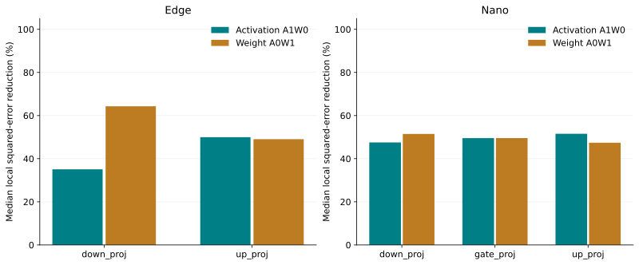
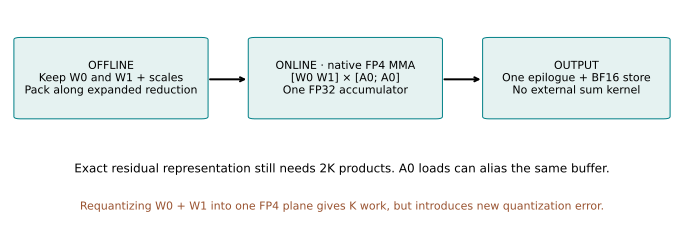
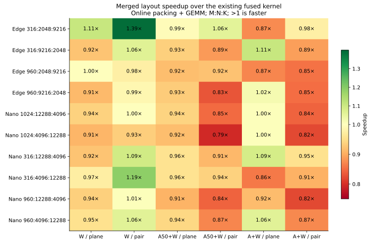
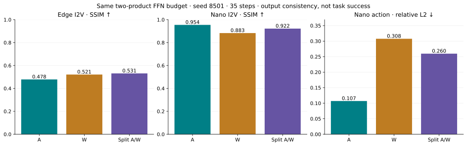
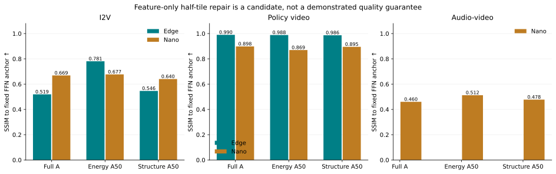

# ThunderWorld: where to spend A/W repair, and what weight fusion can save

**RTX 5090 · 11 September 2026 · experimental implementation, not a default policy**

The evidence supports **module- and task-dependent repair allocation** and **shape-dependent kernel selection**. It does not support dropping weight repair everywhere, or treating two FP4 planes as one FP4 multiply at unchanged precision.

## 1. Keep the algebra and the execution model separate

Using column-vector notation, the first-order approximation is

`Y ≈ W0 A0 + W0 A1 + W1 A0`.

The repository uses the transposed row-vector convention: `A0 W0 + A1 W0 + A0 W1`. The cross term is omitted in this study. The native FFN already fuses the base and selected residual products into **one kernel and one FP32 accumulator**, with a final BF16 store. Avoid claiming that the starting point launches three independent GEMMs.

| Component | What is offline? | Residual products |
|---|---|---|
| FFN; QKV/output projections | Weight planes and their scales | Activation repair and weight repair |
| Attention QK | Neither Q nor K is an offline weight | `Q1 K0ᵀ`, `Q0 K1ᵀ` |
| Attention PV | Neither probabilities nor V is an offline weight | `P1 V0`, `P0 V1` |

Here, attention “A-only” means the current implementation's `Q1 K0ᵀ` and `P1 V0` repairs. Their budgets remain coupled. It does **not** imply that offline projection-weight residuals have been repaired.

## 2. FFN: weight repair is particularly valuable in down projections

| Model / projection | Activation repair: median error reduction | Weight repair: median error reduction | Probe units |
|---|---:|---:|---:|
| Edge / up | 50.0% | 49.0% | 336 |
| Edge / down | 35.1% | 64.3% | 336 |
| Nano / up | 51.6% | 47.4% | 720 |
| Nano / gate | 49.5% | 49.6% | 720 |
| Nano / down | 47.5% | 51.5% | 720 |

These are reductions of **normalized squared local output error** relative to base FP4, from existing seed-7101 calibration probes. They are not percentage reductions of final video error. Captured rows, heads, layers and phases are not independent task samples. Probe scales/support can differ from the complete trajectory.

The split candidate therefore uses **A repair in up/gate and W repair in down**, at the same two-product arithmetic budget as all-A or all-W. Gate's near tie is not evidence for a strong universal preference. The complete-trajectory screen below is the necessary check on this local heuristic.

The archived complete-trajectory ablation (seeds 6103/6104, BF16 attention fixed) supplies the base and dual-repair controls:

| FFN repair | Edge I2V SSIM ↑ | Nano I2V SSIM ↑ | Nano audio relative L2 ↓ |
|---|---:|---:|---:|
| None | 0.534 | 0.923 | 1.150 |
| A only | 0.533 | 0.956 | 0.577 |
| W only | 0.573 | 0.922 | 0.393 |
| A + W | 0.692 | 0.960 | 0.049 |
| A + W + cross | 0.771 | 0.964 | 0.077 |

SSIM is the two-seed mean on `robot_table`; audio is the worst decoded-waveform relative L2 on `av_pottery`, both against BF16. These are different tasks and are not averaged into one score. W repair remains important for audio and for the dual-repair quality target. Cross repair is not uniformly beneficial. Full values, action metrics and source hashes are in `term_quality.csv` and `term_sources.json`.

## 3. Attention: use features as a prior, then calibrate repair benefit

The implemented candidate compiles development-only BF16 observations into head × layer × step-phase directed density priors. It accounts for actual AR, clean/noisy vision, sound and action token layouts, including mixed-role and tail tiles. A global ranking keeps exactly half of the padded 128×128 repair tiles; **every base tile remains active**. The runtime retains a joint streaming softmax and computes fresh values at each step.

The comparator uses current attention mass × V-energy at the same total half-tile quota. Both repair QK and PV using terms=2. This is a matched padded-tile budget, not a claim of exactly equal useful FLOPs at sequence tails.

| Implemented | Still required before a production policy |
|---|---|
| Development-only priors, four step phases | Predict marginal repair benefit, not mass alone |
| Directed role-pair density, token-length normalization | Task-specific action/audio quality floors |
| Global head/tile ranking | Separate QK and PV budgets; compare K/V-side repair |
| No support search during repeated structured calls | Matched uniform/random controls; broader held-out tasks/seeds |
| Full base connectivity | Quality guardrails before dropping any repair family |

AR–DM depth trends and modality asymmetry are **features**, not proof that a tile is safe to leave unrepaired. CFG branches are averaged in this prototype. A per-head scalar cannot alter within-head top-k ranking unless it also changes head quotas or participates in a global allocation; this implementation uses global ranking.

A practical allocator should estimate `benefit(t, tile) = L(without repair) − L(with repair)` and choose repair terms/tiles subject to measured latency and memory budgets. Estimate benefit on representative layer/step probes, then accept policies using full-trajectory video, action and audio checks. Non-additive errors mean that a greedy local score remains a candidate policy, not an optimality guarantee.

## 4. Offline weight merging: exact representation costs 2K

`(W0 + W1) A0 = [W0  W1] [A0; A0]` is exact before rounding. Keeping both FP4 planes allows a single GEMM reduction over **2K**, with activation loads aliasing the same buffer. No additional output-reduction kernel is necessary: the existing FP32 accumulator performs the sum.

In general, `W0 + W1` cannot be represented exactly by one E2M1 FP4 plane with one scale per block. For example, `[6, 0.5] + [0.5, 0] = [6.5, 0.5]` has positive-value ratio 13; one scaled FP4 plane's largest-to-smallest positive ratio is 12. Requantizing the sum restores K work but adds a new error. BF16 storage changes the arithmetic/storage trade-off and does not retain the two-plane FP4 representation.

Two layouts were implemented:

| Layout | Reduction organization | Numerical consequence |
|---|---|---|
| `plane` | Base plane, then weight residual plane; A repair interleaved as before | Original accumulation order; all valid local comparisons bitwise equal |
| `pair` | Pair W0/W1 inside expanded K256 tiles; optional A repair afterward | Different summation order; maximum local relative L2 to original 0.000242 |

Both emit native block-scaled E2M1 MMA instructions. This verifies Tensor Core execution, **not saturation or achieved peak utilization**. Reduction-dimension residual concatenation also has related work; it is not claimed as a new standalone algebraic contribution. See [Triton scaled dot](https://triton-lang.org/main/python-api/generated/triton.language.dot_scaled.html), [block-scaled matmul](https://triton-lang.org/main/getting-started/tutorials/10-block-scaled-matmul.html), and [ARCQuant](https://arxiv.org/abs/2601.07475).

The benchmark covers **10 real model shapes × 3 repair tiers**, 530 valid numerical configurations and 10 shared-memory resource skips. Captured 64-row inputs are repeated to the actual M for timing; they do not add quality samples. Online packing is included; support selection is prepared before timing. Winners are retimed in five randomized CUDA Graph rounds against the existing tuned fused kernel.

The best paired W-only cases reach **1.39× on Edge** and **1.19× on Nano**. Many A50+W and full A+W shapes regress. Therefore this is an optional dispatch choice after shape-specific tuning, not a global replacement. The trajectory prototype retains fallback and merged weights simultaneously; its memory allocation is **not** deployment memory.

## 5. Fresh full-trajectory screen

The fresh screen contains **40 unique mode/task trajectories**: Edge I2V and policy, and Nano I2V, policy and audio-video, all at seed 8501 and 35 steps. This is one fresh seed on existing evaluation scenes, not a broad held-out benchmark. The initial Edge campaign stopped at the new attention wrapper's causal-AR guard; the guard was corrected to preserve the original causal path. Its 12 completed rows are retained with the failed campaign status. A separate completion campaign repeated four anchors, all verified bitwise identical, and supplied the remaining attention rows. These repeats are not extra samples.

| Fixed BF16 attention; FFN variant | Edge I2V SSIM ↑ | Edge action L2 ↓ | Nano I2V SSIM ↑ | Nano action L2 ↓ | Nano waveform L2 ↓ |
|---|---:|---:|---:|---:|---:|
| A everywhere | 0.478 | 0.277 | 0.954 | 0.107 | 0.352 |
| W everywhere | 0.521 | 0.031 | 0.883 | 0.308 | 0.478 |
| A up/gate; W down | 0.531 | 0.146 | 0.922 | 0.260 | 0.232 |

All columns compare to BF16; they are distinct tasks. The split improves Edge I2V and Nano audio, but regresses Nano I2V/action versus A-only. Even Edge action prefers all-W on this seed. **Do not install a universal down=W rule.** The local attribution is useful for proposing allocations, while the trajectory result decides acceptance.

For attention isolation, the FFN is fixed to A-only and SSIM is measured against that same FFN with BF16 attention. Nano I2V SSIM is **0.669 / 0.677 / 0.640** for full A repair / dynamic-energy A50 / structural A50. Nano decoded waveform relative L2 to the same FFN anchor is **2.743 / 2.548 / 2.783**. The structural prior does not consistently beat the matched dynamic selector, and full A repair itself is insufficient for the current high-quality target. A slightly better BF16 SSIM can hide larger perturbations relative to the fixed FFN anchor; both references are retained in the CSV.

A separate two-step dispatch audit confirms that **Edge I2V/policy and Nano policy/AV fall back to the original kernel**. The current policy input has M=416, whereas the tuning table's policy probe has M=316; Edge I2V and Nano AV have no selected winning W-only layout. Their bitwise-equal split/merged outputs therefore do not validate merged-kernel equivalence. Nano I2V (M=960) actually selects the paired layout. Nano I2V does not: video relative L2 between the two split variants is **0.1222**, and trajectory-sketch relative L2 is **0.1753**, despite BF16 SSIM changing only from 0.9219 to 0.9202. Small local accumulation differences can amplify over denoising steps. The paired layout therefore needs a complete-trajectory acceptance gate; this run does not establish equivalence.

Generator request timings are recorded for diagnosis, without throughput claims: variants were not repeatedly randomized as end-to-end performance trials. Waveform decode ran separately after releasing the Transformer. No integrated audio-request latency is inferred by adding the two timings.

See `trajectory_screen.csv`, `trajectory_audit.json`, and `audio_screen.csv` for every configuration and its source. The failed initial Edge run lacks the wrapper's end-of-run hash metadata; the successful completion and Nano campaigns include it. Their actual pre-receipt wrapper is preserved under `source_snapshots`, and all saved output-array hashes were verified.

## 6. What changed, validation, and next implementation decisions

Experimental code is isolated in [tools/repair_design](../tools/repair_design/README.md). Production defaults remain unchanged. The study adds attribution analysis, two native merged-weight layouts, structured attention masks, development-only prior fitting, a process-local trajectory integration, benchmark search and independent numerical validation.

Compute Sanitizer memcheck completed with **0 errors**. GPU validation passed 12 FFN combinations including M=1/257 tails, an independently decoded FP4 reference, and CUDA Graph replay after input mutation. Full/empty external attention masks match the corresponding original paths bitwise, and mixed-role/tail masks obey exact quotas. The benchmark records resource failures explicitly rather than silently dropping them.

| Decision | Recommended implementation |
|---|---|
| Allocate A versus W | Calibrate by projection, layer, phase and task; retain dual repair where its marginal benefit is high |
| Select attention tiles | Combine head/role/phase priors with measured repair sensitivity and protected task budgets |
| Reduce runtime overhead | Freeze or bucket masks/shapes for graph replay; keep optional merged layouts only when consistently faster |
| Promote a kernel/policy | Require actual dispatch receipts, matched end-to-end quality, repeated timing, and deployment memory accounting |

The dispatch audit also checks all 1,056 phase/layer mask receipts across eight real role layouts. Calls include warmup, and these two-step runs are not quality samples. Policy M=416 requires its own tuning and full-trajectory verification before enabling a merged layout there.

No energy measurements or real robot task-success evaluations were added. Output agreement with BF16 is a consistency measure, not a complete perceptual or downstream-quality assessment.

Raw evidence and reproducible figures: [results/repair_design_20260911](../results/repair_design_20260911). Prior two-seed term ablations, fresh one-seed trajectories and local kernel probes remain separate cohorts.
