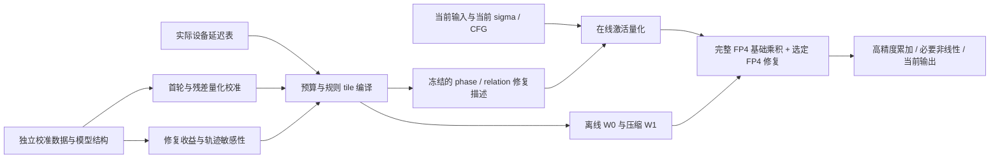

# ThunderWorld：以稠密 FP4 为基础的结构化精度修复

日期：2026-09-10。本文对齐项目当前研究目标，并区分设计、局部证据与端到端实测。
实施顺序与 demo 验收见 [实施计划](ITERFP4_IMPLEMENTATION_PLAN.md)。本文不是已完成实现或质量保证。

## 1. 项目主线

**ThunderWorld 面向混合 AR–DM 世界模型，在完整的低精度基础计算上，用额外 FP4 矩阵乘补偿重要误差；根据层、生成阶段、head 和有向模态关系分配修复预算，并将预算编译为规则的 Tensor Core 工作。**

可以把论文/展示的叙述组织成五步：

1. **部署约束。** 世界模型需要在有限内存、功耗和响应时间内处理长序列与多模态；支持原生 FP4 的设备提供了新的计算资源，但峰值算力不等于应用吞吐。
2. **精度障碍。** 单轮 W4A4 会同时引入权重和激活误差。非均匀分布与粗粒度浮点网格的错配，使 absmax 不一定是最佳缩放；最大值也不必是最大误差或最大输出影响的来源。
3. **数值补偿。** iterFP4 将一个张量表示为基础 FP4 分量和一个或多个 FP4 残差分量。高精度累加有限个低精度乘积，避免将整块操作数恢复成 BF16 再做主 GEMM。
4. **预算分配。** 完整补偿太贵。利用 Cosmos3 的结构寻找“修复收益集中在哪些位置”，保留所有原模型允许的基础连接，只选择部分修复乘积。
5. **系统实现。** 离线校准和规则 tile 调度降低在线选择、packing、搬运及 launch 成本；用完整生成轨迹验证质量，用真实延迟、内存和能量决定部署配置。

研究问题应表述为：**在固定的端到端质量约束下，结构化 FP4 修复能否比单轮量化、统一修复和已有残差方法消耗更少的时间、内存与能量？**
“主要依赖 FP4”指主矩阵乘路径，不代表 softmax、归一化、非线性和累加器全部使用 FP4。

## 2. 数值方法需要明确什么

### 2.1 格式与迭代的含义

NVFP4 的 E2M1 非负数值为 `{0, 0.5, 1, 1.5, 2, 3, 4, 6}`，另有符号；不要遗漏 1.5。
当前实现使用 K16 微块的 E4M3 scale 和外层 FP32 factor。这与仅使用 4 bit 数据码不同：一份表示约为 `4 + 8/16 = 4.5 bit/element`，另加外层因子、padding 和元数据。
[NVIDIA 格式说明](https://docs.nvidia.com/deeplearning/transformer-engine/user-guide/examples/fp8_primer.html)

令 `Q_s(X)` 表示采用合法 scale、量化码及舍入规则后**解码出的数学值**，不表示运行时物化高精度张量：

```text
R0 = X
Xi = Q_si(Ri)
R(i+1) = Ri - Xi
X ≈ X0 + X1 + ...
```

这是一种逐次残差表示。可以说明其受到 HPC mixed-precision iterative refinement 启发，
但目前不是求解 `Ax=b` 的迭代求解器，尚无由条件数和收缩性推导的同类收敛保证。
HPC 的高精度残差计算、低精度修正求解与停止判据不能自动迁移到 FP4 张量分解。
[Carson/Higham 的作者说明](https://nhigham.com/2017/07/)

### 2.2 双线性展开与修复预算

以下记 `W` 为 K×N；仓库线性层存储 N×K，代码中的乘积相应带转置。

```text
A ≈ A0 + A1; W ≈ W0 + W1
Ŷ = A0W0 + (SA ⊙ A1)W0 + A0(SW ⊙ W1)
```

这应称为乘积展开，不是“二阶方程”。基础项始终执行；SA/SW 选择残差支持。
设 `Ar=SA⊙A1, Wr=SW⊙W1, EA=A−A0−Ar, EW=W−W0−Wr`，则精确算术下：

```text
AW − Ŷ = ArWr + EA(W0+Wr) + (A0+Ar)EW + EA EW
```

实际另有累加及输出舍入误差。由此可以看出：

- 忽略的并不只有交叉项，还包括未修复位置和残差自身量化造成的误差。
- `A1W0` 优先、`A0W1` 次之，是当前部分 FFN 数据支持的候选规律，不能预设对所有层和 attention 成立。
- “交叉项可以省略”需要对各模块、生成阶段和分布检验；第一轮主动 clipping 后残差变大，原先交叉项很小的结论尤其需要重测。
- 在相同尺寸、以实际执行乘积数加权时，一阶名义 GEMM 成本为 `1+ρA+ρW`；加入交叉项后另加实际相交支持成本。相交比例不能默认等于 `ρAρW`。

完整三项的理想算术上限已是原生单轮 FP4 的约三分之一。即使 FP4:BF16 为 4:1，忽略其他开销的全修复 GEMM 上限也只是约 4/3，而不是 4 倍。这正是选择性修复的动机。

### 2.3 首轮量化必须与修复预算联合设计

当前 `_quantize.py` 的实际行为是 absmax/6 加最近舍入，然后再量化残差。
它已经实现“第二份 FP4”，但没有实现“首轮优先拟合主体分布”的优化目标。

建议比较三个逐步增加复杂度的方案：

1. **单轮 scale 优化。** 以 absmax 为基线，比较合法 E4M3 scale 的小范围 MSE/output-MSE 搜索，以及 4/6 网格候选。改变 scale 不改变 E2M1 码本。
2. **修复感知 scale 优化。** 固定 SA/SW，在实际会执行的 `Ŷ` 上评价量化方案；不能用完整 `A0+A1` 的重建误差挑选一个实际不完整修复的方案。
3. **交替优化。** 固定量化方案选择支持，再固定支持调整 scale/首轮 clipping，最后以完整轨迹选择候选。校准和搜索离线进行，在线激活只计算少量统计或使用冻结的规则。

一个可实施的离线目标是：

```text
min  E_calib[ ||AW − Ŷ(qA,qW,SA,SW)||² ]
     + λt · measured_operator_cost + λm · stored_bytes
subject to: legal scales / supported tiles / frozen deployment budget
```

局部输出损失用来筛选，最终约束仍是未参与拟合的完整轨迹质量。
若首轮舍弃 outlier，但该位置没有修复预算，误差可能比 absmax 更大；因此“无条件忽略 outlier”不应成为默认规则。
保留无修复位置适用的量化候选，并允许校准选择不 clipping。

当前 kernel 让基础/残差共享外层 factor，以便融合累加和最后缩放。
如果新量化算法需要不同外层 factor，必须改变累加/缩放设计并计入成本，不能只换量化公式。
scale 下溢、E4M3 舍入、极端 outlier、全零块、BF16 prescale 舍入都必须进入参考实现。

## 3. Cosmos3 结构怎样变成修复策略

统一关系记法为 **query 模态 ← key/value 模态**。DM←AR 表示生成部分读取上下文。
不要仅凭名为 AR 的 token 区域，把普通 prompt conditioning 宣称为已执行了 Reasoner 推理。

| 结构观察/假设 | 可以用作什么 | 还不能直接推出什么 |
|---|---|---|
| DM←AR attention mass 随深度变化 | 层/关系先验，候选预算分组 | 深层 AR 信息不重要，或可以直接删除连接 |
| action/audio 与其他模态存在方向不对称 | 有向关系特征，保护关键输入的候选 | action query 自身可以低精度，或少量质量损失不影响控制 |
| 去噪阶段有不同变化速度 | 用归一化 sigma/phase 分配预算 | 后期一定更能容忍误差，或可以复用旧 step 输出 |
| head 存在专门化 | query-head 候选分组，随后按 GQA 成本合并 | Nano 的 head 排名或 layer 编号能直接用于 Edge |

已有结构发现及其数据边界保留在 [历史证据](EXPERIMENTAL_FINDINGS.md)。
需要重新测量这些特征与 **FP4 修复带来的损失下降**之间的关系；删边实验的收益不能直接充当精度修复收益。

建议每个候选记录 `Δloss / Δtime`，包括修复前后的 projected output、去噪预测和完整 rollout。
attention mass 只是描述输入分布的特征：V 的幅度、QK logit 误差、softmax 敏感性、输出投影及误差抵消都会影响最终收益。
先建立低成本残差加权分数，再用真实反事实修复和候选交互校准它；不要把相关性解释写成因果结论。

建议部署 policy 的语义键为：

```text
model revision / topology / task / operator
× layer × normalized sigma phase × CFG branch
× Q-head or GQA bucket × (Q modality ← KV modality)
× repair term × executable tile support
```

FFN 没有 attention head 或 Q/K 模态关系轴，使用 M/N/K 修复支持；共享模型级预算优化器即可，不能强行共用同一种 mask。
注意 K16 量化微块、K128/256 FFN 修复块和 attention 的 token tile 是三种不同概念。

Attention 的 QK 和 PV 必须分别校准修复项：在 QK 中 A/B 是 Q/K；在 PV 中 A/B 是 P/V。
P 依赖本次修复后的 logits 和联合 softmax，因此不能直接套用 FFN 的“A 修复最重要”或复用同一份收益统计。
DM←AR 和 DM←DM 仍共享一个 softmax；原模型 causal/padding 等合法性 mask 必须保留。
repair mask 为 false 只关闭修复乘积，不屏蔽基础连接。

## 4. 执行架构与实现审计



| 部件 | 当前实现 | 需要调整 |
|---|---|---|
| 首轮/残差量化 | [`_quantize.py`](../packages/fp4-repair/src/thunderworld_fp4/_quantize.py) 为 absmax RTN | 增加可追溯的校准候选和修复感知目标，不把 RTN 重命名成已优化的 iterFP4 |
| 公共 FFN API | [`FP4Linear`](../packages/fp4-repair/src/thunderworld_fp4/linear.py) 主要为 A-only repair | 接入实验 Native 的压缩 W1 和独立 A/W 支持，统一 checkpoint 格式 |
| 实验 FFN | [`native.py`](../experiments/ffn_block_repair_20260907/native.py) 已有融合 A1W0、W1 CSR、可选交叉项 | 将实验数据依赖和启动策略分离；用两模型完整轨迹验收 |
| Attention 修复 | [`runtime.py`](../packages/fp4-repair/src/thunderworld_fp4/runtime.py) 已保留完整基础连接，支持显式 repair mask | 分离 QK/PV 和各残差项预算，接入实际模态边界及 phase |
| 在线选择 | [`select_tiles`](../packages/fp4-repair/src/thunderworld_fp4/_kernels.py) 使用 sampled QK×V-energy，并对 tile 两两比较排名 | 现有实现仍有在线选择成本，tile 排名部分为 O(T²)；比较冻结描述、有限刷新和现有 selector 的完整耗时 |
| Head policy | [`head_finding.py`](../packages/fp4-repair/src/thunderworld_fp4/head_finding.py) 可转换 atlas、构造显式 mask | 旧 projection atlas 不是经验证的 attention repair policy；为每模型重新测量收益 |
| 稀疏激活存储 | 双平面 scratch 仍按完整容量分配 | producer 仅生成支持的并集；再评估压缩 A1 的写入/索引是否真正省时省内存 |
| E2E 接入 | [`adapter.py`](../tools/cosmos_e2e/adapter.py) 为自身 RTN W4 + full ACT2；joint 为均匀 75% 双侧修复 | 接入导出的量化资产与冻结策略；当前 pilot 不等于目标算法 |
| Graph | 已验证使用当前输入、输出独立，基线也使用 Graph | phase/CFG 策略不能被 capture 时的 Python 分支冻结；将更新后的 mask/预算作为明确的设备输入，验证跨 phase 切换 |
| 硬件支持 | 公共 API 显式只允许 SM120 | 按目标能力实现和验证后端；不能删除 guard 就宣称适配 Thor/Spark |

优先复用 W0、合并选中 K 块到规则执行组、融合 epilogue 和下一次 packing。
Nano gate/up 的 prescale 若不同，不能无条件共享量化后的激活；Edge 的 ReLU² 与 Nano 的 SiLU×up 也不能互换。
是否使用压缩残差、拼接 reduction 维、interleave 或单独 GEMM，由实际形状计时决定，不能预设越融合越快。

FP32 accumulation 是硬件 MMA 本身支持的工作，不能笼统归因为“高精度累加吃掉了 FP4 峰值”。
真正要拆分测量的是 online quantization、scale handling、内存、softmax/SFU、非线性、布局转换、选择、launch、低 occupancy 以及矩阵形状。
“无反量化”应准确写成“不物化整块 BF16 操作数用于主 GEMM”；scale 应用和必要的局部解码仍然存在。

## 5. 已证明的部分和关键反例

RTX 5090 的 [算子实测](RTX5090_RESULTS.md) 和 [完整 Generator pilot](COSMOS3_E2E_5090.md) 是两组不同范围的证据。

| 同模型内比较 | Edge | Nano |
|---|---:|---:|
| BF16 E2E 延迟 | 2.914 s | 8.130 s |
| 优化 RTN+ACT2 FFN E2E 延迟 | 2.559 s | 6.109 s |
| 相对 BF16 加速 | 1.138× | 1.331× |
| 峰值 allocated memory，BF16 → FFN | 8.22 → 6.88 GiB | 30.25 → 23.06 GiB |
| FFN 视频相对 BF16 SSIM，两 seed | 0.8909 / 0.8934 | 0.9274 / 0.8714 |

条件：一个图/提示词、两 seed、320×192、61 帧、35 步；时间为一个 seed 的三次请求中位数，均使用相同外层 Graph、全驻显存。
详细计时边界和原始记录见 E2E 报告。40 次请求不是 40 个独立质量样本。

目前最强的工程结论是：**FFN 执行优化能迁移到两个模型，且最终采用的无 Split-K 配置与各自原始 FP4 视频逐位一致。**
不能据此宣称 FP4 与 BF16 同等质量；当前 joint attention 同时更慢、与 BF16 视频偏离更大。
Split-K 曾出现局部误差通过、生成轨迹明显改变的反例，说明局部容差不能替代完整轨迹验收。

局部 FFN block study 支持优先 A 修复并尝试少量 W 修复，但只涉及 Nano 少数层与已观察开发输入；
没有证明完整结构策略胜过 uniform ACT2。当前没有能耗实测，也没有 Thor/Spark 实机数据。

## 6. 对照工作与创新边界

不能把相关工作统一描述为“都需要昂贵检索/排序、都不适合 Tensor Core”。
例如 [Sparse VideoGen](https://arxiv.org/abs/2502.01776) 研究空间/时间 head 模式并面向高效执行；
固定或规则 block sparsity 可以有较低索引开销。应比较具体实现及相同质量下的实测结果。

以下是截至本次整理发现的直接相关工作，尚未在本仓库复现其 Cosmos3 结果：

| 工作 | 已有思路 | ThunderWorld 必须额外证明的部分 |
|---|---|---|
| [NVIDIA NVFP4 校准](https://developer.nvidia.com/blog/creating-the-nvidia-nemotron-3-ultra-nvfp4-checkpoint-with-nvidia-model-optimizer/) | MSE、output-MSE 与 4/6 网格选择，不局限于 absmax | 与有限残差预算共同优化，胜过更强单轮量化基线 |
| [ARCQuant](https://arxiv.org/html/2601.07475v1) | FP4 残差通道扩展，统一 GEMM；校准选择并重排通道 | 世界模型结构带来的额外收益，A/W 预算与完整轨迹质量；不能把 FP4 残差 GEMM 本身作为独占新意 |
| [SharQ](https://arxiv.org/abs/2606.26587) | 在线 N:M 稀疏 backbone 与稠密 FP4 残差，共享 FP4 权重；论文也报告视频生成应用 | 稠密基础项加选择性补偿与该分解的实测差异，结构策略是否胜过无需校准的方案 |
| [Rollout-ResQ / HiFloat4](https://arxiv.org/html/2607.26515v1) | 激活量化残差修正，并利用残差稀疏性降低成本 | 场景、格式、选择粒度和预算编译的具体增量，不能只靠“稀疏 FP4 修复”概括创新 |
| MInference / RetrievalAttention / SVG 等 | 注意力模式、检索或删边减少基础计算 | 在相同任务、质量与计时边界下，保留基础连接是否值得其额外计算 |

建议保留三个待验证贡献：**修复感知量化；轨迹与有向模态结构驱动的精度预算；低开销 FP4 修复执行与端侧验证。**
这是一份定位审计，不是穷尽相关工作的优先权结论；各项贡献都需要独立 ablation。

## 7. 硬件与能效论证的口径

- NVIDIA 当前 HGX 规格中 Rubin 的 dense NVFP4 training 为 35 PFLOPS，dense BF16 为 4 PFLOPS，因此同表 dense 比值为 **8.75:1**。50 PFLOPS inference 列使用 sparse 口径，不能混用；规格注明 preliminary。这个比值支持研究动机，不预测 ThunderWorld 加速。
  [NVIDIA HGX 规格及脚注](https://www.nvidia.com/en-us/data-center/hgx/)
- Jetson AGX Thor/T5000 的 2070 FP4 TFLOPS、DGX Spark 的 1 PFLOP 宣传值均带 sparsity 口径。当前软件 block repair 使用普通 MMA，没有使用硬件 N:M 稀疏指令，不能按这些峰值计算利用率。
  [Thor 规格](https://www.nvidia.com/en-us/autonomous-machines/embedded-systems/jetson-thor/)、[Spark 规格](https://www.nvidia.com/en-us/products/workstations/dgx-spark/)
- RTX 5090、GB10、Thor 分别是 CC 12.0、12.1、11.0。算法可探索迁移，但指令、scale 布局、编译器和 launch 参数需要对应后端验证；Spark/Thor 的统一内存也不同于 5090 独立显存。
  [NVIDIA compute capability 表](https://developer.nvidia.com/cuda/gpus)
- Jetson Thor 是机器人/physical AI 部署平台；不把它与汽车平台 DRIVE AGX Thor 的名称、软件栈和应用资格混为一谈。DGX Spark 更适合作为本地开发/部署验证平台，不能只因桌面体积小就等同于所有嵌入式场景。
  [Jetson 定位](https://docs.nvidia.com/jetson/agx-thor-devkit/user-guide/latest/)、[DRIVE AGX 定位](https://developer.nvidia.com/drive/agx/)

在简化的算术受限模型中，若 BF16 时间占比 p 可用 FP4 替代，原生同口径峰值比为 r，额外修复比例为 ρ：

```text
S_ideal ≈ 1 / [(1−p) + p(1+ρ)/r]
```

这是忽略额外开销和利用率差异的解释模型，不是实测预测。实际应使用各模块 latency lookup，
并记录不可重叠的 packing/selection/搬运成本；内存受限形状另受带宽下界限制。
“打满速度”应落实为相对同设备可达 roofline 的差距，而不是只展示理论 TFLOPS。

能效用完整请求的 `J/request`，同时报告时间、平均功率、功率采样方式和质量。
NVML GPU 板卡能量、SoC 功耗与整机插座能量不是同一指标；统一内存设备的 CPU/DRAM 也可能占显著部分。
未测量前不能把 FP4 或更短耗时直接写成已证明低能耗。
