# ThunderWorld

**Dense FP4 computation + budgeted precision repair**  
Visual research report · Cosmos3-Edge / Cosmos3-Nano · RTX 5090 · Evidence through 2026-09-11

## Executive Summary

**Preserve a complete FP4 base; spend extra compute on selected error corrections.** The current system implements FFN repair, executable budgets, and equivalent Graph/fusion paths on both models. Repair-aware first-pass quantization and consistently better structural allocation remain research work.

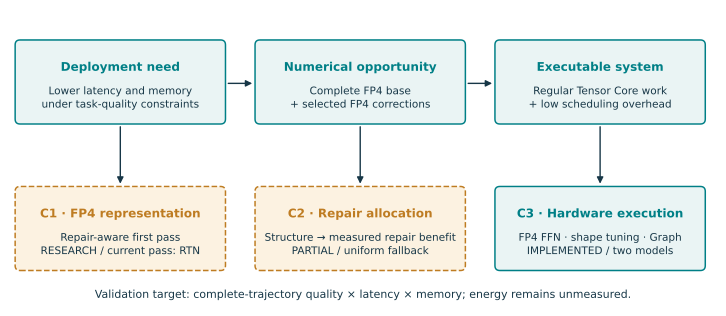

**Measured:** Graph versus each FP4 tier's own eager path: **1.72–2.03× Edge**, **1.16–1.37× Nano**. Execution outputs and budgets match across **120 trajectories**. These are execution gains, not allocator gains or FP4-versus-BF16 speedups. [Evidence](../../docs/GRAPH_FUSION_5090_20260911.md)

## 1. Overall Architecture

**Figure 1.** Solid paths are implemented; dashed paths are research directions. The complete base and selected correction products may share a native GEMM. Attention, necessary nonlinear operations, and normalization retain higher precision. Fresh activation values are used every step.

The overview was generated with image_gen; new diagrams and charts in this edition are reproducible vector figures. [Image provenance](assets/image_provenance.json) · [Detailed report](REPORT_DETAILED.md)

## 2. How Precision Repair Works

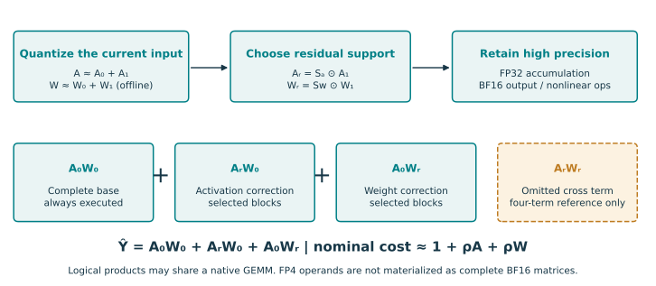

**Figure 2.** FP4 codes/scales feed native Tensor Core products. The cross term is omitted in the budgeted first-order path and evaluated separately in the four-term reference.

**Numerical gap:** the current first pass is absmax RTN. A repair-aware quantizer should optimize the actual selected output, including unrepaired outliers. Two complete FP4 planes use about **9 bit/element** before padding and metadata; that is not fourfold whole-model memory compression. [Equations and error identity](REPORT_DETAILED.md) · [Design audit](../../docs/THUNDERWORLD_ITERFP4_DESIGN.md)

## 3. From Calibration to an Executable Budget

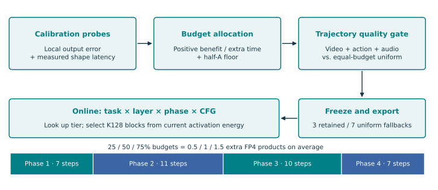

**Figure 3.** Calibration covers **672 Edge / 2,160 Nano** local units. Tiers vary by task, layer, phase, and CFG branch; half-A support is selected on the GPU from current activations. “Dynamic” does not mean online BF16-teacher evaluation.

**Quality gate:** only **3 of 10** automatic candidates survive comparison with equal-budget uniform repair; **7 fall back**. With the half-A floor, the 25% tier becomes uniform a50. Local 64-row probes do not fully preserve full-M scale/support context. [Allocation evidence](../../docs/AUTO_BUDGET_5090_20260910.md)

## 4. Graphs and Fusion Reduce Execution Overhead

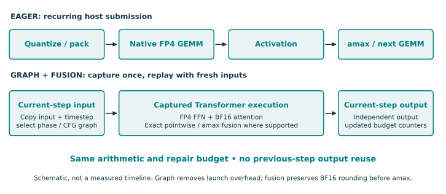

**Figure 4.** Dependency schematic; box widths do not represent measured duration. Capture is separated by phase/CFG branch and replays with current inputs. Fusion preserves BF16 rounding before amax; Nano SiLU retains its original implementation.

**Verified invariant:** same outputs and actual repair budgets across eager, Graph, and Graph+fusion for **120 complete trajectories**. This establishes equivalence within a tier, not losslessness against BF16. [Runtime and validation](../../docs/GRAPH_FUSION_5090_20260911.md)

## 5. Finding A: Deeper DM Layers Attend Less to AR Context

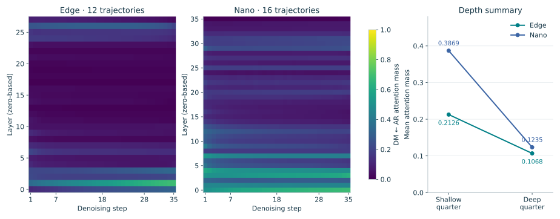

**Figure 5.** Conditional branch; all 35 steps, layers, and heads; **12 Edge / 16 Nano trajectories**, seeds 6101/6102. DM roles are weighted by query counts; trajectories receive equal weight. Shallow/deep are the first/last layer quarters. The heatmaps share a 0–1 scale.

**Implication:** depth is a candidate allocation feature, not a reason to delete AR connections. The trend is not monotonic at every layer, and this experiment does not include full AR Reasoner integration. [Resampling methodology](../../docs/FINDINGS_RESAMPLING_20260910.md)

## 6. Finding B: Token Counts Explain Much of the Directionality

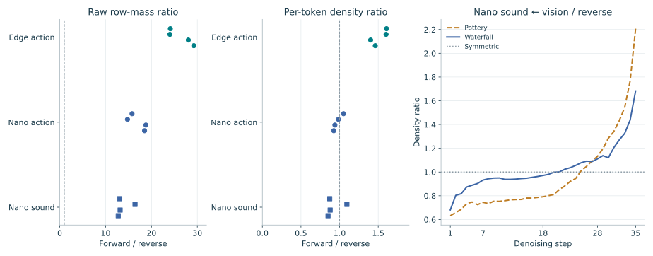

**Figure 6.** Direction means **modality query ← noisy-vision key**, compared with its reverse. Each dot is one complete trajectory, not a confidence interval. Density ratio is `[m(i,j)/n_j] / [m(j,i)/n_i]`; 1 means symmetry. Nano sound curves average two seeds per scene.

**Implication:** Edge action retains moderate directionality; Nano's trajectory averages are near symmetric after normalization. Sound directionality changes with step. Raw mass, token counts, and density must all remain visible to the budget model. [Definitions and evidence](../../docs/FINDINGS_RESAMPLING_20260910.md)

## 7. Stable Head Relationships Still Have Changing Outputs

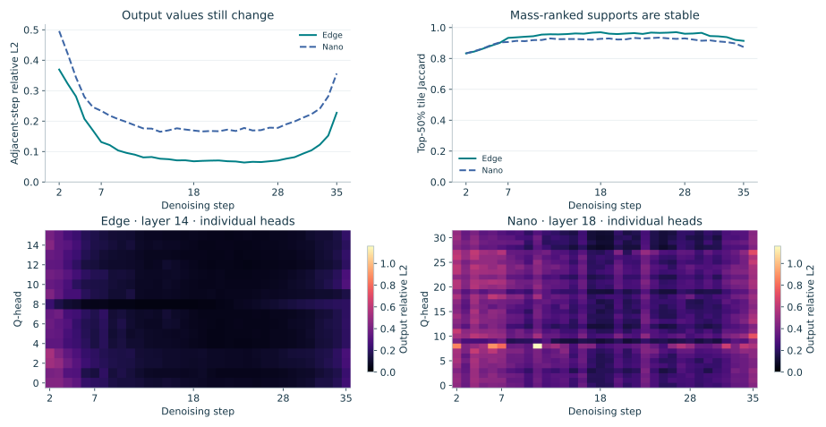

**Figure 7.** Top: conditional noisy-vision queries averaged over all observation trajectories. Bottom: individual heads at the middle layer, `robot_observe`, mean of two seeds; common heatmap scale. Step 1 is omitted because it has no predecessor. The late-step rise is retained without smoothing.

**Implication:** dominant roles stay unchanged about **99.16%** of the time, yet mean output relative L2 changes are **0.1163 / 0.2190**. Mass-ranked top-half support is an observation metric, not the runtime repair selector. [Head/step analysis](../../docs/FINDINGS_RESAMPLING_20260910.md)

## 8. Cross-Step Reuse Has Not Delivered a Reliable Win

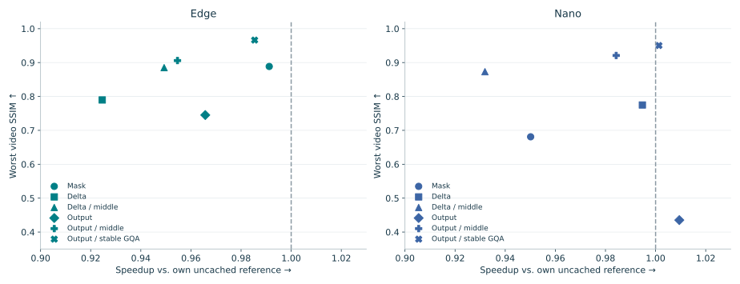

**Figure 8.** Each point combines worst video SSIM with paired geometric-mean speedup. Compare within each model: their case sets differ. Mask/delta references are uncached attention dual50; output-reuse reference is the FFN ACT2 path with BF16 attention. Seeds 6103/6104; exploratory eager timing.

**Decision:** keep fresh values in the recommended path. Restricted middle-stage/GQA reuse improves consistency, but **1.001× / 1.010×** single-run timing differences do not establish acceleration. Full-output reuse can reduce Nano AV SSIM to **0.4352** against its uncached reference. [Cache ablations](../../docs/FINDINGS_RESAMPLING_20260910.md)

## 9. Repair Helps, but Its Best Form Depends on the Task

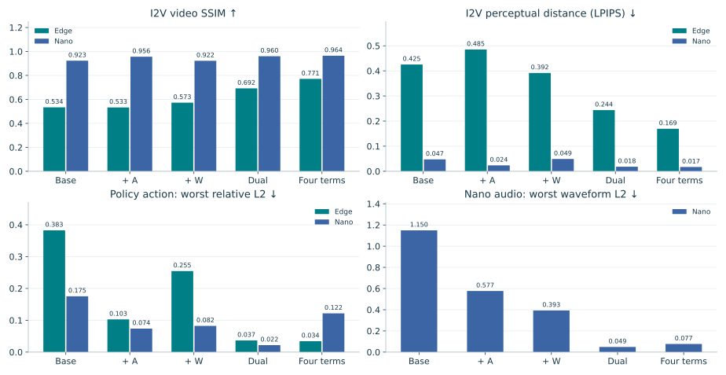

**Figure 9.** Seeds 6103/6104; all variants retain BF16 attention. I2V SSIM/LPIPS are two-seed means; action and audio show the worst relative L2 across two seeds. All references are same-seed BF16. Edge has no sound path.

**Conclusion:** dual first-order repair improves several modalities, but adding the cross term can worsen Nano action/audio. A-only is not universally superior to W-only. Edge still has a substantial BF16-consistency gap. These metrics do not measure physical correctness or task success. [Complete ablation table](../../results/findings_20260910/ablation/ABLATION.md)

## 10. End-to-End Speed and Video Consistency

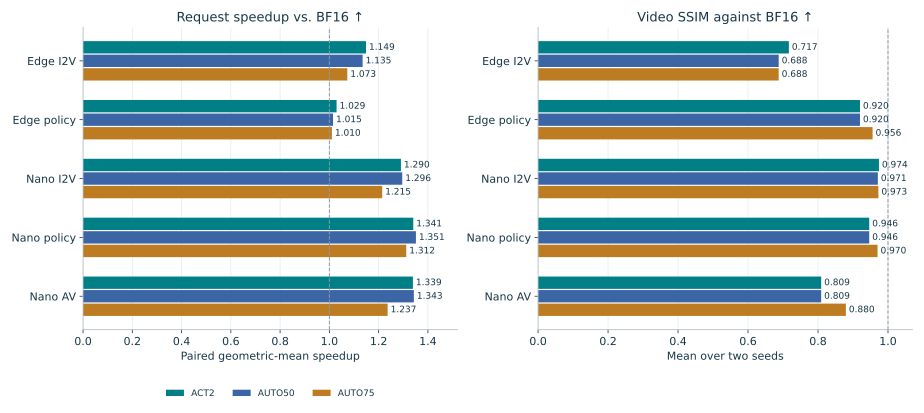

**Figure 10.** All **15 FP4 operating points**: ACT2, auto50, auto75 across five model/tasks. Seeds 7403/7404; 35 steps; Graph+fusion. BF16 uses the same Graph framework. Speedups are paired geometric means; SSIM is the two-seed mean. Automatic labels include uniform fallbacks.

Timing includes image encoding, denoising, video decoding, and a consistent trajectory sketch; excludes loading, offline quantization, warmup, serialization, AV waveform decoding, and the AR Reasoner. New seeds reuse existing scenes. Action/audio require separate validation. [Exact times and all rows](data/execution_summary.csv)

## 11. Separate Execution Gains from Memory Savings

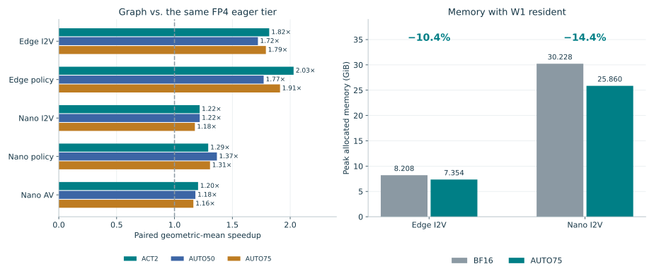

**Figure 11.** Left: Graph versus the **same FP4 tier's eager path**, not BF16. Right: I2V peak allocated memory, common Graph+fusion framework, W1 resident. Graph adds less than **11 MiB** to peak allocation in the measured configurations.

Pointwise/amax fusion improves local full-FFN time by **3.4–7.2% Edge / 0.2–1.0% Nano**, but its extra request-time benefit is not stable. A BF16 Nano AV negative control changes from **10.992 to 9.233 s** across processes despite no FFN fusion; small gains need repeated timing. [Execution evidence](../../docs/GRAPH_FUSION_5090_20260911.md)

## 12. Why More FP4 Work or Overlap Is Not Automatically Faster

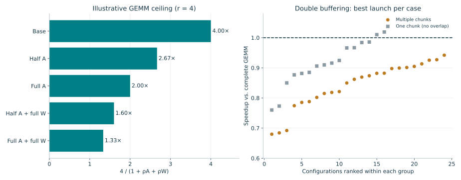

**Figure 12.** Left is an illustrative compute-only model with FP4/BF16 ratio `r=4`, not a measured speedup. Right uses **40 retuned cases / 240 launch candidates**, with the best launch selected for each case. One-chunk cases cannot overlap producer and consumer work.

**Measured limit:** genuine multichunk pipelines remain slower; the best reaches about **0.942×**. Tensor-pipe elapsed activity is **14.2–44.6%**, not peak-FLOP/s utilization. Keep double buffering experimental, preserve K accumulation order, and judge changes by complete-request quality and latency. [Pipeline evidence](../../results/execution_20260911/analysis.json) · [Profiling](../../docs/AUTO_BUDGET_5090_20260910.md)

## 13. What to Complete Next—and What the Demo Should Show

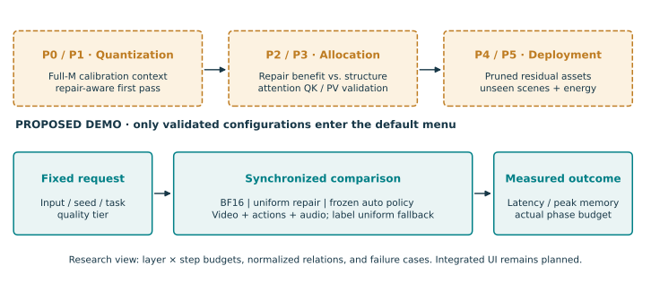

**Figure 13.** Proposed implementation and demo flow, not an existing UI. The immediate priorities are full-M calibration fidelity, repair-aware first-pass quantization, and structural policies that beat equal-budget uniform/random baselines. Attention requires separate QK/PV calibration and joint-softmax correctness.

**Claim boundary:** native FP4 FFN execution is validated on RTX 5090; universal structural-allocation gains, near-BF16 quality, reduced energy, and Thor/Spark/Rubin performance remain unproven. [Full English report and equations](REPORT_DETAILED.md) · [Detailed PDF](REPORT_DETAILED.pdf) · [Figure data and source hashes](data/visual_manifest.json)
