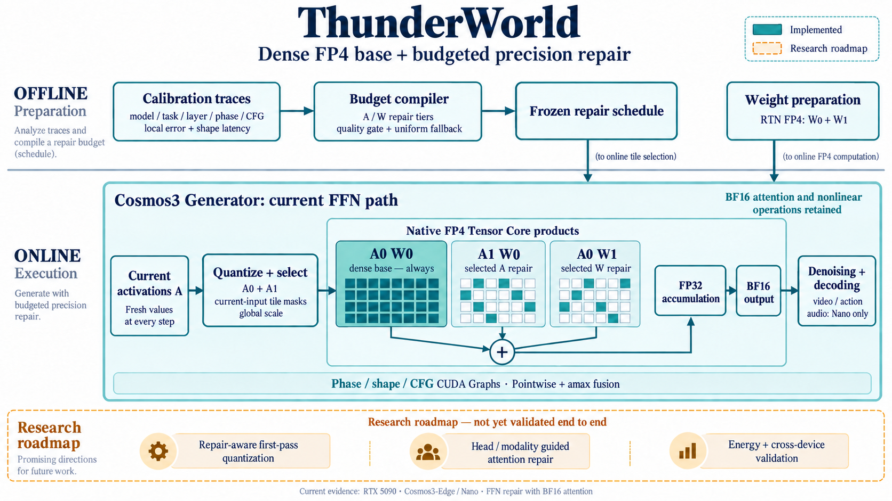

# ThunderWorld：面向世界模型的稠密 FP4 计算与结构化精度修复

**论文主线、方法论与实现证据报告 · 2026-09-11**  
研究对象：Cosmos3-Edge / Cosmos3-Nano；实测设备：RTX 5090。  
本文整合截至本日的设计、重采样、质量消融、自动预算及执行优化结果。它同时服务于论文组织、后续实现和 demo 设计。

## 阅读摘要

**ThunderWorld 的目标，是把世界模型的高质量推理转化为“完整的低精度基础计算，加上少量有选择的低精度误差修复”。** 基础信息通路保留，额外算力按修复收益分配，主矩阵乘仍交给原生 FP4 Tensor Core；高精度累加、必要的非线性和敏感模块继续保留。

这条主线连接三个层次：端侧部署需要更低的存储与响应成本；FP4 残差表示提供可调的精度；世界模型的层、生成阶段和模态结构为修复预算提供线索。系统实现负责把这些线索转成硬件能高效执行的规则工作。

目前已完成两模型的 FFN 原生 FP4 修复、分层/分阶段/CFG 自动预算、质量门控、形状调优、完整 Transformer CUDA Graph，以及等价的激活/amax 融合。最新 120 条完整轨迹验证中，执行改造前后输出逐位一致，实际预算一致；FP4 三个主档位使用 Graph 后，相对各自 eager 路径，Edge 加速 **1.72–2.03×**、Nano **1.16–1.37×**。这些倍率属于执行优化，不能写成自动预算或 FP4 相对 BF16 的贡献。[执行证据](../../docs/GRAPH_FUSION_5090_20260911.md)

当前最需要补齐的算法环节，是**修复感知的首轮量化**与**结构特征到真实修复收益的映射**。自动预算尚未普遍胜过均匀修复，attention 修复未进入推荐路径，也没有能耗和 Thor/Spark 实机结论。因此，现阶段适合表述为“已建立并验证核心执行系统，部分算法假设获得支持，完整方法仍在收敛”。

## 1. High-level motivation：为什么值得做

### 1.1 世界模型的部署价值

世界模型不仅生成图像，还需要在多步推演中维持时序、物理和条件一致性，并可能输出动作或联合音视频。对具身智能而言，更短的推演时间可以增加决策前的候选评估次数，更小的内存占用可以容纳更长上下文或更多并行假设，更低的请求能量则可能延长持续运行时间。后两项扩展价值需要分别测量，不能由单次延迟直接推导。

因此，项目应优化的目标是：**在满足任务质量约束时，减少每条完整推理轨迹的延迟、内存和能量。** Tensor Core 利用率是定位瓶颈的指标，不是论文的最终目标。

### 1.2 原生 FP4 硬件提供机会，但峰值不等于应用加速

Jetson Thor 面向机器人与 physical AI，DGX Spark 提供本地模型开发/运行能力，两类产品都提供 FP4 算力。其公开峰值包含硬件 sparsity 口径，不能直接作为当前 dense MMA 路径的利用率分母。[Jetson Thor](https://www.nvidia.com/en-us/autonomous-machines/embedded-systems/jetson-thor/)；[DGX Spark 规格与脚注](https://www.nvidia.com/en-us/products/workstations/dgx-spark/)

NVIDIA 当前 HGX 表列出 Rubin 的 dense NVFP4 training 为 35 PFLOPS、dense BF16 为 4 PFLOPS，同口径比值为 8.75，页面仍标注为初步规格。它说明低精度/高精度的算力差距值得研究；它不是本项目的预期加速比，也不能与 sparse inference 列混算。提交论文时应再次核对产品规格与脚注。[HGX 规格](https://www.nvidia.com/en-us/data-center/hgx/)

现实限制至少有三类：量化误差会沿生成轨迹传播；修复本身要增加矩阵乘；在线量化、scale 统计、softmax、非线性、数据搬运、调度与不合适的矩阵形状会消耗额外时间。FP32 累加本来就是相关 MMA 路径的一部分，不能笼统归因为“高精度累加导致 FP4 无法加速”。

### 1.3 核心矛盾：低精度很便宜，全面恢复精度并不便宜

FP4 码本很粗。NVFP4 E2M1 的非负值为 `{0, 0.5, 1, 1.5, 2, 3, 4, 6}`；本项目采用 K16 的 E4M3 微块 scale 与外层 factor。分布主体和 outlier 不一定能同时匹配这些网格，最大绝对值也不必对应最大的量化误差或输出影响。[格式说明](https://docs.nvidia.com/deeplearning/transformer-engine/user-guide/examples/fp8_primer.html)

单份表示约为 `4 + 8/16 = 4.5 bit/element`，两份完整 FP4 平面约为 9 bit/element，尚未计入 padding、外层因子与索引。这说明残差修复仍可能节省操作数存储，但不能承诺“两份 FP4 仍有四倍显存压缩”，更不能把操作数压缩率当成整模型峰值显存下降率。

修复预算要同时回答两个问题：**哪些误差值得补；补这些误差的执行成本是否低于收益。** 这就是 ThunderWorld 的方法与系统需要联合设计的原因。

## 2. 论文主线与贡献组织

### 2.1 建议的中心论点

> 面向混合 AR–DM 世界模型，保留完整的低精度基础计算，将模型结构与生成轨迹中的非均匀敏感性转化为精度修复预算，并编译成规则的原生 FP4 计算，以改善质量约束下的推理成本。

建议英文题名：**ThunderWorld: Budgeted Precision Repair for FP4 World-Model Inference**。若修复感知量化尚未完成，不宜在题名或摘要中声称已经实现“near-lossless iterative FP4”。

论文叙事顺序应为：部署约束 → 单轮 FP4 的误差 → 全量补偿的成本 → 修复收益非均匀 → 结构化预算 → 硬件执行 → 完整轨迹验收。CUDA Graph 和 fusion 放在系统实现中，不替代方法贡献。

### 2.2 拟议贡献与当前证据

| 贡献 | 论文要证明的内容 | 当前状态与边界 |
|---|---|---|
| C1：修复感知的 FP4 数值表示 | 首轮量化与有限残差预算共同优化，在同成本下改善质量 | 基础/残差 FP4 与乘积展开已实现；当前首轮仍为 absmax RTN，bulk-fit/repair-aware 校准待实现 |
| C2：结构与轨迹驱动的修复预算 | 层、阶段、head、模态关系能预测修复收益，并优于同预算均匀及随机分配 | 两个 finding 已重采样；FFN 层/phase/CFG 分配与质量回退已实现；head/模态 attention 策略及稳定优势尚未证明 |
| C3：硬件可执行的低开销修复系统 | 规则 FP4 GEMM、量化融合与调度把理论节省变成实际推理收益 | 两模型 FFN 和 SM120 后端、shape 调优、Graph、等价 fusion 已测；跨设备与能效待验证 |
| C4：完整轨迹的证据与失效分析 | 说明哪些近似可用、在哪些任务失效，以及局部指标的局限 | 有多模态重采样、修复项/缓存消融、质量门控、数值等价回归及负结果；场景覆盖仍有限 |

C1/C2 的完整形态是主要算法贡献候选，C3 是已经较扎实的工程贡献，C4 为方法可信度提供支持。它们的创新性仍需与相关方法实证比较，不能仅凭命名确定优先权。

### 2.3 相邻工作与应当守住的区别

FP4 残差本身已有直接相关工作，例如 ARCQuant 将残差通道并入 reduction 维以执行统一 NVFP4 GEMM。因此，ThunderWorld 需要证明的是世界模型中的修复预算、数值表示与执行方式的具体增量，不能把“再补一份 FP4”单独当成独占新意。[ARCQuant](https://arxiv.org/abs/2601.07475)

稀疏 attention 方法主要减少基础连接的计算；ThunderWorld 的设计保留原模型允许的基础连接，只对修复项进行选择。二者可能组合，也可能在不同质量/形状下各有优势。不能统一声称已有稀疏方法都依赖昂贵检索或不适合 Tensor Core；Sparse VideoGen 就包含面向硬件的布局与 kernel 设计。[Sparse VideoGen](https://arxiv.org/abs/2502.01776)

HPC mixed-precision iterative refinement 提供了“便宜计算加误差修正”的启发。但本项目是张量的逐次残差表示与有限乘积补偿，不是求解 `Ax=b` 的同一种迭代算法；其收敛定理不能直接移用。[Higham 对迭代改进的说明](https://nhigham.com/2017/07/)

## 3. 流程架构总图



**图 1｜ThunderWorld 的准备、预算和执行流程。** 总图使用内置 image_gen 工具生成，生成与校正提示词保存在 [architecture_prompt.txt](assets/architecture_prompt.txt) 和 [architecture_edit_prompt.txt](assets/architecture_edit_prompt.txt)。实线部分表示当前实现：离线准备 RTN FP4 权重和修复策略，在线对当前激活量化与选块，执行完整基础项和选中的修复项，再高精度累加。虚线部分表示研究路线。图中选中修复乘积是逻辑表达，实际可在一个 native GEMM 内融合执行；FFN 的多个投影及层间次序以模型代码为准。attention、必要的非线性和归一化目前保留高精度。

从概念到执行，三个接口尤其重要：校准输出必须带实际硬件成本；预算描述必须落到可执行的 tile；Graph 必须复制当前 step 输入并正确切换阶段，不能把 capture 时的预算冻结为全程预算。

## 4. 方法论：从残差表示到可调精度

### 4.1 iterFP4 的数学表达

下式中的 `Q` 表示量化后解码出的数学值，不代表运行时物化整块 BF16 操作数。以 `A ∈ R^(M×K)`、`W ∈ R^(K×N)` 表示线性层：

```text
X0 = Qs0(X)
R1 = X − X0
X1 = Qs1(R1)
X ≈ X0 + X1

A ≈ A0 + A1;  W ≈ W0 + W1
Y_hat = A0W0 + (SA ⊙ A1)W0 + A0(SW ⊙ W1)
```

基础项 `A0W0` 始终执行；`SA/SW` 决定残差支持；全量四项参考额外加入 `A1W1`。这是双线性乘积展开，不是“二阶方程”。主 GEMM 直接消费 FP4 codes/scales，保留 FP32 累加与 BF16 输出；“无需反量化”宜写为“不为主 GEMM 物化整块 BF16 操作数”，scale 应用与必要的局部转换依然存在。

令 `Ar=SA⊙A1`、`Wr=SW⊙W1`、`EA=A−A0−Ar`、`EW=W−W0−Wr`，精确算术下：

```text
AW − Y_hat = ArWr + EA(W0+Wr) + (A0+Ar)EW + EA EW
```

因此误差不只来自省略的交叉项，还包括未选择的支持和残差自身量化误差，实际另有累加/舍入误差。首轮主动 clipping 会改变这些项；不能在量化器改变后沿用旧的“cross 很小”结论。

### 4.2 为什么需要预算而不是全面修复

若实际执行的 A/W 修复比例为 `ρA/ρW`，名义矩阵乘成本约为 `1+ρA+ρW`。假定原生 FP4/BF16 的同口径算力比为 `r=4`，理想纯 GEMM 上限为：

| 修复配置 | 名义乘积成本 | 理想加速上限，r=4 |
|---|---:|---:|
| 只有基础项 | 1 | 4× |
| 半量 A | 1.5 | 2.67× |
| 全量 A | 2 | 2× |
| 半量 A + 全量 W | 2.5 | 1.6× |
| 双一阶全量 | 3 | 1.33× |

这些只是忽略量化、带宽和形状效率的解释性上限。若只有时间占比 `p` 能被替换，简化整网模型为 `S ≈ 1 / [(1−p)+p(1+ρA+ρW)/r]`。实际分配应使用实测延迟，不能按名义 FLOPs 直接决定档位。

### 4.3 首轮量化应如何与修复协同

“优先拟合分布主体，再用残差补偿”的直觉可以转成离线搜索目标：在合法 scale、硬件 tile 和固定预算下，最小化校准输出误差，并加入实测延迟及存储成本。需要逐步比较 absmax RTN、单轮 MSE/output-MSE scale 搜索、固定支持下的 repair-aware 搜索，以及量化/支持交替优化。

不能无条件忽略 outlier：若该位置没有修复预算，首轮舍弃它可能使最终输出更差。选择目标必须针对实际执行的 `Y_hat`，而不是假设完整残差都被恢复。**这部分目前是待实现的方法，不属于现有实测收益。** [数值设计审计](../../docs/THUNDERWORLD_ITERFP4_DESIGN.md)

## 5. 世界模型结构：哪些 finding 成立，如何进入方法

### 5.1 深度先验：DM 读取 AR 上下文的 mass 下降

统一采用“query ← key/value”的记法，DM←AR 表示 Generator 读取 AR 区域的上下文。28 条 BF16 观察轨迹覆盖全部 35 steps、所有层/heads；每个真实 role 至多随机抽 32 个 query，对所有 keys 计算统计。浅层/深层指首/末四分之一层。

| 指标 | Edge | Nano |
|---|---:|---:|
| 浅层 DM←AR mass | 0.2126 | 0.3869 |
| 深层 DM←AR mass | 0.1068 | 0.1235 |
| 逐轨迹 depth Pearson 均值 | −0.3475 | −0.6922 |

这支持把深度作为候选先验，但没有证明每层都单调下降，或深层 AR 信息可以删除。当前实验没有完整 AR Reasoner 联动，不能把所有 AR token 都解释为已经生成的 reasoning trace。[重采样报告](../../docs/FINDINGS_RESAMPLING_20260910.md)

### 5.2 有向模态先验：必须控制 token 数量

令 `m(i,j)` 为 i-query 对 j-key 的平均 row mass，`n_j` 为 j 的 token 数。应同时报告原始方向比和密度比：`[m(i,j)/n_j] / [m(j,i)/n_i]`。

| 关系方向与反向比较 | 原始 row-mass 比 | 长度归一化密度比 |
|---|---:|---:|
| Edge action ← noisy vision | 24.0–29.2× | 1.40–1.61× |
| Nano action ← noisy vision | 14.8–18.8× | 0.925–1.051× |
| Nano sound ← noisy vision | 12.8–16.4× | 0.850–1.095× |

Edge action 仍有中等方向性；Nano action/audio 的全轨迹平均接近对称，且 sound 的方向随 step 变化。论文可以讨论真实 token 布局下的非均匀注意力分配，但不能把原始十几倍差异解释为排除了长度效应的模态偏好。[归一化与阶段趋势](../../docs/FINDINGS_RESAMPLING_20260910.md)

### 5.3 时间先验：选择稳定不等于数值稳定

两模型 noisy-vision query 的主导 mass role 相邻步保持率均约 99.16%，但 attention 输出相对 L2 变化分别为 Edge 0.1163、Nano 0.2190。按 mass 排序的 top-50% tile Jaccard 分别为 0.9407、0.9123；这种观测支持并不是运行时修复 selector 的支持。

后半段通常变化较小，最后几步又上升。已有 mask、repair delta 和完整输出复用消融，没有给出可靠净加速；Nano AV 全程隔步输出缓存相对不缓存参考最差 SSIM 为 0.4352。当前正式执行路径因此每步使用新数值，不复用上轮输出。

### 5.4 从相关性走向修复收益

真正进入预算的量应是反事实修复的 `Δloss / Δtime`：在相同轨迹状态下，只改变一个或一组支持，测量输出和下游预测的变化。attention mass、token counts、V 能量、head 稳定性应作为特征输入，而不是直接充当修复收益。

FFN 的修复维度是 M/N/K 支持；attention 则需要分别校准 QK 与 PV、query heads/GQA groups、有向模态关系和 token tiles。二者可共享上层预算思想，但不能共用未经验证的 mask。QK 改变会影响联合 softmax，attention 修复也不能按几个独立归一化的 tile 简单相加。

## 6. 已实现的自动预算与执行系统

### 6.1 预算定义和分配流程

决策单元为“任务 × CFG 分支 × 去噪阶段 × 层内线性算子”。阶段为 `[0,.2)、[.2,.5)、[.5,.8)、[.8,1)`，35 steps 对应 7/11/10/7 步。候选为 base、半 A、全 A、全 W、半 A+全 W、全 A+全 W。

25%/50%/75% 指相对“双一阶全修复”的额外 FP4 产品 FLOP 上限，平均允许 0.5/1/1.5 个额外乘积；不是显存比例，也不是整网总 FLOPs 比例。

当前流程是：采集 Edge 672、Nano 2,160 个局部单元 → 测量误差与真实 shape 时间 → 按正向误差改善/增量耗时贪心分配 → 设置半量 A 下限 → 完整轨迹质量门控 → 导出冻结策略。在线只查当前层/phase/CFG 档位，并根据当前激活能量在 GPU 上选择半量 A 的 K128 支持。

因此“动态”指阶段切换与当前值驱动的选块，不是生成时调用 BF16 teacher 做闭环质量估计。设置半量 A 下限后，25% 档位正好退化为 uniform a50，不能再计作分配器收益。[预算实现](../../docs/AUTO_BUDGET_5090_20260910.md)

### 6.2 质量门控与当前限制

不限最低 A 的局部贪心分配曾使完整轨迹明显退化。修订后以同预算均匀方案作参考，按视频、action、音频分别验收；10 个任务/预算组合中只保留 3 个自动候选，7 个回退均匀方案。保留的是 Edge I2V auto50、Nano I2V auto50/auto75。

局部探针仅含连续 64 行，会重新计算其 amax 和支持，未完全保留完整 M 的 scale/选择上下文。这是当前校准到推理的一个明确偏差来源。质量门控是验证集选择，不是最终盲测；最新执行测试虽使用新 seeds，但仍复用已有场景，不能称为未知场景泛化证据。

### 6.3 实际计算路径

| 部件 | 已实现的作用 | 主要代码入口 |
|---|---|---|
| Native FP4 GEMM | 完整基础项、独立 A/W 修复支持、高精度累加 | [native.py](../../experiments/ffn_block_repair_20260907/native.py) |
| 自动预算 runtime | 当前输入 GPU 选块、分层/phase/CFG 档位、实际 FLOP 计数 | [dynamic.py](../../tools/auto_budget/dynamic.py) |
| 形状调优 | 按 M/N/K/档位搜索 tile 和 stages | [auto_budget 工具](../../tools/auto_budget/README.md) |
| 完整 Transformer Graph | 阶段/分支独立 capture，当前输入复制、输出独立、计数更新 | [phase_graph.py](../../tools/auto_budget/phase_graph.py) |
| 等价 fusion | Edge ReLU² 或 Nano BF16 multiply 与 down-input amax 合并 | [fusion.py](../../tools/auto_budget/fusion.py) |
| 两模型/多模态验证 | 完整 Generator、数组/视频、源代码与预算追溯 | [run.py](../../tools/finding_resample/run.py) |

Graph 支持当前 BF16/FFN 模式，自动档位最多 4 phases × 2 CFG branches，预热时建图。它不减少数学计算，也不缓存前一步输出。Nano SiLU 仍保留原实现；融合先执行相同 BF16 舍入再统计 amax，以保持完整轨迹等价。

所有档位共用准备好的 W0/W1，W1 当前常驻。单策略裁去永远不用的 W1、压缩残差资产与统一 checkpoint/API 仍待完成。现有可复现实验工具不等于已经完成生产部署 SDK。

## 7. 已实现的效果：按证据层次分别归因

### 7.1 修复项的质量贡献

下表来自独立的修复消融 cohort，seeds 6103/6104；FFN 变体均保持 BF16 attention。I2V 为两 seeds 的视频 SSIM 均值，action 为 policy 两 seeds 的最大相对 L2。[完整消融与 LPIPS](../../results/findings_20260910/ablation/ABLATION.md)

| FFN 项 | Edge I2V SSIM ↑ | Nano I2V SSIM ↑ | Edge action L2 ↓ | Nano action L2 ↓ |
|---|---:|---:|---:|---:|
| 基础项 | 0.5337 | 0.9229 | 0.3826 | 0.1754 |
| 基础 + A 修复 | 0.5329 | 0.9563 | 0.1028 | 0.0739 |
| 基础 + W 修复 | 0.5727 | 0.9221 | 0.2546 | 0.0824 |
| 双一阶 | 0.6919 | 0.9603 | 0.0366 | 0.0219 |
| 完整四项 | 0.7710 | 0.9644 | 0.0344 | 0.1217 |

双一阶相对 base 的全帧 LPIPS，Edge 从 0.4254 降到 0.2437，Nano 从 0.0474 降到 0.0182。Nano 音频最坏波形相对 L2 从 base 1.1496 降到双一阶 0.0489，但四项为 0.0766。

这些结果支持“残差修复有效且依赖任务”，并纠正了统一排序假设：A-only 对 Nano I2V 更有效，在当前 Edge I2V 样本中却不成立；更多修复项也不保证完整轨迹的各项指标都改善。Edge 四项仍未达到 BF16 等质，说明首轮量化和敏感模块处理是关键缺口。

### 7.2 自动预算的独立贡献尚有限

在 seeds 7203/7204 的门控开发验证中，保留的三个候选相对同预算均匀方案分别为：Edge I2V auto50 1.068×、Nano I2V auto50 1.022×、Nano I2V auto75 0.987×。均为两个种子、每种子一次，不能把小差异写成稳定优势。

保留只表示满足临时相对容差；例如 Edge auto50 的 BF16 SSIM 均值只有 0.6286，相对 BF16 还略慢。当前分配器的贡献是可执行预算与跨模态退化检测，尚不是“普遍提升质量—速度 Pareto 前沿”。[门控证据](../../docs/AUTO_BUDGET_5090_20260910.md)

### 7.3 最新端到端：共同 Graph 下的实际运行点

下表沿用冻结的 `policy_validated.json`，seeds 7403/7404、每条 35 steps；采用 Graph+fusion，BF16 也采用同样的 Graph 框架。时间为两种子均值，加速比为同种子配对比值的几何均值。这里保留 ACT2 与 auto75 便于看清基础对照和较高预算档；全部 auto50 等行见原始表。[完整 20 组结果](../../results/execution_20260911/summary.csv)

| 模型 / 任务 | 档位 | BF16 时间 s | 候选时间 s | 相对 BF16 加速 | 视频 SSIM ↑ |
|---|---|---:|---:|---:|---:|
| edge / I2V | act2 | 3.024 | 2.632 | 1.149× | 0.7167 |
| edge / I2V | auto75 | 3.024 | 2.819 | 1.073× | 0.6876 |
| edge / policy | act2 | 1.290 | 1.253 | 1.029× | 0.9199 |
| edge / policy | auto75 | 1.290 | 1.277 | 1.010× | 0.9560 |
| nano / I2V | act2 | 8.586 | 6.657 | 1.290× | 0.9742 |
| nano / I2V | auto75 | 8.586 | 7.070 | 1.215× | 0.9726 |
| nano / policy | act2 | 3.560 | 2.655 | 1.341× | 0.9464 |
| nano / policy | auto75 | 3.560 | 2.713 | 1.312× | 0.9702 |
| nano / AV | act2 | 9.233 | 6.895 | 1.339× | 0.8090 |
| nano / AV | auto75 | 9.233 | 7.467 | 1.237× | 0.8796 |

视频 SSIM 是与同 seed BF16 的一致性，不是绝对生成质量、物理准确性或任务成功率。policy 还必须单独验收 action，AV 还必须验收音频与同步。auto75 在部分任务已回退均匀预算，这些行的加速不能归于“自动分配”。

计时包含图像编码、去噪、视频解码和一致的轨迹摘要；排除模型加载、离线量化、JIT/Graph 预热与序列化，AV 波形解码和 AR Reasoner 不在范围。仅有两 seeds 和已见场景，各变体顺序分进程运行，尚不是服务级延迟分布。

特别地，Nano BF16 AV 在 Graph / Graph+fusion 两进程中的请求均值为 10.992 / 9.233 s，虽然此时没有任何 FFN 融合。Transformer 事件时间接近，说明其他开销的进程间差异足以影响小幅加速判断；完整负控制已保留。

### 7.4 执行优化的贡献与内存

| 优化项 | 已测结果 | 归因边界 |
|---|---|---|
| 真实 shape/tier launch 调优 | 60 组算子，360 候选输出一致；部分 Edge/Nano 小 M down 最佳 2.05×/1.67× | 算子级，不等于整模型倍率 |
| 完整 Transformer Graph | FP4 ACT2/auto50/auto75 相对各自 eager：Edge 1.72–2.03×，Nano 1.16–1.37× | 提交与执行路径收益；BF16 也可获益 |
| pointwise + amax fusion | 20 组完整 FFN：Edge +3.4–7.2%，Nano +0.2–1.0% | 端到端额外收益不稳定 |
| Nano gate/up 共享打包 | 两投影局部 +0.5–3.6%，9 条轨迹逐位一致 | 未与本轮 fusion 同时启用，不相乘 |
| 最新等价验证 | 120 条完整轨迹三路输出、预算一致；3 项新增 GPU 测试通过，memcheck 0 errors | 相对同一 FP4 档位等价，不是相对 BF16 无损 |

最新 I2V 的峰值 allocated memory：Edge BF16 8.208 GiB → auto75 7.354 GiB，约下降 10.4%；Nano 30.228 → 25.860 GiB，约下降 14.4%。这是 W1 常驻的当前预算 runtime。早期仅保留 A 修复资产的 pilot 有不同显存结果，不应与这批数字拼成同一个运行点。Graph 对各配置的额外分配峰值均低于 11 MiB。[执行与显存口径](../../docs/GRAPH_FUSION_5090_20260911.md)

### 7.5 尚未打满 Tensor Core；负结果也应写进系统分析

八组 down-projection profile 的 Tensor pipe elapsed 活跃度为 14.2–44.6%，活跃 warp 占用为 8.2–22.4%；部分配置使用 254 registers/thread。该活跃度不是理论 FLOP/s 利用率，Nsight replay 时间也不是正式稳态延迟。[硬件证据](../../docs/AUTO_BUDGET_5090_20260910.md)

跨 stream 的独立 SIMT/GEMM 探针出现过局部 overlap，但真实 producer→consumer 的两槽 M 分块流水在 120 个初始候选中均未超过原路径。随后补测 240 个 tile/stage 配置，真正多块的最佳仍慢于完整 GEMM；两个约 1–1.9% 的正值来自 M316/chunk512，实际上只有一个块。故双缓冲保留为研究工具，不默认启用。

Split-K 的局部误差曾在完整生成中放大；当前采用保持 K 累加顺序的路径。上述结果共同说明：增加并发、增加修复项、减少局部误差或提高某个利用率指标，都不能替代完整请求的质量和性能验收。

## 8. 建议如何写论文与安排图表

### 8.1 当前证据版摘要草案

世界模型在本地部署中同时受到推理延迟与内存约束，而原生 FP4 计算的潜在收益又受到量化误差及修复开销限制。本文研究保留完整低精度基础计算、对选定误差追加 FP4 修复的 ThunderWorld 框架。我们在 Cosmos3-Edge 和 Cosmos3-Nano 上重新分析层、模态及生成阶段特征，建立 FFN 激活/权重残差修复与硬件成本感知预算原型，并以完整轨迹的多模态指标约束策略。系统通过形状调优、分阶段 CUDA Graph 和等价融合降低执行开销；最新 120 条轨迹验证保持同档位输出与预算一致。实验同时揭示模态长度混杂、局部校准与完整轨迹之间的偏差，以及缓存和分块流水的失效边界。修复感知首轮量化、基于 attention 结构的预算、未知场景质量及能效仍需进一步验证。

这段摘要适用于内部研究进展或当前系统版本；完整算法论文的摘要应在 C1/C2 验收后再改写，而不是删掉限制后直接投稿。

### 8.2 建议的正文结构

| 章节 | 应回答的问题 | 关键图表 |
|---|---|---|
| Introduction / Motivation | 为什么要分配“精度”而非统一补偿？ | 预算—理想成本示意、部署约束 |
| Characterization | 哪些结构与时间特征可信？ | depth×step mass、长度归一化方向性、head 稳定与输出漂移 |
| Method | 如何量化、选修复项、编译预算？ | 总架构图、乘积展开、收益/成本与门控流程 |
| System | 如何保留原生 FP4 的执行优势？ | tile/packing、Graph phase、SIMT/GEMM 开销分解 |
| Evaluation | 同质量下是否更快、更省？ | 同框架 Pareto 曲线、逐任务质量、内存与能量 |
| Ablation / Limitations | 哪些设计确有贡献，哪些会失败？ | RTN/repair-aware、A/W/cross、uniform/random/structure、缓存与流水负例 |

主文使用最新、同输入同框架的端到端表。旧的 layer-0 数据包微基准、早期单场景 pilot 和新的预算实验分别标注 cohort；它们的加速比不能相乘，轨迹数也不能简单相加当作独立样本量。

## 9. 补齐实现与 demo 的优先级

| 优先级 | 下一项交付 | 判定通过的条件 |
|---|---|---|
| P0 | 完整 M 上下文的量化/修复参考与校准 | 保留真实 global scale、支持和舍入；独立数值参考通过 |
| P1 | repair-aware 首轮量化及敏感模块回退 | 在同预算下超过 RTN 与强单轮量化基线；完整轨迹与跨模态指标同时验收 |
| P2 | 结构到修复收益的映射 | 超过 uniform、random、mass-only、energy-only；消融 layer/phase/head/modality 各自贡献 |
| P3 | 更高质量的 attention 修复候选 | 分开 QK/PV；保持联合 softmax 与合法性 mask；质量/速度过关才接推荐路径 |
| P4 | 冻结策略导出与可部署资产 | 裁去永不使用的 W1；统一模型 revision、scale、预算和 launch 格式 |
| P5 | 未知场景与设备/能耗验证 | 冻结算法后测未见场景、更多 seeds、动作真值、音视频同步；记录 J/request |

系统侧可继续做 kernel 内部预取与执行分工，以及 epilogue/packing 衔接；但全局 amax 必须完成后才能使用当前精确 scale，不能为了融合悄悄切成局部 scale。跨设备后端必须实际验证，不能通过移除 SM120 guard 声称适配。

Demo 建议分为三个联动区域：左侧固定输入/seed/任务和质量档位，中间并排显示 BF16、均匀修复、冻结自动策略的视频及对应动作/音频，右侧显示请求时间、分配峰值、实际预算和 phase 进度。明确标出“自动策略回退均匀”的任务，不用一个 auto 标签遮住回退。

另设 research 视图展示 layer×step 预算、归一化模态关系和失败案例。默认不开放跨 step 数值复用或双缓冲；只有新轨迹验收通过的配置才进入推荐菜单。当前已有生成与采样工具及可追溯媒体，但尚未完成上述集成 demo UI、真实机器人任务执行或能耗面板。

## 10. 证据、复现与表述边界

模型固定 revision：Edge `a9d944e2c6a1bf9f48b92ad16348e70c5f1836ba`；Nano `411f42a8fdfb8c5b2583cb8786e0938f49796eaa`。当前两者的 Generator 分别为 28/36 层、16/32 个 Q-head、均为 8 个 KV-head；Edge 没有 sound 路径。实测使用本机 RTX 5090、Torch 2.11.0+cu130、Triton 3.6、CUDA 12.9 工具，完整请求依赖固定 Diffusers revision。

| 证据包 | 作用 | 解释范围 |
|---|---|---|
| [原始 5090 算子研究](../../results/rtx5090_20260909/validation.json) | 60 主配置、局部 FFN、profiling、数值回归 | 捕获权重/输入与构造性能形状；不是整模型质量 |
| [全步 finding 与消融](../../results/findings_20260910/README.md) | 28 观察轨迹、170 消融轨迹、全帧 LPIPS、34 音频解码 | 场景簇有限，action 缺匹配真值 |
| [自动预算](../../results/auto_budget_20260910/README.md) | 139 完整对照、质量门控、60 算子、硬件指标 | 探索/验证选择，有均匀回退 |
| [Graph / fusion 执行](../../results/execution_20260911/README.md) | 120 轨迹三路等价、20 FFN、分块与调参负例 | 新 seeds、旧场景、暖机后请求；不含完整应用闭环 |

报告中的内部证据链接指向仓库原始记录；外部规格与相关论文仅用于动机和定位，未将其性能数字当作 ThunderWorld 结果。总图是 AI 生成的概念架构，不是 profiling 图；所有测量数值来自已归档实验。报告附带数据摘录、来源哈希、生成提示词与可编辑 Markdown，便于后续更新而不改写旧 cohort。

当前可以明确陈述：两模型均已有原生 FP4 FFN 修复和可执行预算；残差项的收益因模型/模态而异；执行优化在所测轨迹保持数值等价；Graph 带来实际暖机请求收益。尚不能陈述：完整 iterFP4 量化算法已经完成、结构策略普遍最优、全部模块接近 BF16 质量、Tensor Core 已打满、已经降低能耗，或已经在 Thor/Spark/Rubin 上获得同样收益。
