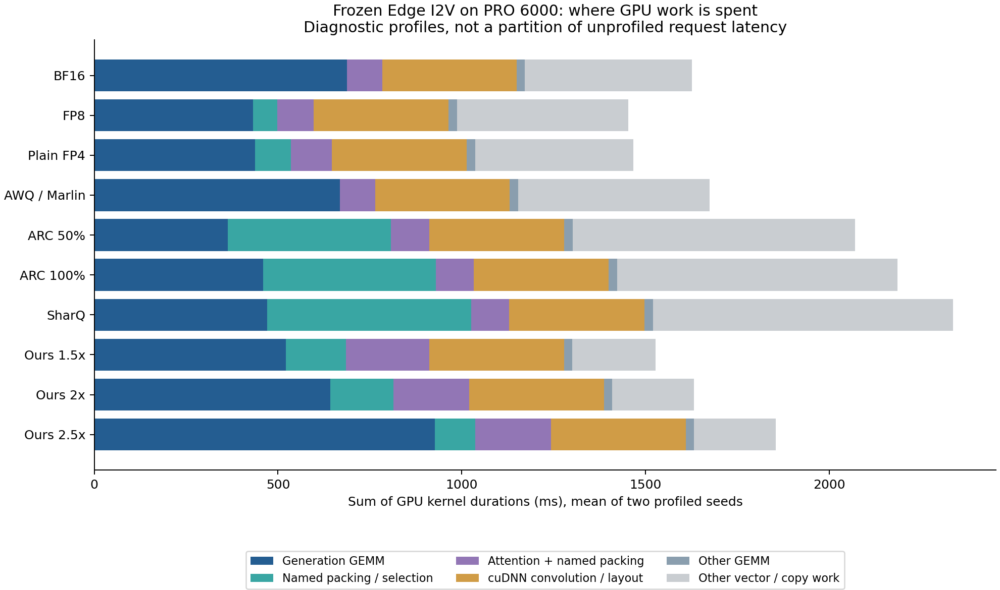

# FP4 论文主线与执行瓶颈核验：PRO 6000

当前证据支持：**用原生 FP4 的计算能力承担可控的双侧残差修复，再共同约束修复计算、W1 存储和在线准备成本，改善世界模型的质量—资源取舍。**

不能改写成“其他 FP4 方法都只能反量化”“我们的 GEMM 已打满 Tensor Core”或“低预算全面超过 FP8”。本轮新增 20 次完整请求 profiler、150 次外部 baseline 的无探针请求计时、4 个代表性 GEMM 的 Nsight Compute 计数器采样。没有修改量化定义、资产、模型输入或 baseline 内核。

可用于正文的完整叙事及贡献边界见 [PAPER_STORY.md](PAPER_STORY.md)。

## 口径

- GPU0：RTX PRO 6000 Blackwell Server Edition，188 SM，96 GB；CUDA 13.0 / PyTorch 2.11.0+cu130。不是 5090。
- Cosmos3-Edge，同模型修订、同生成投影范围、35 steps、CFG 6、192×320、61 帧；当前输入在线激活量化，权重资产离线准备。各方法 AR 均保留 BF16，计入每请求预填充。
- 外部线性 baseline 使用 BF16 attention；我们的联合方案和普通 W4A4 使用 FP4 attention。执行模式保留各适配器支持的 Graph/eager；差别明确列出。
- 所有结果 `performance_eligible=false`。GPU0 在计时边界无外部计算进程，但未完成严格设备调优资格认证。按用户要求未专项优化 baseline。
- profiler：同一 RBench 输入、两个种子。所有 20 个输出与各自冻结质量输出哈希一致。
- 外部计时：五轮随机交错、每轮独立加载预热，每种方法每个输入三个种子；一项 RBench 和一项 PAI-Bench 输入。我们的新旧三档、BF16/FP8 复用上一轮相同计时器的五轮数据；三个 cohort 并非共同交错。
- 计时包含主机请求设置、输入、噪声、AR、35 步降噪、视频解码及 CPU 输出；不含加载/建图、磁盘序列化及计时后哈希。FPS = 61 / 请求秒数。

## BF16 中有多少工作可直接替换

只汇总 Chrome trace 的 `cat=kernel, ph=X` 事件。没有再加 CPU op 的 CUDA attribution，因此不重复统计子 kernel。

BF16 每个 DM Graph 有 173 个 GEMM：前 4 个辅助矩阵、28 层 × 6 个生成投影/FFN、最后输出头。解析器核验全部 70 个 DM Graph 的顺序及 kernel 签名，排除两个 AR Graph、辅助矩阵和输出头。两个种子的平均结果：

| 类别 | 累计 kernel ms | 占比 |
|---|---:|---:|
| 本轮可替换的生成投影 / FFN GEMM | 687.71 | 42.28% |
| FlashAttention，含 combine | 95.46 | 5.87% |
| cuDNN 卷积和布局转换 | 366.04 | 22.51% |
| 其他 GEMM | 22.76 | 1.40% |
| 其他逐元素、归约、复制等 | 454.42 | 27.94% |
| 合计 | 1626.38 | 100% |

**这不是端到端墙钟时间分解，也不能把剩余 57.72% 都叫作“激活函数”。** 卷积同样可能使用 Tensor Core，但不在本轮生成投影量化范围内；其他工作还包括布局、归一化、rotary、编解码和复制等。

以可替换部分占比 `f=0.42285` 为例，假设仅该部分瞬间达到 4×、其余工作不变、没有 packing/修复开销，则累计 kernel 工作的示意比值为：

`1 / [(1-f) + f/4] = 1.464×`

这仅解释峰值比不能直接外推到完整请求；不是整系统的物理上限。修复的 MMA 倍数、在线量化和实际小矩阵效率还会影响结果，通用执行优化则可以改变其余部分。

## baseline 慢在哪里，我们加速了什么

以下为同一输入两个种子的平均累计 GPU kernel ms。每列是互斥 kernel 集合，但总和不是无探针请求关键路径。`准备`只包含可明确识别的专用 packing/选择/amax kernel；ARC/SharQ 的通用 div/amax/cast 仍列入“其余”，因此该列是其准备成本下界。我们的准备列包含融合进去的 FFN ReLU。

| 方法 | 生成 GEMM | 专用准备 | attention及专用packing | 卷积/布局 | 其余含其他GEMM |
|---|---:|---:|---:|---:|---:|
| BF16 | 687.7 | 0.0 | 95.5 | 366.0 | 477.2 |
| FP8 | 431.3 | 66.7 | 99.0 | 367.3 | 489.4 |
| 普通 W4A4 | 437.1 | 98.4 | 110.6 | 367.1 | 454.2 |
| AWQ-lite / Marlin | 668.7 | — | 95.2 | 366.2 | 544.6 |
| ARCQuant 50% | 362.8 | 444.4 | 103.9 | 367.3 | 792.1 |
| ARCQuant 100% | 458.9 | 470.3 | 103.3 | 366.9 | 786.2 |
| SharQ 现成融合 | 471.1 | 554.0 | 103.9 | 367.9 | 840.1 |
| 我们 1.5× / norm | 521.7 | 163.1 | 226.5 | 366.5 | 249.6 |
| 我们 2× / norm | 642.1 | 171.6 | 206.3 | 366.4 | 245.2 |
| 我们 2.5× / norm | 927.3 | 109.8 | 205.7 | 366.6 | 245.5 |



具体解释：

1. **AWQ/Marlin** 是本实验的 ModelOpt NVFP4 AWQ-lite W4A16 路径。权重解码融合在 Marlin GEMM 内，没有在线生成完整 BF16 权重的独立反量化 kernel。其 GEMM 合计略低于 BF16 目标 GEMM；完整请求较慢还包括 prescale 等外围工作。没有单独测得“反量化耗时”，不能把整个 Marlin 时间当作 dequant overhead，也不能泛化为所有 AWQ 实现必然慢于 BF16。
2. **ARCQuant** 的主计算是真实 FP4 CUTLASS，不是高精度模拟。该输入中 ARC50 GEMM 比我们的 1.5× 还快；重排及量化 kernel 已有 444 ms，另有归约、缩放和转换。当前固定适配器调用 `float(factor * self.factor)`，每个生成线性层发生一次 GPU 标量主机读取，共多出 11760 次 stream synchronize。这个限制属于本次固定接口/适配，不能声称是 ARCQuant 算法必然限制。
3. **SharQ** 使用真实 sparse FP4 + dense FP4 路径及现成 extra_fusion。两个矩阵 kernel 合计 471 ms，而 fused sparse/residual preparation 已有 554 ms。保留 eager 调用和大量准备 kernel，是当前 Cosmos 接入的重要成本；本次没有移植其 LLM RMSNorm 融合。没有把源码中 autotune 用的同步误计为每层稳态同步。
4. **我们的优势主要是系统组合及可控修复成本**：压缩后的 W1 支持、共享 FP32 累加器、所需残差的 packing、联合 Graph，加上已验证的外围融合。上一轮固定资产/支持的执行消融使吞吐增加 10.9–13.4%，主 GEMM 时间基本未变。这部分包含通用优化，不能全归为新的 FP4 算术收益。
5. **现有 attention 不是速度贡献的成功证据**：修复 attention 约 206–227 ms，明显高于 BF16 FlashAttention 的约 95 ms；部分修复的 1.5× 甚至比全量三项 attention 更慢。少算 MMA 不等于低延迟，分支、选择、packing 和 softmax 的实现成本仍需解决。

运行时调用计数（单个完整请求；两个种子一致）：

| 路径 | cudaLaunchKernel 主机调用 | cudaGraphLaunch | cudaStreamSynchronize |
|---|---:|---:|---:|
| BF16 / FP8 / 普通 FP4 / AWQ | 24338 | 72 | 330 |
| ARC50 / ARC100 | 251488 | 2 | 12090 |
| SharQ | 310288 | 2 | 330 |
| 我们 norm | 4163 | 74 | 330 |

Graph 中节点仍执行 GPU kernel，不能将主机 launch 减少等同于相同比例计算减少。Torch profiler 对 eager 路径有 buffer flush 等额外扰动；不能用 profiler 墙钟减去 kernel 总和估计正常主机开销，也不能把以上 CPU 调用时长与 GPU 时间相加。

## 无探针完整请求时间

每格为中位数秒 / FPS；各方法各输入 15 次。P90、逐请求输出哈希、显存和三个 cohort 来源见 `analysis.json.gz`。

| 方法 | RBench | PAI-Bench |
|---|---:|---:|
| BF16 | 1.674 / 36.44 | 1.689 / 36.13 |
| FP8 | 1.471 / 41.47 | 1.487 / 41.04 |
| 普通 W4A4 | 1.481 / 41.19 | 1.508 / 40.44 |
| AWQ-lite / Marlin | 1.729 / 35.29 | 1.746 / 34.94 |
| ARCQuant 50% | 2.408 / 25.33 | 2.440 / 25.00 |
| ARCQuant 100% | 2.503 / 24.37 | 2.549 / 23.93 |
| SharQ 现成融合 | 2.379 / 25.64 | 2.431 / 25.09 |
| 我们 1.5× / norm | 1.553 / 39.29 | 1.590 / 38.38 |
| 我们 2× / norm | 1.678 / 36.36 | 1.727 / 35.31 |
| 我们 2.5× / norm | 1.905 / 32.01 | 1.952 / 31.25 |

当前实现中，1.5× 比 BF16 快约 6–8%，2× 大致持平，2.5× 较慢。三档均快于本次 ARC/SharQ 适配；1.5×/2× 快于本次 AWQ，2.5× 则慢于 AWQ。**不能以更高预算的质量搭配更低预算的速度，也不能将两个固定输入结果称为整个数据集速度。**

各 baseline 计时未新增优化；共同运行环境不等于相同融合程度。本报告解释固定现成实现的差异，不主张战胜这些方法在任意框架中的最优实现。旧并发结果没有并发质量保证，也不与本轮单请求质量拼接。

## Tensor Core 是否打满

额外对 2× 固定计划的第 0 层、第 0 阶段、CFG 分支 0，读取真实 full-M 教师面板。沿用相同原生 FP4 GEMM 和安全 launch，仅在预热后采样一次调用；四个重复输出逐位一致。NCU 8-pass kernel replay，`clock-control=none, cache-control=none`，不改系统设置。

| 代表性 GEMM (M,N,K) | CTA 数 | Tensor pipe 活跃指标 | 活跃 warp 占比 | registers/thread |
|---|---:|---:|---:|---:|
| Q (960,2048,2048) | 128 | 30.30% | 8.37% | 250 |
| K (960,1024,2048) | 64 | 13.00% | 8.35% | 255 |
| FFN up (960,9216,2048) | 576 | 49.30% | 14.52% | 250 |
| FFN down (960,2048,9216) | 128 | 28.45% | 9.79% | 254 |

Tensor 指标为 `sm__pipe_tensor_cycles_active.avg.pct_of_peak_sustained_elapsed`，不是实测 FP4 FLOP/s 除以宣传峰值；warp 指标也不是速度。含义见 [NVIDIA Nsight Compute Profiling Guide](https://docs.nvidia.com/nsight-compute/ProfilingGuide/)。

四例 local load/store sector 均为 0，没有观察到这两类 spill 流量。高寄存器数不能直接解释为“正在 spill”。缓存已热且未清空，DRAM 数值不能代表完整模型权重流量或证明全请求不受带宽限制。

这些是局部诊断，不是全部层、阶段或候选轨迹的利用率分布。但它们已足以否定“整条 FP4 路径已打满”的主张。Q/K/down 的 64/128 CTA 少于 188 SM；后续应验证更合适的 tile、加载/寄存器生命周期与独立 GEMM 调度，不能直接承诺 `1/利用率` 的加速。

## 下一步优化应如何解释

- 保持已验证质量资产，优先减少线性准备的重复 pass 和 scratch；共享 packing 必须保持全输入 amax、prescale 及支持语义。
- 对 Q/K/down 的小网格及高寄存器路径做设备专属优化；并发独立投影与真正合并 M 的 batch 分开验证。跨 stream 操作只有存在资源余量和正确依赖时才可能重叠，不能假定 CUDA core 与 Tensor Core 时间可完全隐藏。
- attention 优先把完整 packing—selector—softmax—PV 路径与 FlashAttention 比较，不能只用 MMA 倍数解释速度。当前部分修复路径的额外代价必须作为负结果保留。
- 质量改进用实际组合干预检验。head/step 特征提出候选，完整输出决定取舍；不能将统计相关性当作修复收益的因果证明。

## 复现与交付

新增工具：`tools/fp4_handoff/baseline_breakdown.py`、`breakdown_counter_probe.py`、`analyze_breakdown.py`。不改变模型运行内核。CPU 编译检查、20 条 trace 的唯一 kernel 分组守恒、BF16 140 个 DM Graph 结构核验、4 次计数器输入/输出校验均通过。

本机复测（先按已有 handoff 准备原模型、资产和 ARC 紧凑 orders）：

```bash
export TW_PYTHON=/home/yufeng/thunderworld/.venvs/cosmos3/bin/python
export CUDA_VISIBLE_DEVICES=0
bash tools/fp4_handoff/python.sh tools/fp4_handoff/baseline_breakdown.py \
  --reference-study /home/yufeng/thunderworld/fp4_baseline_sweep_20260918 \
  --compact-orders /tmp/fp4-baselines-recipe-20260918/arc_orders \
  --output /home/yufeng/thunderworld/fp4_breakdown_20260918 \
  --benchmark-baselines

bash tools/fp4_handoff/python.sh tools/fp4_handoff/analyze_breakdown.py \
  --study /home/yufeng/thunderworld/fp4_breakdown_20260918 \
  --previous-runtime /home/yufeng/thunderworld/fp4_next_20260918 \
  --output /home/yufeng/thunderworld/fp4_breakdown_20260918/analysis.json \
  --plot results/fp4_breakdown_20260919/kernel_work
```

NCU 的可复测参数记录在 `counter-command.txt`。新的 raw trace 保留于本机原目录，不向 Git 填入巨型 trace、模型或视频。Git 中包含可审计的全部逐 kernel 汇总、trace 哈希、逐请求 JSON、原始计数器 CSV 与 `.ncu-rep`、质量证据快照及索引。其他设备必须重新测量，不复用此处性能结论。

`--plot` 为可选项，需要 matplotlib。本次将 matplotlib 3.10.6 安装在独立的 `/tmp/fp4-breakdown-plotdeps`，仅生成图时加入 PYTHONPATH；没有修改推理环境依赖。没有绘图库时去掉 `--plot` 即可完成 JSON 分析。
