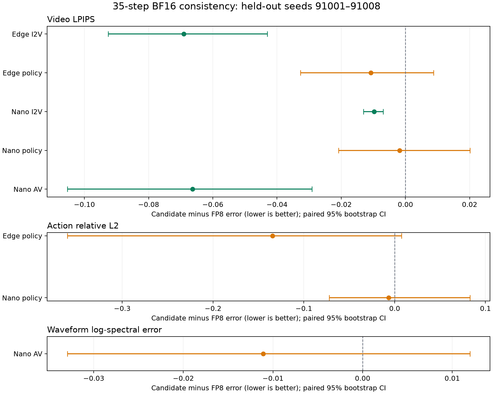

# 联合 FP4 完整推理：实现与复测

**实验尚未全部完成。** 缺失项标为待测，已有完整矩阵独立保留。

实现分支 `feat/joint-inference-runtime`，主体提交 `ac12603`。正式性能均在物理 GPU3：RTX PRO 6000 Blackwell Server Edition（96GB、600W）测量，不是 RTX5090。GPU0 只保留实现验证和被中止的非正式性能尝试。

框架已实现默认无诊断探针的完整请求入口；最终种子测试中，Edge/Nano I2V 通过了严格 FP8 一致性门槛，两个 policy 与 Nano AV 未通过。高预算 FP4 的延迟需与下表一起判断，不能把一致性改善等同于保质加速。

## 质量结果

同一模型修订、相同生成投影范围、输入、35 steps、CFG 和 Graph 条件。FP8 是原生 W8A8 投影（W per-tensor、A 在线 per-token）加 BF16 attention。这里评价相对 BF16 的输出一致性，不是动作成功率或跨场景泛化。

最终8个种子为91001–91008；验证集为92001–92008。候选在最终测试前确定，测试结果没有参与校准或修改配置。下表区间为候选误差减 FP8 误差的配对95% bootstrap CI，负值更好。

| 任务 | 预定候选 | LPIPS差值及95% CI | 动作/音频主指标差值及95% CI | 全部条件通过 |
|---|---|---|---|---|
| Edge I2V | dual | -0.06900 [-0.09256, -0.04304] | — | 是 |
| Edge policy | dual | -0.01077 [-0.03268, +0.00876] | -0.13454 [-0.36054, +0.00746] | 否 |
| Nano I2V | four | -0.00977 [-0.01309, -0.00693] | — | 是 |
| Nano policy | four_dual_attention | -0.00180 [-0.02083, +0.02010] | -0.00646 [-0.07207, +0.08290] | 否 |
| Nano AV | four | -0.06630 [-0.10534, -0.02908] | -0.01109 [-0.03296, +0.01198] | 否 |

视频还要求 SSIM 不降、相对 L2 不升；policy 还要求 action RMSE 不升；AV 还要求 waveform/sound latent L2 不升。完整守门条件、普通 W4A4、ACT2、完整交叉项等结果见 [Edge质量原始JSON](quality_edge.json) 和 [Nano质量原始JSON](quality_nano.json)。

## 完整请求性能

每配置独立进程加载和预热，先运行一次完整35步暖机请求，再按固定随机顺序交错5轮，每轮3个固定种子（15次请求）。以下中位数包含 CPU 请求状态/参数构造、图像读取、编码、Transformer、最终输出转换与解码；排除磁盘结果写入和离线质量指标。debug 全部关闭、调优全部命中、逐请求独占检查通过。

| 任务 | BF16秒 | FP8秒 | 普通FP4秒 | 修复FP4秒 | 相对BF16速度 | 相对FP8速度 | 修复峰值 allocated / reserved GiB |
|---|---:|---:|---:|---:|---:|---:|---:|
| Edge I2V | 2.1220 | 1.9106 | 1.8393 | 2.3617 | 0.899× | 0.809× | 7.134 / 7.523 |
| Edge policy | 0.8470 | 0.8409 | 0.7766 | 0.9266 | 0.914× | 0.907× | 7.238 / 7.645 |
| Nano I2V | 待测 | 待测 | 待测 | 待测 | — | — | — |
| Nano policy | 2.0616 | 1.7831 | 1.6425 | 2.5359 | 0.813× | 0.703× | 24.760 / 25.268 |
| Nano AV | 5.7181 | 4.5518 | 4.2481 | 7.4278 | 0.770× | 0.613× | 26.472 / 27.688 |

速度倍率小于1表示修复方案更慢。完整各配置中位数、P90、样本量和显存见性能 JSON 与 [汇总CSV](performance.csv)。AV 上表包含波形解码；latent-only 数据单列如下，不能混用口径。

| Nano AV配置 | latent-only秒 | 包含波形解码秒 |
|---|---:|---:|
| bf16 | 5.6973 | 5.7181 |
| fp8 | 4.5358 | 4.5518 |
| base | 4.2290 | 4.2481 |
| four | 7.4079 | 7.4278 |
| four_legacy | 7.5494 | 7.5681 |
| ffn_only | 4.9992 | 5.0177 |

## 消融与实现边界

legacy 对照在相同新入口中使用原始 CSR FFN 内核；投影范围、当前输入、修复预算和 Graph 条件完全一致。它是匹配范围的 FFN 内核消融，不是旧历史脚本整条路径的原始计时。旧脚本仅FFN的投影范围与当前联合方案不同，未混入排名。

| 任务 | legacy FFN秒 | 优化FFN秒 | 请求延迟降低 |
|---|---:|---:|---:|
| Edge I2V | 2.4739 | 2.3617 | +4.54% |
| Edge policy | 0.9836 | 0.9266 | +5.79% |
| Nano policy | 2.5627 | 2.5359 | +1.05% |
| Nano AV | 7.5681 | 7.4278 | +1.85% |

探针、联合Graph和pointwise融合的独立收益尚待独占窗口测量；不从当前内核消融反推或编造收益。

若原生密集 FP4/BF16 的有效吞吐比为 R，全量三乘积/四乘积修复仅 GEMM 的理想加速上限分别为 R/3、R/4；还未扣除 packing、非线性、attention 归约及其他组件。attention 的 padded-tile 乘积数为 1+(terms−1)×实际选中比例，尾块向上取整后不一定等于设定比例。它们是计算量模型，不是本机峰值吞吐测量。

高预算方案仍要付出多份 FP4 乘积、在线 packing/selector、softmax/P量化、combine、BF16 非线性与未量化部分的成本。全量 W1 采用规则寻址，A修复复用W0和FP32累加器；attention的Q残差重载作为逐位等价候选参与完整算子调优，未宣称其必然更快。已从实际编译 PTX 确认 FFN 和 attention 使用原生 e2m1 FP4 MMA，见 [ISA证据](native_fp4_isa.json)。没有 Tensor Core 峰值占用率的计数器证据，不能声称“打满算力”。

## 显存、离线校准与未达成项

W0/W1 离线量化；A及attention Q/K/V/P使用当前输入在线量化。导出资产只保存策略需要的W1支持并集，增加超出资产支持的W预算会被拒绝。全量W1接近两份FP4，含尺度后比单份FP8权重略大；不能同时宣称高预算方案仍具有单份W4存储。

不同M/A/cross变体共享W0，相同W支持共享W1；多个不同非零W档位仍分别持有GPU residual bank。PyTorch allocated/reserved峰值与常驻模型状态分开统计，Graph池包含中间激活/scratch；reserved不是权重大小，也不包含所有驱动层分配。当前仍先载入原始BF16 pipeline再替换投影，低暖机占用不代表低启动峰值，不保证32GB 5090能加载全部配置。

已提供无训练的prescale/尺度校准，以及逐block实际修复收益驱动的head配额候选生成。development第一层试验和原始收益已保存；这些局部代理结果尚未通过完整轨迹选参，未混入最终推荐。最终通过的I2V证据来自高预算配置，尚未证明低预算head稀疏策略具备同等质量。

policy与AV质量目标未达成；普通FP4或ACT2即便更快，也不因速度而绕过门槛。未使用隐藏BF16 attention回退、删base block、旧step输出复用或减少步数来宣布成功。

## 复现与交付

统一入口、配置语义、离线资产、调优、质量门槛和自动命令见 [使用文档](../../tools/joint_inference/README.md)。本目录保存原始测量JSON、严格门槛、GPU专属profiles、测试日志、模型文件SHA256和图表。大型模型和输出视频不纳入代码包，模型由目标机器自行下载。

GPU0/3 曾出现其他用户的 CUDA 进程，独占保护自动中止相应请求。未完成/重试前的局部轮次保留为历史尝试，未冒充完整5轮数据。早期排除CPU setup的计时也未进入最终排名。

## 显存对照

完整请求 PyTorch peak allocated，单位GiB；常驻模型状态、量化权重、支持buffer及Graph allocated/reserved另外保存在raw receipts中。当前未把Graph临时激活池精确拆分为独占scratch。

| 任务 | BF16 | FP8 | 普通FP4 | 修复FP4 | 修复相对BF16变化 | 修复相对FP8变化 |
|---|---:|---:|---:|---:|---:|---:|
| Edge I2V | 8.206 | 6.897 | 6.376 | 7.134 | -13.06% | +3.43% |
| Edge policy | 8.322 | 7.017 | 6.482 | 7.238 | -13.02% | +3.15% |
| Nano policy | 30.342 | 23.872 | 21.089 | 24.760 | -18.40% | +3.72% |
| Nano AV | 32.046 | 25.574 | 22.780 | 26.472 | -17.40% | +3.51% |

## 独立进程加载与准备

来自正式性能矩阵的每配置5个独立进程，以下为各准备阶段中位数。模型加载、离线权重准备与warmup相互分开；capture是warmup子项。磁盘缓存保留。

| 任务/配置 | 加载秒 | 离线权重准备秒 | 预热秒 | 其中capture秒 |
|---|---:|---:|---:|---:|
| Edge policy / base | 5.090 | 0.691 | 1.175 | 0.048 |
| Edge policy / bf16 | 5.038 | 0.001 | 0.850 | 0.027 |
| Edge policy / dual | 5.052 | 0.693 | 1.188 | 0.046 |
| Edge policy / fp8 | 5.042 | 0.583 | 0.864 | 0.034 |
| Edge I2V / base | 5.086 | 0.686 | 1.613 | 0.086 |
| Edge I2V / bf16 | 5.066 | 0.001 | 1.241 | 0.049 |
| Edge I2V / dual | 5.043 | 0.691 | 1.653 | 0.084 |
| Edge I2V / fp8 | 5.057 | 0.591 | 1.234 | 0.060 |
| Nano AV / base | 5.624 | 2.075 | 3.224 | 0.139 |
| Nano AV / bf16 | 5.626 | 0.001 | 1.653 | 0.064 |
| Nano AV / four | 5.684 | 2.095 | 3.561 | 0.130 |
| Nano AV / fp8 | 5.627 | 0.411 | 1.548 | 0.092 |
| Nano policy / base | 5.373 | 2.116 | 2.536 | 0.085 |
| Nano policy / bf16 | 5.384 | 0.001 | 0.988 | 0.035 |
| Nano policy / four_dual_attention | 5.376 | 2.116 | 2.673 | 0.074 |
| Nano policy / fp8 | 5.371 | 0.420 | 0.985 | 0.059 |

## 冷启动与准备时间

冷启动测量口径为每配置另起一个进程单测一次；缺失任务仍待测。保留磁盘 kernel cache。冷启动是父进程发起到 Graph 准备完毕，包含解释器/库导入；不是清空缓存后的首次编译测试。Graph capture 是 warmup 的子项，不能再次相加。

| 任务/配置 | 冷启动到准备就绪秒 | 模型加载秒 | 权重准备秒 | 预热/建图秒 | 其中capture秒 |
|---|---:|---:|---:|---:|---:|

已完成的进程时间、配置与显存快照见对应 cold JSON；空表表示当前尚未获得该测量。冷启动样本量为每配置1次，不将其当作暖机请求中位数或P90。

## 验证记录

CPU/SM120测试、完整模型 debug/eager/Graph 对照、已完成的冻结调优35步轨迹逐位对照，以及内核 memcheck/racecheck 日志随目录提供。已归档调优表覆盖各正式配置实际请求形状；M416全8档位的额外 sweep 以独立 receipt 为准，未完成时不宣称覆盖。

最终结果使用相同量化和内核源哈希。后续 CLI 独立策略解析、Python benchmark 独占保护与显式 mask 调优键修复不改变本轮无显式 mask 的推理数值/热路径；每进程源码哈希均在 raw JSON 中保存。

## 待测文件

- `performance_nano_i2v.json`
- `ablation.json`
- `cold_edge.json`
- `cold_nano_i2v.json`
- `cold_nano_policy_av.json`
- `all_tiers_edge.json`
- `all_tiers_nano.json`
- `tuned_equivalence_edge.json`
- `tuned_equivalence_nano_i2v.json`
- `offline_assets_validation.json`
- `tests_full_final.log`
